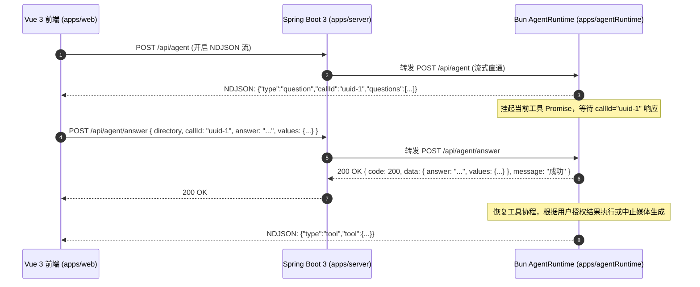
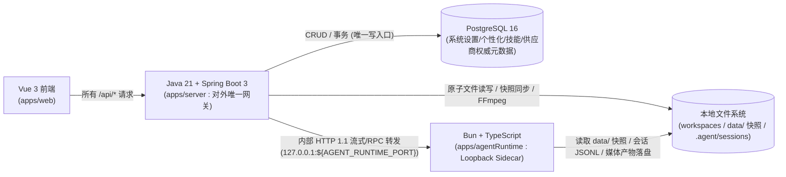

# Toonflow Next-Gen API 接口契约规范（API Contract Specification）

> **文档版本**：`v1.0.0-baseline`（正式工程基准封板版）
> **最后更新**：`2026-10-28`
> **状态**：已封板（Baseline Frozen）
> **配套基准文档**：[`newToonflowPrd.md`](file:///C:/Users/c1338/.gemini/antigravity/brain/c2ec26a6-8aaa-4a4e-b09d-c3dbec88d75c/newToonflowPrd.md)（`v1.0.0-baseline`）

| 版本号 | 日期 | 变更摘要 |
| :--- | :--- | :--- |
| `v0.1.0` | `2026-10-28` | 初始工程基准草案（完成架构转型与 6W 产品定义） |
| `v0.2.0` | `2026-10-28` | 拆分独立 API 契约文档 `apiContract.md`，建立双文档工程基准 |
| `v0.3.0` | `2026-10-28` | 落实 `DEC-01 ~ DEC-06`（清理 `/api/singleAgent/*`、保留第三方供应商余额接口、剥离废弃设置字段、收敛 `export` 仅支持 `skill`、锁定双后端配置同步与 `TOONFLOW_INTERNAL_TOKEN` 鉴权、移除 `reveal` 接口，接口总数锁定为 65 个） |
| `v1.0.0-baseline` | `2026-10-28` | 完成最后一轮封板：落实 `DEC-07 ~ DEC-09`（`sys_personalization` 独立权威表、配置同步重试/启动对账/持续恢复/可观测性要求、`balanceEvents` 临时 `accountId` 404 有限次重刷重连机制），并基于现有源码完成全部 65 个接口 Schema 与流式协议核对 |

> [!IMPORTANT]
> **文档命名与权威性声明（Document Authority & Governance）**
> 1. **文件命名说明**：遵循仓库 [`AGENTS.md`](file:///c:/Users/c1338/Desktop/workplace/toonflow/Toonflow-app/AGENTS.md) 第 7、8 条铁律（*“所有新建文件、文件夹名称必须统一使用小驼峰，禁止使用短横线命名、蛇形命名、帕斯卡命名或全大写格式”*），本文档物理文件名定为 `apiContract.md`（对应工程基准中的 `API_CONTRACT`）。
> 2. **双基准职责边界**：
>    - [`newToonflowPrd.md`](file:///C:/Users/c1338/.gemini/antigravity/brain/c2ec26a6-8aaa-4a4e-b09d-c3dbec88d75c/newToonflowPrd.md) 负责定义**产品范围（6W 约束）、业务规则、领域模型与架构决策**；
>    - [`apiContract.md`](file:///C:/Users/c1338/.gemini/antigravity/brain/c2ec26a6-8aaa-4a4e-b09d-c3dbec88d75c/apiContract.md)（本文档）负责定义**接口路径、HTTP 方法、服务归属、请求/响应 Schema、流式协议、错误码与跨服务调用约定**。
> 3. **冲突解决机制**：两份文档共同构成项目正式工程基准。任何前后端开发、网关迁移（Spring Boot 3）或运行时重构（Bun AgentRuntime）不得单方面偏离契约；当实现或需求与任一基准发生冲突时，必须先在本文档第 4 节登记变更单，并同步修订 `newToonflowPrd.md` 与 `apiContract.md` 后方可合入代码。

---

## 1. 通用协议与核心机制规范

### 1.1 统一响应格式（`ApiResponse<T>`）

除明确标记为**二进制文件流（Binary Stream）**、**SSE 流（`text/event-stream`）**或**NDJSON 流（`application/x-ndjson`）**的接口外，所有 REST 接口（无论由 Spring Boot 3 直接处理还是由 Bun `agentRuntime` 处理后返回）均必须返回如下 JSON 信封结构（对应源码 [`responseFormat.ts`](file:///c:/Users/c1338/Desktop/workplace/toonflow/Toonflow-app/apps/server/src/lib/responseFormat.ts)）：

```ts
export interface ApiResponse<T = unknown> {
  /** 业务状态码：200 表示成功；非 200 与 HTTP 状态码保持语义一致（如 400/403/404/409/413/415/424/500/502） */
  code: number;
  /** 响应载荷：成功时为具体业务数据或 null；validateFields 参数校验失败（400）时为 ZodIssue[] 校验详情数组，业务显式报错时为附加错误对象或 null */
  data: T | null;
  /** 面向用户或调试的可读提示信息，默认成功为 "成功"，参数校验失败默认为 "参数错误" */
  message: string;
}
```

### 1.2 全局 HTTP 状态码与业务错误码映射

| HTTP 状态码 | 响应 `code` | `data` 结构 | 触发场景与业务语义 |
| :--- | :--- | :--- | :--- |
| `200 OK` | `200` | `T \| null` | 请求正常完成（注：`POST /api/ai/media/generate` 若在响应头发出后发生异常，HTTP 状态码仍为 `200`，但 JSON 信封内 `code` 为 `400/403/404/409/500`，详见 1.3.3 节） |
| `400 Bad Request` | `400` | `ZodIssue[] \| null` | 参数校验未通过（`validateFields` 校验失败时 `message` 为 `"参数错误"`，`data` 为 `ZodIssue[]`）或业务前置条件不满足 |
| `403 Forbidden` | `403` | `{ code?: "EACCES" \| "EPERM" } \| null` | 路径越界（逃逸工作区或受保护目录）、非本机请求访问本机专属管理接口、系统权限不足、禁止删除工作区根目录 |
| `404 Not Found` | `404` | `{ code?: "ENOENT" \| "ENOTDIR" } \| null` | 目标工作区、文件、目录、技能、供应商、会话条目或进程内临时 `accountId` 不存在 |
| `409 Conflict` | `409` | `{ code?: "EEXIST" \| "ENOTEMPTY" \| "ESTALE" } \| null` | 1. `EEXIST`：`exclusive=true` 新建文件或重命名/移动/复制时目标已存在；<br>2. `ENOTEMPTY`：非递归删除非空目录；<br>3. `ESTALE`：**SHA-256 `revision` 乐观锁版本冲突**（目标文件或配置已被其他端修改或删除）；<br>4. 同一工作区存在运行中的主 Agent 会话或同名 `requestId` 的 FFmpeg 任务 |
| `413 Payload Too Large` | `413` | `null` | 上传或读取的文件超过接口上限（如快照读取超过 `maxBytes`、技能文件超过 `20MB`、文件写入超过 `100MB`、图片导入超过 `20MB`） |
| `415 Unsupported Media Type` | `415` | `null` | 快照模式读取了含空字节的二进制文件/非受支持文本编码，或导入的图片魔数（Magic Bytes）校验不合法 |
| `424 Failed Dependency` | `424` | `{ code: "FFMPEG_REQUIRED" }` | `POST /api/ffmpeg/execute` 调用时本地 FFmpeg 或 FFprobe 二进制未安装/不可用（同时触发 `/api/ffmpeg/events` 广播 `{"type":"required"}`） |
| `500 Internal Server Error` | `500` | `{ code?: string, partial?: boolean, target?: string } \| null` | 服务端内部异常、磁盘写入失败、上游模型调用异常或目录递归复制中断且回滚未完全清理（`ECOPYINCOMPLETE`） |
| `502 Bad Gateway` | `502` | `null` | `POST /api/providers/models` 请求上游供应商 `/v1/models` 失败或上游返回非预期结构 |

---

### 1.3 流式传输协议规范（SSE / NDJSON / Chunked JSON）

本项目存在 3 种长连接/流式响应协议，已全部根据现有服务端与客户端源码核实。Spring Boot 3 反向代理转发至 Bun `agentRuntime` 时**严禁缓冲响应体（必须开启 `flushImmediately`）**：

#### 1.3.1 NDJSON 流（`application/x-ndjson; charset=utf-8`）
- **适用接口**：`POST /api/agent`（[`routes/agent/index.ts`](file:///c:/Users/c1338/Desktop/workplace/toonflow/Toonflow-app/apps/server/src/routes/agent/index.ts)）、`POST /api/providers/debug/run`（[`routes/providers/debug/run.ts`](file:///c:/Users/c1338/Desktop/workplace/toonflow/Toonflow-app/apps/server/src/routes/providers/debug/run.ts)）。
- **响应头**：
  - `Content-Type: application/x-ndjson; charset=utf-8`
  - `Cache-Control: no-cache, no-transform`
  - `Connection: keep-alive`
  - `X-Accel-Buffering: no`
- **数据分帧格式**：每帧为一个序列化后的紧凑 JSON 对象加换行符 `\n`（`res.write(JSON.stringify(event) + "\n")`）。
- **保活心跳**：服务端每隔 **`20,000ms`（20 秒）** 写入一个单独的换行符 `"\n"`。客户端解析器按 `\n` 切分时必须忽略空行（`line.trim() === ""`）。
- **结束标志与错误处理**：
  - **建连前错误**：参数校验、工作区校验或并发会话锁冲突（`409`）在 `res.flushHeaders()` 前直接返回标准 HTTP `400/403/404/409` JSON `ApiResponse`。
  - **流内错误与结束标志**：响应头一旦以 `200 OK` 发出，后续异常不再修改 HTTP 状态码，而是向流中写入 `{"type":"error","message":"..."}\n`（`debug/run` 若已启动执行还会携带 `duration: number`），最后固定写入终结帧 `{"type":"done"}\n` 并调用 `res.end()` 关闭连接。

#### 1.3.2 Server-Sent Events 流（`text/event-stream; charset=utf-8`）与 `POST /api/ffmpeg/execute` 双模式区分机制
- **适用接口**：`POST /api/ai/generate`、`GET /api/ai/media/balanceEvents`、`GET /api/ffmpeg/events`、`POST /api/ffmpeg/execute`（执行/查询态）。
- **通用 SSE 响应头**：
  - `Content-Type: text/event-stream; charset=utf-8`
  - `Cache-Control: no-cache, no-transform`
  - `Connection: keep-alive`
  - `X-Accel-Buffering: no`
- **通用帧格式**：
  - 建连首帧：`GET /api/ffmpeg/events` 发送注释帧 `": connected\n\n"`；`GET /api/ai/media/balanceEvents` 建连后立即针对每个订阅的 `accountId` 发送首条 `data: ${JSON.stringify(snapshot)}\n\n`；`POST /api/ai/generate` 与 `POST /api/ffmpeg/execute` 在 `res.flushHeaders()` 后随事件产生直接发送 `data:` 帧。
  - 保活注释帧：`": keepalive\n\n"`（`POST /api/ffmpeg/execute` 间隔为 **`1,000ms`**，其余 SSE 接口间隔为 **`20,000ms`**）。
  - 数据帧：`data: ${JSON.stringify(payload)}\n\n`。
- **`POST /api/ffmpeg/execute` 的 JSON / SSE 双模式区分规则（源码依据：[`routes/ffmpeg/execute.ts`](file:///c:/Users/c1338/Desktop/workplace/toonflow/Toonflow-app/apps/server/src/routes/ffmpeg/execute.ts)、[`packages/ffmpeg/src/remote.ts`](file:///c:/Users/c1338/Desktop/workplace/toonflow/Toonflow-app/packages/ffmpeg/src/remote.ts)、[`packages/ffmpeg/src/browser.ts`](file:///c:/Users/c1338/Desktop/workplace/toonflow/Toonflow-app/packages/ffmpeg/src/browser.ts)）**：
  - **模式判别条件**：严格由请求体中的 `req.body.operation.method` 决定：
    1. **JSON 模式（当 `operation.method === "cancel"` 或 `"prepare"` 时）**：
       - **`operation.method === "cancel"`**：根据 `cwd + "\0" + requestId` 在进程内 `runningTasks` 中查找运行中的任务并调用 `abort()`，立即返回 `200 OK`（`Content-Type: application/json; charset=utf-8`），响应体为 `{"code":200,"data":null,"message":"成功"}`。
       - **`operation.method === "prepare"`**：校验工作区路径及 `options`/`calls` 参数后，调用 `createWorkspaceFfmpeg(cwd)` 检查本地 FFmpeg/FFprobe 二进制是否可用。就绪时返回 `200 OK` JSON `{"code":200,"data":null,"message":"成功"}`；未就绪时触发 `/api/ffmpeg/events` 推送 `{"type":"required"}` 并返回 HTTP `424 Failed Dependency`（`{"code":424,"data":{"code":"FFMPEG_REQUIRED"},"message":"..."}`）。
    2. **SSE 模式（当 `operation.method` 为其余 20 个受支持方法之一时）**：
       - **方法集合**：
         - `runMethods`（11 个）：`"run" | "save" | "saveToFile" | "takeScreenshots" | "thumbnail" | "thumbnails" | "screenshot" | "screenshots" | "mergeToFile" | "concatenate" | "concat"`；
         - `queryMethods`（9 个）：`"ffprobe" | "availableFilters" | "getAvailableFilters" | "availableCodecs" | "getAvailableCodecs" | "availableEncoders" | "getAvailableEncoders" | "availableFormats" | "getAvailableFormats"`。
       - **建连前同步错误**：参数或调用链校验失败返回 `400`；工作区越界或不存在返回 `403`/`404`；同一 `cwd + "\0" + requestId` 已在运行中返回 `409 Conflict`（`"FFmpeg 任务已在运行"`）；FFmpeg 未就绪返回 `424 Failed Dependency`。以上均返回 `application/json`。
       - **SSE 数据帧与结束标志**：前置检查通过后立即 `res.flushHeaders()` 开启 `text/event-stream` 流，每 `1,000ms` 发送 `": keepalive\n\n"`。运行期间推送中间事件帧 `data: {"event":"start"|"codecData"|"progress"|"stderr"|"filenames","args":[...]}\n\n`；任务完成或失败时固定发送以下**唯一一条终结事件帧**并立即调用 `res.end()` 结束流：
         - `runMethods` 成功：`data: {"event":"end","args":[stdout, stderr]}\n\n`
         - `queryMethods` 成功：`data: {"event":"result","args":[data]}\n\n`
         - 执行失败：`data: {"event":"error","args":[{"name":"...","message":"...","code":"..."}, stdout, stderr]}\n\n`
       - **异常断连检测**：客户端（`browser.ts`）若在收到 `"end"` / `"result"` / `"error"` 终结帧之前检测到流关闭且非客户端主动 `abort`，判定为 `"FFmpeg 执行连接意外中断"`。

#### 1.3.3 前导空白保活 Chunked JSON（`POST /api/ai/media/generate`）
- **源码依据**：[`routes/ai/media/generate.ts`](file:///c:/Users/c1338/Desktop/workplace/toonflow/Toonflow-app/apps/server/src/routes/ai/media/generate.ts)、[`utils/media/generation.ts`](file:///c:/Users/c1338/Desktop/workplace/toonflow/Toonflow-app/apps/server/src/utils/media/generation.ts)。
- **实际响应头**：
  - `Content-Type: application/json; charset=utf-8`
  - `Cache-Control: no-cache, no-transform`
  - `X-Accel-Buffering: no`
  - `Transfer-Encoding: chunked`（由 HTTP/1.1 `res.flushHeaders()` 自动启用）
- **数据分帧格式与结束标志**：
  1. **建连前同步校验阶段（未 Flush 响应头）**：服务端先校验 `directory` 与 `mediaType`，再按 `mediaType` 使用严格模式 Schema（`imageGenerationSchema` / `videoGenerationSchema` / `audioGenerationSchema`，均为 `z.strictObject`）校验请求体，并调用 `resolveWorkspace(req, directory)` 校验工作区路径。若任一校验失败，直接返回 HTTP `400` / `403` / `404` 与标准 JSON `ApiResponse`，不进入流式模式。
  2. **保活分帧阶段（已 Flush `200 OK` 响应头）**：前置校验通过后，服务端立即调用 `res.flushHeaders()` 发送 `HTTP 200 OK` 响应头，并启动 `20,000ms`（20 秒）定时器；在等待上游多模态模型生成与文件下载落盘期间，每隔 20 秒向响应体写入一个单独的换行符 `"\n"`（`0x0A`）。
  3. **结束标志**：当生成完成或捕获异常后，服务端清除保活定时器，向流中一次性写入 `JSON.stringify(payload)`（单段紧凑 JSON 文本，不含尾随事件帧），随即调用 `res.end()` 关闭 HTTP 响应流。整条响应流的字节流形态为：`"\n" * N + JSON.stringify(ApiResponse)`。
- **两阶段错误处理与文件回滚规则**：
  - 若在 `res.flushHeaders()` **之后**发生任何异常（如供应商未启用、模型不存在、上游 API 报错、下载超时或落盘失败），`generateMedia` 会先通过 `unlink` 自动删除本次调用已写入工作区的部分产物文件完成回滚，随后路由层捕获异常并调用 `errorFromCause(err)` 生成错误信封 `{"code": 400|403|404|409|500, "data": null, "message": "..."}`，将其序列化写入当前 `200 OK` 响应流并 `res.end()`。
  - **客户端解析要求**：标准 `await response.json()` 或 `JSON.parse()` 会自动忽略所有前导 `"\n"` 空白字符；客户端解析出 JSON 对象后，**必须检查 `body.code === 200`** 来判断生成是否成功，不能仅凭 HTTP 状态码 `200 OK` 视为成功。

---

### 1.4 文件 SHA-256 `revision` 乐观锁与编码保持协议

为防止前端画布自动保存、用户手动编辑与后台 Agent 工具并发写入发生静默覆盖（Lost Update），所有支持并发保护的文本/配置/源码接口均遵循以下 SHA-256 乐观锁协议：

1. **版本号计算规则**：
   - `revision` 为目标磁盘文件**原始字节（Raw Bytes，含 BOM）**或数据库文本字段 UTF-8 字节的 **64 位小写十六进制 SHA-256 摘要**（正则：`/^[a-f0-9]{64}$/`）。
2. **读取阶段**：
   - 工作区文本文件通过 `GET /api/workspaces/files/read?snapshot=true` 读取，返回 `{ text, encoding, revision }`，其中 `encoding` 自动识别为 `"utf-8" | "utf-8-bom" | "utf-16le" | "utf-16be"`，且返回的 `text` 已剥离 BOM 并解码为标准 UTF-8 字符串。
   - 长期记忆/手册（`GET /api/settings/personalization/get`）与媒体供应商源码（`GET /api/providers/media/list`）同样在读取时返回当前 `revision`。
3. **写入阶段（Compare-And-Swap + 原子替换）**：
   - 调用方在更新时必须携带上次读取获得的 `expectedRevision`（或 `revision` 字段）。
   - 服务端在**进程内同路径互斥队列（Per-Path Mutex Queue）**中重新计算磁盘/数据库当前内容的 SHA-256：
     - 若文件已被删除，或当前 SHA-256 !== `expectedRevision`，立即拒绝写入并返回 **HTTP `409 Conflict`**，响应体为 `{"code": 409, "data": {"code": "ESTALE"}, "message": "...已被其他位置修改，请刷新后再试"}`。
     - 若校验一致，工作区文件按传入的 `encoding` 还原原始字节（包括补回 BOM 或重编码为 UTF-16LE/BE），通过临时文件 + `rename` 原子落盘（`writeAtomic`），并返回新的 `{ revision: "<new_sha256>" }`。

---

### 1.5 异步任务取消与连接中断传播机制（Abort Propagation）

1. **HTTP 连接断开级联取消**：
   - 所有流式与长耗时接口（`POST /api/agent`、`POST /api/ai/generate`、`POST /api/ai/media/generate`、`POST /api/providers/debug/run`、`POST /api/ffmpeg/execute`）均监听客户端 HTTP 连接的 `close` / `aborted` 事件。
   - 当客户端主动调用 `AbortController.abort()` 断开连接时：
     - **Spring Boot 3 网关层**必须立即同步关闭发往 Bun `agentRuntime` 的上游 HTTP 请求连接；
     - **Bun `agentRuntime` / FFmpeg 执行器**捕获连接关闭信号后，立即触发内部 `AbortController.abort()`，终止正在进行的 LLM 流式推理、媒体轮询或 kill 子进程（FFmpeg），并释放工作区会话锁。
2. **显式控制指令取消**：
   - **FFmpeg 下载取消**：调用 `POST /api/ffmpeg/cancel` 终止当前正在进行的二进制包下载。
   - **FFmpeg 任务取消**：调用 `POST /api/ffmpeg/execute` 且 `operation.method === "cancel"`，传入需要取消的 `requestId`，服务端终止对应 FFmpeg 进程并清理临时资源。
   - **Agent 提问取消**：调用 `POST /api/agent/answer` 且 `cancelled: true`，中断当前挂起的 `askUser` 等待。

---

### 1.6 算力消耗硬性授权门控协议（`askUser` Question-Answer Loop）

根据 PRD 第 3.2 节与第 6.2 节要求，Agent（含主 Agent 与子 Agent）在触发任何高成本媒体生成或批量重绘动作前，**必须通过 `askUser` 工具挂起当前执行协程，向前端发起结构化授权提问**：



- **算力授权提问约定**：当 `askUser` 用于算力消耗门控时，`questions` 数组中必须说明预计调用的模型名称、生成张数/条数及预计消耗，由用户点击确认或拒绝后再通过 `POST /api/agent/answer` 唤醒。

---

### 1.7 画布实时双向受控桥协议（`canvasCall` Loop）

当主 Agent 调用 `canvas` 工具（`read` / `edit` / `executeNode`）或画布暴露的 `node:*` 节点工具时，若目标画布已在前端打开，通过如下异步回路完成实时操作与 `revision` 同步：

1. Bun `agentRuntime` 在 `POST /api/agent` 的 NDJSON 流中下发 `{"type":"canvasCall","call":{ callId, canvasId, action, ... }}`，并在内存中挂起 `callId` 对应的 Promise（超时时间：**`300,000ms` / 5 分钟**）。
2. 前端接收 `canvasCall` 事件，在内存中执行画布读取、节点增删改连线或运行指定节点，并将最新画布 JSON 通过 `PUT /api/workspaces/files/write` 落盘取得最新 `revision`。
3. 前端调用 `POST /api/agent/canvasResult` 提交 `{ directory, callId, result }`（若失败则提交 `error`），唤醒 Bun `agentRuntime` 继续后续推理。

---

## 2. Spring Boot 3 与 Bun Agent Runtime 接口边界及调用约定

### 2.1 架构拓扑与职责划分



1. **对外唯一入口**：前端 `apps/web` 仅与 **Spring Boot 3 (`apps/server`)** 通信，所有对外路径保持 `/api/*` 不变。
2. **Spring Boot 3 (`apps/server`) 独立承载的模块（共 41 个接口）**：
   - 第 1 组：系统设置与个性化（5 个接口，系统设置落库 `sys_setting` / `ai_language_provider` / `ai_media_provider`，`memory` 与 `agents` 文本及其 `revision` 唯一权威落库 `sys_personalization`，不在 `sys_setting` 中重复存储，并在事务提交后原子同步 `data/` 派生文件快照）
   - 第 2 组：工作区与文件操作（11 个接口，直接操作本地文件系统 + SHA-256 乐观锁；首发版本不保留 `POST /api/workspaces/files/reveal`）
   - 第 3 组：全局资产与技能管理（17 个接口，操作 `data/assets`、`data/skills` 及 PostgreSQL `skill_meta`；`GET /api/plugins/export` 仅支持 `type=skill`）
   - 第 4 组：语言模型探测与 FFmpeg 引擎（8 个接口，其中 `/api/ai/models` 读取已启用模型配置，FFmpeg 6 个接口直接管理本地二进制与子进程）
3. **Spring Boot 3 代理转发或协同 Bun `agentRuntime` 的模块（共 24 个接口）**：
   - 第 5 组：主 Agent 会话与推理（10 个接口，由 Spring Boot 3 校验工作区路径后携带内部鉴权 Token 转发至 Bun `agentRuntime`；已移除过时的 `/api/singleAgent/*`）
   - 第 6 组：多模态生成与媒体供应商沙箱（14 个接口，其中 `.ts` 源码 AST 校验、动态加载、调试运行、算力计价、第三方供应商余额查询与媒体生成由 Bun `agentRuntime` 执行，供应商权威元数据持久化至 PostgreSQL `ai_media_provider`）

### 2.2 跨进程内部通信与双后端配置同步规范（Spring Boot 3 ↔ Bun `agentRuntime`）

1. **绑定地址与端口**：
   - Bun `agentRuntime` 仅监听本机回环地址 `127.0.0.1:${TOONFLOW_AGENT_RUNTIME_PORT}`（默认端口 `3001`，禁止绑定 `0.0.0.0` 暴露到公网）。
2. **服务间内部鉴权与追踪请求头**：
   - `X-Toonflow-Internal-Token`：Java (`apps/server`) 与 Bun (`apps/agentRuntime`) 之间的内部 HTTP 调用必须通过环境变量 `TOONFLOW_INTERNAL_TOKEN` 进行服务间鉴权；Bun 侧拒绝任何未携带或 Token 不匹配的请求，且**严禁将该 Token 暴露给前端**。
   - `X-Request-Id`：UUID v4，用于跨 Java 与 Bun 串联请求日志。
3. **超时与流式转发配置**：
   - 普通 JSON 请求转发（如 `/api/agent/create`、`/api/providers/media/validate`）：连接超时 `5,000ms`，读取超时 `30,000ms`。
   - 长耗时与流式转发（`/api/agent`、`/api/ai/generate`、`/api/ai/media/generate`、`/api/providers/debug/run`）：连接超时 `5,000ms`，读取超时设为 **`1,860,000ms`（31 分钟，略大于调试沙箱的 30 分钟硬超时）**，禁用响应体缓冲。
4. **双后端权威数据源与 `data/` 原子快照同步机制（对应 `DEC-05`、`DEC-07`、`DEC-08`）**：
   - **唯一权威源与唯一写入口**：PostgreSQL 16（含 `sys_setting`、`sys_personalization`、`ai_language_provider`、`ai_media_provider`、`skill_meta`、`workspace_project` 共 6 张核心表）是系统配置、个性化文档、供应商及相关元数据的**唯一权威数据源**；Spring Boot 3 是这些数据的**唯一写入口**。其中 `sys_personalization` 是 `memory` 和 `agents` 文本及其 `revision` 的唯一权威数据源，不在 `sys_setting` 中重复存储。
   - **事务后原子文件同步**：当 Spring Boot 3 的数据库事务提交后，将 Bun `agentRuntime` 需要读取的派生文件快照——系统配置快照（`data/settings.json`）、媒体供应商源码（`data/providers/<fileName>`）、长期记忆与行为准则（`data/memories/memory.md`、`data/AGENTS.md`）同步写入共享 `data/` 目录，所有文件写入必须采用**临时文件 + 原子替换（Atomic Rename）**方式。
   - **同步失败重试、启动对账、持续恢复与状态可观测**：
     1. **失败自动重试**：数据库事务提交后若派生快照写入失败，必须执行自动重试（具体重试次数与退避间隔属于工程实现参数，不在 PRD/契约中硬性锁死），**严禁静默忽略同步异常**；
     2. **启动时全量对账（Startup Reconciliation）**：Spring Boot 3 启动阶段必须全量比对 PostgreSQL 权威记录（`revision` / `updated_at`）与 `data/` 目录下派生文件快照的实际 SHA-256 摘要，不一致或缺失时立即重写修复；
     3. **持续恢复（Continuous Recovery）**：单次请求内重试仍未恢复的同步项必须纳入后台恢复队列持续补偿，直至磁盘快照与数据库权威状态一致；
     4. **同步状态可观测（Observability）**：Spring Boot 3 必须在结构化日志与运行状态中记录同步失败、待恢复项与最近一次成功对账时间，确保同步异常可追踪、可诊断。
   - **Bun 内存缓存版本检测与刷新**：Bun `agentRuntime` 不得长期使用过期配置；如存在内存缓存（如已编译的媒体供应商实例或配置缓存），必须基于文件 `mtime` 或 SHA-256 `revision` 进行明确的版本检测与自动刷新。MVP 阶段不引入额外的跨进程 RPC 同步机制。

---

## 3. 全量接口契约明细（共 65 个接口）

---

### 3.1 第一组：系统设置与个性化（5 个接口，归属：Spring Boot 3）

#### 3.1.1 `GET /api/settings/get`
- **服务归属**：Spring Boot 3 (`apps/server`)
- **用途**：读取全局系统设置完整快照（含语言模型供应商、媒体供应商启用及 API Key 配置、Agent 系统提示词、FFmpeg 模式等）。
- **请求参数**：无。
- **响应结构（`200 OK`）**：
  ```json
  {
    "code": 200,
    "data": {
      "providers": [],
      "mediaProviders": {},
      "agentSystemPrompt": "...",
      "ffmpegMode": "auto"
    },
    "message": "成功"
  }
  ```
  - `data` 类型为 `Record<string, JSONValue>`；首次未保存时返回 `{}`。

#### 3.1.2 `PUT /api/settings/save`
- **服务归属**：Spring Boot 3 (`apps/server`)
- **用途**：完整覆盖保存全局系统设置至 PostgreSQL 并原子同步 `data/settings.json` 快照，在媒体供应商状态变更时同步刷新可用节点菜单配置。
- **请求体（`application/json`）**：
  | 字段名 | 类型 | 必填 | 校验规则与说明 |
  | :--- | :--- | :--- | :--- |
  | `settings` | `Record<string, JSONValue>` | 是 | 顶层设置对象 |
  | `settings.agentSystemPrompt` | `string` | 否 | 最大长度 `50000` 字符（超出返回 400 `"系统提示词不能超过 50000 字"`） |
  > **遗留字段忽略规则（已锁定 `DEC-03`）**：服务端不再校验或保存已排除功能的 `desktopUpdateSource`、`desktopUpdateCustomUrl` 和 `mcp` 专属字段；旧客户端若仍传入这些字段，服务端直接忽略剥离，不得持久化到 PostgreSQL 或 `data/settings.json`，也不得生效。
- **响应结构（`200 OK`）**：
  ```ts
  interface SaveSettingsData {
    /** 仅当请求体 settings 中包含 providers 字段时返回规范化后的可用语言模型列表 */
    models?: Array<{
      providerId: string;
      providerLabel: string;
      protocol: "openai-completions" | "openai-responses" | "anthropic-messages";
      modelId: string;
      label: string;
      contextWindow: number;
      maxOutputTokens: number;
    }>;
    nodeMenu: JSONValue | null;
  }
  ```
  - `message`: `"设置已保存"`。
- **错误处理**：`400` 参数错误（如 `providers` / `mediaProviders` / `ffmpeg` 结构非法或系统提示词超长）。

#### 3.1.3 `GET /api/settings/systemPrompt`
- **服务归属**：Spring Boot 3 (`apps/server`)
- **用途**：获取系统内置的默认主 Agent 系统提示词模板及长度上限。
- **请求参数**：无。
- **响应结构（`200 OK`）**：
  ```json
  {
    "code": 200,
    "data": {
      "defaultSystemPrompt": "string",
      "maxLength": 50000
    },
    "message": "成功"
  }
  ```

#### 3.1.4 `GET /api/settings/personalization/get`
- **服务归属**：Spring Boot 3 (`apps/server`)
- **用途**：从唯一权威表 `sys_personalization` 读取全局个性化文档（长期记忆 `memory` 或全局行为准则 `agents`）内容及其 SHA-256 `revision`（派生文件快照分别为 `data/memories/memory.md` 与 `data/AGENTS.md`）。
- **Query 参数**：
  | 参数名 | 类型 | 必填 | 校验规则与说明 |
  | :--- | :--- | :--- | :--- |
  | `document` | `"memory" \| "agents"` | 是 | `"memory"` 对应 `data/memories/memory.md`；`"agents"` 对应 `data/AGENTS.md` |
- **响应结构（`200 OK`，对应源码 [`routes/settings/personalization/get.ts`](file:///c:/Users/c1338/Desktop/workplace/toonflow/Toonflow-app/apps/server/src/routes/settings/personalization/get.ts)）**：
  ```json
  {
    "code": 200,
    "data": {
      "content": "string",
      "revision": "e3b0c44298fc1c149afbf4c8996fb92427ae41e4649b934ca495991b7852b855"
    },
    "message": "成功"
  }
  ```
- **错误处理**：`400` 参数错误或底层文档内容超过 `20000` 字符上限。

#### 3.1.5 `PUT /api/settings/personalization/save`
- **服务归属**：Spring Boot 3 (`apps/server`)
- **用途**：基于 SHA-256 乐观锁保存全局个性化文档（`memory` 或 `agents`）至唯一权威表 `sys_personalization`，并在事务提交后原子更新派生快照文件（`data/memories/memory.md` 或 `data/AGENTS.md`）。
- **请求体（`application/json`）**：
  | 字段名 | 类型 | 必填 | 校验规则与说明 |
  | :--- | :--- | :--- | :--- |
  | `document` | `"memory" \| "agents"` | 是 | 目标文档类型 |
  | `content` | `string` | 是 | 最大长度 `20000` 字符（超出返回 400 `"内容不能超过 20000 字"`；服务端自动剥离 UTF-8 BOM 并统一换行符为 `\n`） |
  | `revision` | `string` | 是 | 64 位小写十六进制 SHA-256（`/^[a-f0-9]{64}$/`） |
- **响应结构（`200 OK`，对应源码 [`routes/settings/personalization/save.ts`](file:///c:/Users/c1338/Desktop/workplace/toonflow/Toonflow-app/apps/server/src/routes/settings/personalization/save.ts)）**：
  ```json
  {
    "code": 200,
    "data": {
      "content": "string (normalized content)",
      "revision": "string (new 64-char sha256)"
    },
    "message": "保存成功"
  }
  ```
- **错误处理**：`400` 参数错误；`409` `{ code: "ESTALE" }`（`"内容已被其他位置修改，请刷新后再试"`）。

---

### 3.2 第二组：工作区与文件操作（11 个接口，归属：Spring Boot 3）

#### 3.2.1 `GET /api/workspaces/check`
- **服务归属**：Spring Boot 3 (`apps/server`)
- **用途**：校验指定工作区目录是否存在、可访问且为合法目录，并返回规范化后的真实绝对路径。
- **Query 参数**：
  | 参数名 | 类型 | 必填 | 校验规则与说明 |
  | :--- | :--- | :--- | :--- |
  | `directory` | `string` | 是 | `trim` 后长度 `1..4096` |
- **响应结构（`200 OK`）**：
  ```json
  {
    "code": 200,
    "data": {
      "directory": "C:\\Users\\...\\workspace"
    },
    "message": "成功"
  }
  ```
- **错误处理**：`400` 参数错误；`403` 无访问权限或路径指向受保护目录；`404` 工作目录不存在。

#### 3.2.2 `GET /api/workspaces/list`
- **服务归属**：Spring Boot 3 (`apps/server`)
- **用途**：列出服务端托管工作区根目录（`data/workspaces`）下指定相对路径的子目录列表。
- **Query 参数**：
  | 参数名 | 类型 | 必填 | 校验规则与说明 |
  | :--- | :--- | :--- | :--- |
  | `path` | `string` | 否 | 相对路径，`trim` 后最大长度 `4096`，默认 `""` |
- **响应结构（`200 OK`）**：
  ```ts
  interface WorkspaceListData {
    path: string;
    absolutePath: string;
    parent: string | null;
    directories: Array<{
      name: string;
      path: string;
    }>;
  }
  ```
- **错误处理**：`400` 路径非法（含 `..` 或绝对路径）；`404` 目录不存在。

#### 3.2.3 `POST /api/workspaces/selectDirectory`
- **服务归属**：Spring Boot 3 (`apps/server`)
- **用途**：在支持本地图形界面的宿主环境（Windows / macOS / Linux GUI）唤起操作系统原生文件夹选择器；在无头容器/远程服务器模式下返回 `native: false` 引导前端使用服务端目录树弹窗。
- **请求体**：无。
- **响应结构（`200 OK`）**：
  ```ts
  interface SelectDirectoryData {
    /** 当前服务端是否支持唤起原生 OS 目录选择框 */
    native: boolean;
    /** 用户选中的绝对路径；取消选择或 native=false 时为 null */
    directory: string | null;
  }
  ```
- **错误处理**：`500` 唤起系统文件夹选择器失败。

#### 3.2.4 `GET /api/workspaces/files/list`
- **服务归属**：Spring Boot 3 (`apps/server`)
- **用途**：列出工作区内指定相对路径下的一层文件与子目录（自动过滤隐藏系统目录 `.toonflow`；排序规则：目录在前、文件在后，同类型按名称排序）。
- **Query 参数**：
  | 参数名 | 类型 | 必填 | 校验规则与说明 |
  | :--- | :--- | :--- | :--- |
  | `directory` | `string` | 是 | 工作区绝对路径，长度 `1..4096` |
  | `path` | `string` | 否 | 工作区内相对路径，最大长度 `4096`，默认 `""` |
- **响应结构（`200 OK`）**：
  ```ts
  interface WorkspaceFilesListData {
    directory: string;
    /** 当列出工作区根目录且目录内没有任何可见项（且非仅含 .toonflow）时标识是否为空 */
    empty: boolean;
    entries: Array<{
      name: string;
      path: string;
      type: "file" | "directory";
    }>;
  }
  ```
- **错误处理**：`400` 参数错误；`403` 路径越界或尝试访问 `.toonflow`；`404` 目录不存在。

#### 3.2.5 `GET /api/workspaces/files/read`
- **服务归属**：Spring Boot 3 (`apps/server`)
- **用途**：读取工作区内的文件。支持两种模式：**快照文本模式（`snapshot=true`）**返回解码文本、编码类型与 SHA-256 `revision`；**二进制流模式（默认）**直接传输原始文件流并支持 HTTP `Range` 分片读取。
- **Query 参数**：
  | 参数名 | 类型 | 必填 | 校验规则与说明 |
  | :--- | :--- | :--- | :--- |
  | `directory` | `string` | 是 | 工作区绝对路径，长度 `1..4096` |
  | `path` | `string` | 是 | 工作区内相对文件路径，最大长度 `4096` |
  | `snapshot` | `"true"` | 否 | 传 `"true"` 时启用文本快照与 `revision` 计算模式 |
  | `maxBytes` | `number` | 否 | 仅 `snapshot="true"` 时生效，正整数 `1..20971520`（最大 20MB），默认 `20971520` |
- **响应结构**：
  - **模式 A（`snapshot="true"`，`200 OK` JSON）**：
    ```ts
    interface FileSnapshotData {
      text: string;
      encoding: "utf-8" | "utf-8-bom" | "utf-16le" | "utf-16be";
      revision: string; // 64位十六进制 SHA-256
    }
    ```
  - **模式 B（未传 `snapshot`，`200 OK` 或 `206 Partial Content` 二进制流）**：
    - 根据文件后缀设置 `Content-Type`，支持 `Range: bytes=0-N` 请求头（供前端 `readText(path, maxBytes)` 探测 JSON 头部标记或音视频拖拽播放）。
- **错误处理**：`400` 参数错误或路径是目录；`403` 路径越界；`404` 文件不存在；`413` 文件体积超过 `maxBytes`；`415` 文件包含二进制字节或非受支持的文本编码。

#### 3.2.6 `PUT /api/workspaces/files/write`
- **服务归属**：Spring Boot 3 (`apps/server`)
- **用途**：向工作区写入文件（支持二进制流、原子覆盖、仅新建 `exclusive` 模式、原始编码还原以及 `expectedRevision` SHA-256 乐观锁校验）。
- **Query 参数**：
  | 参数名 | 类型 | 必填 | 校验规则与说明 |
  | :--- | :--- | :--- | :--- |
  | `directory` | `string` | 是 | 工作区绝对路径，长度 `1..4096` |
  | `path` | `string` | 是 | 工作区内相对文件路径，最大长度 `4096` |
  | `exclusive` | `"true" \| "false"` | 否 | `"true"` 时仅允许新建（文件已存在返回 `409 EEXIST`） |
  | `expectedRevision` | `string` | 否 | 64 位小写十六进制 SHA-256，与 `exclusive="true"` 互斥 |
  | `encoding` | `"utf-8" \| "utf-8-bom" \| "utf-16le" \| "utf-16be"` | 否 | 文本编码；传入时要求请求体为合法 UTF-8 字节并由服务端转换为目标编码落盘 |
- **请求体**：`application/octet-stream`（原始二进制字节流，上限 `100MB`）。
- **响应结构（`200 OK`）**：
  - 当传入了 `expectedRevision` 时：`data` 为 `{ "revision": "<new_64_char_sha256>" }`；
  - 当未传 `expectedRevision` 时：`data` 为 `null`。
- **错误处理**：`400` 参数冲突（如同时传 `exclusive="true"` 与 `expectedRevision`）或非合法 UTF-8；`403` 越界；`404` 父目录不存在；`409` `EEXIST` 或 `ESTALE`；`413` 超过 100MB。

#### 3.2.7 `POST /api/workspaces/files/mkdir`
- **服务归属**：Spring Boot 3 (`apps/server`)
- **用途**：在工作区内创建单层目录（父目录必须已存在，不自动递归创建）。
- **请求体（`application/json`）**：
  | 字段名 | 类型 | 必填 | 校验规则与说明 |
  | :--- | :--- | :--- | :--- |
  | `directory` | `string` | 是 | 工作区绝对路径，长度 `1..4096` |
  | `path` | `string` | 是 | 新目录相对路径，最大长度 `4096` |
- **响应结构（`200 OK`）**：`data: null`。
- **错误处理**：`400` 路径为空；`403` 越界；`404` 父目录不存在；`409` `EEXIST` 同名文件或目录已存在。

#### 3.2.8 `POST /api/workspaces/files/rename`
- **服务归属**：Spring Boot 3 (`apps/server`)
- **用途**：在工作区内重命名或移动文件/目录（非覆盖模式，目标已存在时报错；禁止将目录移动到自身或其子目录下）。
- **请求体（`application/json`）**：
  | 字段名 | 类型 | 必填 | 校验规则与说明 |
  | :--- | :--- | :--- | :--- |
  | `directory` | `string` | 是 | 工作区绝对路径，长度 `1..4096` |
  | `path` | `string` | 是 | 源相对路径，最大长度 `4096` |
  | `target` | `string` | 是 | 目标相对路径，长度 `1..4096` |
- **响应结构（`200 OK`）**：`data: null`。
- **错误处理**：`400` 参数错误或非法移动；`403` 越界；`404` 源不存在或目标父目录不存在；`409` `EEXIST` 目标已存在。

#### 3.2.9 `POST /api/workspaces/files/copy`
- **服务归属**：Spring Boot 3 (`apps/server`)
- **用途**：在工作区内复制文件或递归复制目录（排除符号链接；禁止将目录复制到自身或其子目录内；目标已存在时拒绝覆盖）。
- **请求体（`application/json`）**：
  | 字段名 | 类型 | 必填 | 校验规则与说明 |
  | :--- | :--- | :--- | :--- |
  | `directory` | `string` | 是 | 工作区绝对路径，长度 `1..4096` |
  | `path` | `string` | 是 | 源相对路径，长度 `1..4096` |
  | `target` | `string` | 是 | 目标相对路径，长度 `1..4096` |
- **响应结构（`200 OK`）**：`data: null`。
- **错误处理**：`400` 包含符号链接或复制目录至自身子目录；`403` 越界；`404` 源不存在；`409` `EEXIST`；`500` 若复制中断且回滚清理未完全成功，返回 `data: { code: "ECOPYINCOMPLETE", partial: true, target: string }`。

#### 3.2.10 `DELETE /api/workspaces/files/remove`
- **服务归属**：Spring Boot 3 (`apps/server`)
- **用途**：删除工作区内的文件或目录（禁止删除工作区根目录本身；非空目录必须显式传 `recursive: true`）。
- **请求体（`application/json`）**：
  | 字段名 | 类型 | 必填 | 校验规则与说明 |
  | :--- | :--- | :--- | :--- |
  | `directory` | `string` | 是 | 工作区绝对路径，长度 `1..4096` |
  | `path` | `string` | 是 | 待删除相对路径，最大长度 `4096`（不能为空或指向根目录） |
  | `recursive` | `boolean` | 否 | 默认 `false`；传 `true` 时递归删除目录内容 |
- **响应结构（`200 OK`）**：`data: null`。
- **错误处理**：`400` 参数错误；`403` 试图删除工作区根目录或越界；`404` 目标不存在；`409` `ENOTEMPTY` 目录非空且未传 `recursive: true`。

#### 3.2.11 `POST /api/workspaces/files/importImage`
- **服务归属**：Spring Boot 3 (`apps/server`)
- **用途**：将外部 `http(s)://` 图片链接或 `data:image/*` URI 下载/解码后，校验文件头魔数（支持 PNG/JPEG/WEBP/GIF/BMP/ICO/AVIF），重命名（`image-<timestamp>-<random>.<ext>`）并原子保存到工作区 `assets/chatImages/` 目录下。
- **请求体（`application/json`）**：
  | 字段名 | 类型 | 必填 | 校验规则与说明 |
  | :--- | :--- | :--- | :--- |
  | `directory` | `string` | 是 | 工作区绝对路径，长度 `1..4096` |
  | `url` | `string` | 是 | `http://`、`https://` 或 `data:image/...` 字符串，长度 `1..16384` |
- **响应结构（`200 OK`）**：
  ```json
  {
    "code": 200,
    "data": {
      "path": "assets/chatImages/image-1730000000000-a1b2c3d4.png",
      "mimeType": "image/png"
    },
    "message": "成功"
  }
  ```
- **错误处理**：`400` URL 格式不支持或下载失败；`413` 图片超过 `20MB`；`415` 文件头魔数不是受支持的图片格式。

---

### 3.3 第三组：全局资产与技能管理（17 个接口，归属：Spring Boot 3）

#### 3.3.1 `GET /api/assets/list`
- **服务归属**：Spring Boot 3 (`apps/server`)
- **用途**：递归列出全局资产库（`data/assets`）的完整目录与文件树。
- **请求参数**：无。
- **响应结构（`200 OK`）**：
  ```ts
  interface AssetEntry {
    name: string;
    path: string;
    type: "file" | "directory";
    children?: AssetEntry[];
  }
  interface AssetsListData {
    entries: AssetEntry[];
  }
  ```

#### 3.3.2 `GET /api/assets/read`
- **服务归属**：Spring Boot 3 (`apps/server`)
- **用途**：读取或下载全局资产库中的指定文件（二进制流）。
- **Query 参数**：
  | 参数名 | 类型 | 必填 | 校验规则与说明 |
  | :--- | :--- | :--- | :--- |
  | `path` | `string` | 是 | 全局资产相对路径，长度 `1..4096` |
  | `download` | `"true"` | 否 | 传 `"true"` 时添加 `Content-Disposition: attachment` 触发浏览器下载 |
- **响应结构（`200 OK`）**：二进制文件流（支持 HTTP `Range`）。
- **错误处理**：`400` 路径指向目录；`403` 越界；`404` 文件不存在。

#### 3.3.3 `PUT /api/assets/save`
- **服务归属**：Spring Boot 3 (`apps/server`)
- **用途**：向全局资产库上传新建文件（自动递归创建父目录，采用 `exclusive: true` 模式，同名文件已存在时拒绝覆盖）。
- **Query 参数**：
  | 参数名 | 类型 | 必填 | 校验规则与说明 |
  | :--- | :--- | :--- | :--- |
  | `path` | `string` | 是 | 全局资产相对路径，长度 `1..4096` |
- **请求体**：`application/octet-stream`（上限 `100MB`）。
- **响应结构（`200 OK`）**：`data: null`。
- **错误处理**：`400` 文件内容为空或路径非法；`403` 越界；`409` `EEXIST` 同名资产已存在；`413` 超过 100MB。

#### 3.3.4 `POST /api/assets/mkdir`
- **服务归属**：Spring Boot 3 (`apps/server`)
- **用途**：在全局资产库中创建目录。
- **请求体（`application/json`）**：
  | 字段名 | 类型 | 必填 | 校验规则与说明 |
  | :--- | :--- | :--- | :--- |
  | `path` | `string` | 是 | 目录相对路径，长度 `1..4096` |
- **响应结构（`200 OK`）**：`data: null`。
- **错误处理**：`403` 越界；`404` 父目录不存在；`409` `EEXIST`。

#### 3.3.5 `POST /api/assets/rename`
- **服务归属**：Spring Boot 3 (`apps/server`)
- **用途**：在全局资产库内重命名或移动文件/目录（不覆盖已存在目标）。
- **请求体（`application/json`）**：
  | 字段名 | 类型 | 必填 | 校验规则与说明 |
  | :--- | :--- | :--- | :--- |
  | `path` | `string` | 是 | 源相对路径，长度 `1..4096` |
  | `target` | `string` | 是 | 目标相对路径，长度 `1..4096` |
- **响应结构（`200 OK`）**：`data: null`。
- **错误处理**：`400` 移动目录至自身子目录；`403` 越界；`404` 源不存在；`409` `EEXIST`。

#### 3.3.6 `DELETE /api/assets/remove`
- **服务归属**：Spring Boot 3 (`apps/server`)
- **用途**：删除全局资产库中的文件或递归删除目录（禁止删除资产根目录）。
- **请求体（`application/json`）**：
  | 字段名 | 类型 | 必填 | 校验规则与说明 |
  | :--- | :--- | :--- | :--- |
  | `path` | `string` | 是 | 待删除相对路径，长度 `1..4096` |
- **响应结构（`200 OK`）**：`data: null`。
- **错误处理**：`403` 越界或尝试删除根目录；`404` 目标不存在。

#### 3.3.7 `GET /api/skills/get`
- **服务归属**：Spring Boot 3 (`apps/server`)
- **用途**：获取已安装的全局 Markdown 技能（Skills）列表及其启用状态。
- **请求参数**：无。
- **响应结构（`200 OK`）**：
  ```ts
  interface SkillSummary {
    name: string;
    version: string;
    displayName: string;
    description: string;
    author: string;
    github: string;
    enabled: boolean;
  }
  type GetSkillsData = SkillSummary[];
  ```

#### 3.3.8 `POST /api/skills/install`
- **服务归属**：Spring Boot 3 (`apps/server`)
- **用途**：通过上传本地 `.zip` / `.md` Base64 包或远程 URL 安装 Markdown 技能包（内置 ZIP 路径穿越防护、符号链接拒绝、单文件及总解压大小 <= 20MB 校验、`SKILL.md` Frontmatter 校验及失败自动回滚）。
- **请求体（`application/json`）**：
  | 字段名 | 类型 | 必填 | 校验规则与说明 |
  | :--- | :--- | :--- | :--- |
  | `fileName` | `string` | 条件必填 | 本地安装时必填，最大长度 `128`（后缀 `.zip` 或 `.md`） |
  | `base64` | `string` | 条件必填 | 本地安装时必填，解码后字节上限 `20MB`（`20971520` 字节） |
  | `url` | `string` | 条件必填 | 远程安装时必填，合法 URL，最大长度 `4096`（与 `fileName + base64` 二选一） |
  | `force` | `boolean` | 否 | 已存在同名技能时是否强制覆盖安装，默认 `false` |
- **响应结构（`200 OK`）**：`data` 为安装后的 `SkillSummary`，`message: "技能已安装"`。
- **错误处理**：`400` 包格式非法、缺少 `SKILL.md`、Frontmatter 中 `name`/`description` 缺失或同名已存在且未传 `force: true`。

#### 3.3.9 `DELETE /api/skills/uninstall`
- **服务归属**：Spring Boot 3 (`apps/server`)
- **用途**：卸载并删除指定的全局技能。
- **请求体（`application/json`）**：
  | 字段名 | 类型 | 必填 | 校验规则与说明 |
  | :--- | :--- | :--- | :--- |
  | `name` | `string` | 是 | 技能标识名，长度 `1..1024` |
- **响应结构（`200 OK`）**：`data: null`。
- **错误处理**：`404` 技能不存在。

#### 3.3.10 `PUT /api/skills/setEnabled`
- **服务归属**：Spring Boot 3 (`apps/server`)
- **用途**：启用或禁用指定的全局技能。
- **请求体（`application/json`）**：
  | 字段名 | 类型 | 必填 | 校验规则与说明 |
  | :--- | :--- | :--- | :--- |
  | `name` | `string` | 是 | 技能标识名，长度 `1..1024` |
  | `enabled` | `boolean` | 是 | 目标启用状态 |
- **响应结构（`200 OK`）**：`data: { name: string, enabled: boolean }`。
- **错误处理**：`404` 技能不存在。

#### 3.3.11 `GET /api/skills/list`
- **服务归属**：Spring Boot 3 (`apps/server`)
- **用途**：列出指定技能包内的入口文件与全部附属文件列表（遵循 `.toonflowOrder.json` 自定义排序）。
- **Query 参数**：
  | 参数名 | 类型 | 必填 | 校验规则与说明 |
  | :--- | :--- | :--- | :--- |
  | `name` | `string` | 是 | 技能标识名，长度 `1..1024` |
- **响应结构（`200 OK`）**：
  ```json
  {
    "code": 200,
    "data": {
      "mainPath": "SKILL.md",
      "files": ["SKILL.md", "references/guide.md"]
    },
    "message": "成功"
  }
  ```
- **错误处理**：`404` 技能不存在。

#### 3.3.12 `GET /api/skills/read`
- **服务归属**：Spring Boot 3 (`apps/server`)
- **用途**：读取技能包内指定文件的 UTF-8 文本内容（不传 `path` 时默认读取入口 `SKILL.md`）。
- **Query 参数**：
  | 参数名 | 类型 | 必填 | 校验规则与说明 |
  | :--- | :--- | :--- | :--- |
  | `name` | `string` | 是 | 技能标识名，长度 `1..1024` |
  | `path` | `string` | 否 | 技能目录内相对路径，长度 `1..1024` |
- **响应结构（`200 OK`）**：`data: { content: string }`。
- **错误处理**：`400` 路径非法或非 UTF-8 文本；`404` 技能或文件不存在；`413` 文件超过 `20MB`。

#### 3.3.13 `PUT /api/skills/save`
- **服务归属**：Spring Boot 3 (`apps/server`)
- **用途**：保存技能包内指定文件的文本内容。若保存的是入口 `SKILL.md`，强制校验 YAML Frontmatter（`name` 必须与当前技能目录名一致，`description` 非空且不超过 1024 字）。
- **请求体（`application/json`）**：
  | 字段名 | 类型 | 必填 | 校验规则与说明 |
  | :--- | :--- | :--- | :--- |
  | `name` | `string` | 是 | 技能标识名，长度 `1..1024` |
  | `path` | `string` | 否 | 技能内文件相对路径，长度 `1..1024`；省略时保存主文件 `SKILL.md` |
  | `content` | `string` | 是 | UTF-8 文本内容，上限 `20MB` |
- **响应结构（`200 OK`）**：`data: null`。
- **错误处理**：`400` Frontmatter 校验失败或禁止修改 `.toonflowOrder.json`；`404` 技能不存在。

#### 3.3.14 `POST /api/skills/create`
- **服务归属**：Spring Boot 3 (`apps/server`)
- **用途**：在指定技能包内新建空白附属文件（`exclusive: true`）。
- **请求体（`application/json`）**：
  | 字段名 | 类型 | 必填 | 校验规则与说明 |
  | :--- | :--- | :--- | :--- |
  | `name` | `string` | 是 | 技能标识名，长度 `1..1024` |
  | `path` | `string` | 是 | 新文件相对路径，长度 `1..1024`（禁止为 `.toonflowOrder.json`） |
- **响应结构（`200 OK`）**：`data: null`。
- **错误处理**：`404` 技能不存在；`409` `EEXIST` 文件已存在。

#### 3.3.15 `PUT /api/skills/move`
- **服务归属**：Spring Boot 3 (`apps/server`)
- **用途**：在指定技能包内移动或重命名附属文件（禁止移动主文件 `SKILL.md`）。
- **请求体（`application/json`）**：
  | 字段名 | 类型 | 必填 | 校验规则与说明 |
  | :--- | :--- | :--- | :--- |
  | `name` | `string` | 是 | 技能标识名，长度 `1..1024` |
  | `path` | `string` | 是 | 源相对路径，长度 `1..1024` |
  | `target` | `string` | 是 | 目标相对路径，长度 `1..1024` |
- **响应结构（`200 OK`）**：`data: null`。
- **错误处理**：`400` 尝试移动 `SKILL.md`；`404` 技能或源文件不存在；`409` 目标已存在。

#### 3.3.16 `PUT /api/skills/order`
- **服务归属**：Spring Boot 3 (`apps/server`)
- **用途**：保存技能包内附属文件的排序列表（写入 `.toonflowOrder.json`）。
- **请求体（`application/json`）**：
  | 字段名 | 类型 | 必填 | 校验规则与说明 |
  | :--- | :--- | :--- | :--- |
  | `name` | `string` | 是 | 技能标识名，长度 `1..1024` |
  | `order` | `string[]` | 是 | 相对路径数组，最多 `2000` 项，每项长度 `1..1024` |
- **响应结构（`200 OK`）**：`data: null`。
- **错误处理**：`404` 技能不存在。

#### 3.3.17 `GET /api/plugins/export`
- **服务归属**：Spring Boot 3 (`apps/server`)
- **用途**：将已安装的指定技能打包导出为 `.zip` 压缩包下载（自动剔除内部元数据文件 `.toonflowOrder.json`；路径保持 `/api/plugins/export` 不变，但仅支持导出技能）。
- **Query 参数**：
  | 参数名 | 类型 | 必填 | 校验规则与说明 |
  | :--- | :--- | :--- | :--- |
  | `type` | `"skill"` | 是 | 导出类型枚举，**唯一合法值为 `"skill"`**（不再支持 `"node"`、`"tool"`、`"agent"`、`"ext"`，传入其他值直接返回 `400 Bad Request`） |
  | `name` | `string` | 是 | 技能名称，正则 `/^[a-zA-Z0-9][a-zA-Z0-9-]*$/`，长度 `1..96` |
- **响应结构（`200 OK` 二进制流）**：
  - `Content-Type: application/zip`
  - `Content-Disposition: attachment; filename="<name>.zip"`
- **错误处理**：`400` `type` 非 `"skill"` 或 `name` 格式非法；`404` 技能不存在；`413` 打包体积超过 `20MB` 或条目超过 `2000` 个。

---

### 3.4 第四组：语言模型与 FFmpeg 引擎（8 个接口，归属：Spring Boot 3）

#### 3.4.1 `POST /api/providers/models`
- **服务归属**：Spring Boot 3 (`apps/server`)
- **用途**：在设置面板配置语言模型供应商时，使用用户输入的 `apiUrl`、`protocol` 与 `apiKey` 请求上游供应商 `{apiUrl}/v1/models` 接口，拉取可用模型列表。
- **请求体（`application/json`）**：
  | 字段名 | 类型 | 必填 | 校验规则与说明 |
  | :--- | :--- | :--- | :--- |
  | `apiUrl` | `string` | 是 | 合法 `http:` / `https:` URL，长度 `1..2048`，不得包含用户名密码、Query 或 Hash |
  | `protocol` | `"openai-completions" \| "openai-responses" \| "anthropic-messages"` | 是 | 通信协议类型 |
  | `apiKey` | `string` | 是 | API 密钥，`trim` 后长度 `1..8192` |
- **响应结构（`200 OK`）**：
  ```ts
  interface UpstreamModelItem {
    id: string;
    label: string;
    contextWindow?: number;
    maxOutputTokens?: number;
  }
  type FetchModelsData = UpstreamModelItem[];
  ```
- **错误处理**：`400` URL 格式错误；`502` 请求上游模型列表超时、状态码非 2xx 或响应结构不含 `data` 数组。

#### 3.4.2 `GET /api/ai/models`
- **服务归属**：Spring Boot 3 (`apps/server`)
- **用途**：读取全局设置中所有**已启用且配置了有效 `apiKey` / `apiUrl`** 的语言模型列表（供前端 Agent 模型选择器与文本生成节点使用）。
- **请求参数**：无。
- **响应结构（`200 OK`）**：
  ```ts
  interface ConfiguredLanguageModel {
    providerId: string;
    providerLabel: string;
    protocol: "openai-completions" | "openai-responses" | "anthropic-messages";
    modelId: string;
    label: string;
    contextWindow: number; // 默认 128000
    maxOutputTokens: number; // 默认 16384
  }
  type AiModelsData = ConfiguredLanguageModel[];
  ```

#### 3.4.3 `GET /api/ffmpeg/status`
- **服务归属**：Spring Boot 3 (`apps/server`)
- **用途**：查询本地 FFmpeg / FFprobe 二进制就绪状态、当前工作模式、支持的下载源列表、可执行文件版本路径及下载器状态快照（对应源码 [`packages/ffmpeg/src/index.ts`](file:///c:/Users/c1338/Desktop/workplace/toonflow/Toonflow-app/packages/ffmpeg/src/index.ts) 的 `getStatus()`）。
- **请求参数**：无。
- **响应结构（`200 OK`）**：
  ```ts
  interface DownloadState {
    phase: "idle" | "downloading" | "verifying" | "installing" | "completed" | "error" | "cancelled";
    file?: string;
    received: number;
    total?: number;
    error?: string;
  }
  interface ToolBinaryStatus {
    path?: string;
    origin?: "bundled" | "system";
    version?: string;
    error?: string;
  }
  interface FfmpegStatusData {
    platform: string;
    arch: string;
    target?: string;
    supported: boolean;
    directory: string;
    version: string;
    sources: Array<{
      id: "github" | "npmmirror" | "unpkg";
      label: string;
      description: string;
      available: boolean;
      homepage: string;
    }>;
    config: {
      mode: "auto" | "system" | "bundled";
      source: "github" | "npmmirror" | "unpkg";
    };
    tools: {
      ffmpeg: ToolBinaryStatus;
      ffprobe: ToolBinaryStatus;
    };
    download: DownloadState;
  }
  ```

#### 3.4.4 `GET /api/ffmpeg/progress`
- **服务归属**：Spring Boot 3 (`apps/server`)
- **用途**：查询 FFmpeg 二进制包当前的下载进度快照（对应源码 `getProgress()`）。
- **请求参数**：无。
- **响应结构（`200 OK`）**：`data` 为 `DownloadState`（结构同 3.4.3 节：`{ phase, file?, received, total?, error? }`）。

#### 3.4.5 `POST /api/ffmpeg/download`
- **服务归属**：Spring Boot 3 (`apps/server`)
- **用途**：启动从指定镜像源下载 FFmpeg 与 FFprobe 二进制包。
- **请求体（`application/json`）**：
  | 字段名 | 类型 | 必填 | 校验规则与说明 |
  | :--- | :--- | :--- | :--- |
  | `source` | `string` | 是 | 下载源 ID（`"github" \| "npmmirror" \| "unpkg"`），长度 `1..40` |
- **响应结构（`200 OK`）**：`data` 为 `DownloadState`，`message: "已开始下载 FFmpeg"`。
- **错误处理**：`400` 不支持的平台或无效下载源。

#### 3.4.6 `POST /api/ffmpeg/cancel`
- **服务归属**：Spring Boot 3 (`apps/server`)
- **用途**：取消当前正在进行的 FFmpeg 二进制包下载任务。
- **请求体**：无。
- **响应结构（`200 OK`）**：`data` 为取消后的 `DownloadState`，`message: "已取消下载"`。

#### 3.4.7 `GET /api/ffmpeg/events`
- **服务归属**：Spring Boot 3 (`apps/server`)
- **用途**：建立全局 FFmpeg 状态通知 SSE 流；当后端工具或节点尝试调用 FFmpeg 但本地二进制未就绪时，主动向前端推送弹窗引导事件。
- **请求参数**：无。
- **响应协议（SSE `text/event-stream; charset=utf-8`）**：
  - 建连首帧：`": connected\n\n"`
  - 保活帧（每 20s）：`": keepalive\n\n"`
  - 缺失唤醒帧：`data: {"type":"required"}\n\n`

#### 3.4.8 `POST /api/ffmpeg/execute`
- **服务归属**：Spring Boot 3 (`apps/server`)
- **用途**：在指定工作区上下文中执行流式 FFmpeg 合成指令链、预检（`prepare`）或取消正在运行的合成任务（`cancel`）。
- **请求体（`application/json`，对应源码 [`routes/ffmpeg/execute.ts`](file:///c:/Users/c1338/Desktop/workplace/toonflow/Toonflow-app/apps/server/src/routes/ffmpeg/execute.ts)）**：
  | 字段名 | 类型 | 必填 | 校验规则与说明 |
  | :--- | :--- | :--- | :--- |
  | `requestId` | `string (uuid)` | 是 | 任务唯一 UUID |
  | `directory` | `string` | 是 | 工作区绝对路径，长度 `1..4096` |
  | `options` | `object` | 是 | `{ source?: string, cwd?: string, niceness?: -20..20, priority?: -20..20, stdoutLines?: number, timeout?: number }` |
  | `calls` | `FfmpegCall[]` | 是 | 链式方法调用数组（最多 `2048` 项），每项 `{ method: string (1..64), args: JSONValue[] (max 128), undefinedArgs?: number[] }` |
  | `operation` | `FfmpegCall` | 是 | 终结操作，其 `method` 决定 JSON 模式或 SSE 模式（详见 1.3.2 节） |
- **响应结构（按 `operation.method` 双模式分流）**：
  - **模式 A（JSON 模式，当 `operation.method === "cancel"` 或 `"prepare"` 时）**：
    - `Content-Type: application/json; charset=utf-8`
    - 成功返回 `200 OK`：`{"code": 200, "data": null, "message": "成功"}`。
    - 若 `prepare` 时本地 FFmpeg/FFprobe 未就绪，触发 `/api/ffmpeg/events` 推送 `{"type":"required"}` 并返回 **HTTP `424 Failed Dependency`**：`{"code": 424, "data": {"code": "FFMPEG_REQUIRED"}, "message": "..."}`。
  - **模式 B（SSE 模式，当 `operation.method` 为 11 个 `runMethods` 或 9 个 `queryMethods` 之一时）**：
    - `Content-Type: text/event-stream; charset=utf-8`
    - 每 `1,000ms`（1 秒）发送保活帧 `": keepalive\n\n"`。
    - 事件数据帧格式为 `data: {"event": "<eventType>", "args": [...]}\n\n`：
      - 中间事件帧：
        - `"start"`：`args: [commandLine: string]`
        - `"codecData"`：`args: [codecData: object]`
        - `"progress"`：`args: [progress: { percent?: number, timemark?: string, frames?: number, currentFps?: number, currentKbps?: number, targetSize?: number }]`
        - `"stderr"`：`args: [line: string]`
        - `"filenames"`：`args: [filenames: string[]]`
      - 终结事件帧（流结束前必发送以下三者之一，随后立即 `res.end()`）：
        - `"end"`：`args: [stdout: string | null, stderr: string | null]`（`runMethods` 执行完成）
        - `"result"`：`args: [data: JSONValue]`（`queryMethods` 如 `ffprobe` 查询完成）
        - `"error"`：`args: [err: { name: string, message: string, code?: string }, stdout?: string | null, stderr?: string | null]`
- **错误处理**：`400` 参数或路径非法；`403`/`404` 工作区越界或不存在；`409` 同一工作区下相同 `requestId` 的任务已在运行中；`424` `{ code: "FFMPEG_REQUIRED" }` FFmpeg 二进制未就绪。

---

### 3.5 第五组：主 Agent 会话与推理（10 个接口，Spring Boot 3 代理至 Bun `agentRuntime`）

#### 3.5.1 `POST /api/agent`
- **服务归属**：Spring Boot 3 网关流式代理 → Bun `agentRuntime`
- **用途**：发起主 Agent 流式对话推理（支持多模态图片附件、`@` 引用画布/节点/资产、重发历史消息、动态注入当前打开画布的 `node:*` 工具集，以及流式输出思考过程、工具调用、子 Agent 状态与 `askUser` 提问）。
- **请求体（`application/json`，对应源码 [`routes/agent/index.ts`](file:///c:/Users/c1338/Desktop/workplace/toonflow/Toonflow-app/apps/server/src/routes/agent/index.ts)）**：
  | 字段名 | 类型 | 必填 | 校验规则与说明 |
  | :--- | :--- | :--- | :--- |
  | `prompt` | `string` | 是 | 用户输入文本（当存在非空 `attachments`、非空 `mentions` 或 `resendFrom` 时允许为空字符串 `""`，否则 `trim` 后非空） |
  | `directory` | `string` | 是 | 工作区绝对路径，非空 |
  | `attachments` | `Array<{ name: string, path: string, mimeType: string }>` | 否 | 最多 `20` 个工作区图片附件（每项 `path` 为工作区相对路径，图片体积 <= 20MB） |
  | `mentions` | `AgentMention[]` | 否 | 最多 `20` 个 `@` 引用对象（联合类型：`canvas` \| `node` \| `output` \| `asset`） |
  | `providerId` | `string` | 是 | 语言模型供应商 ID |
  | `modelId` | `string` | 是 | 语言模型 ID |
  | `thinkingLevel` | `"off" \| "low" \| "medium" \| "high"` | 否 | 深度思考等级 |
  | `sessionFile` | `string` | 否 | 会话 JSONL 文件名（位于工作区 `.agent/sessions/` 下），正则 `/^[\w-]+\.jsonl$/`；省略时自动创建新会话 |
  | `resendFrom` | `string` | 否 | 历史消息条目 ID，长度 `1..128`；传入时将该条目及其后续记录标记删除并重新推理 |
  | `canvas` | `{ id: string, tools: CanvasNodeTool[] }` | 否 | 当前打开画布绑定的节点工具集（最多 `1000` 个工具，`name` 正则 `/^node:[a-z][a-zA-Z0-9]*$/`） |
- **响应协议（NDJSON `application/x-ndjson; charset=utf-8`，对应源码 [`agent/runtime/types.ts`](file:///c:/Users/c1338/Desktop/workplace/toonflow/Toonflow-app/apps/server/src/agent/runtime/types.ts)）**：
  - 每行输出一个 `AgentEvent` JSON 对象（20s `\n` 保活心跳）：
    ```ts
    type AgentEvent =
      | { type: "session"; file: string; id: string; name: string }
      | { type: "userMessage"; id: string }
      | { type: "accepted"; sessionFile: string }
      | { type: "thinking"; delta: string }
      | { type: "text"; delta: string }
      | { type: "tool"; tool: { id: string; name: string; label: string; arguments: Record<string, unknown>; status: "streaming" | "running" | "completed" | "error"; content: string; startedAt?: number; finishedAt?: number } }
      | { type: "canvasCall"; call: { callId: string; canvasId: string; action: "read" | "edit" | "executeNode"; operations?: unknown[]; nodeId?: string; toolName?: string; inputs?: Record<string, unknown> } }
      | { type: "question"; callId: string; questions: AgentQuestionItem[] }
      | { type: "subAgent"; subAgent: AgentSubAgent }
      | { type: "subAgentEvent"; subAgentId: string; event: AgentSubAgentStreamEvent }
      | { type: "subAgentReport"; subAgentId: string; report: { title: string; content: string; timestamp?: number } }
      | { type: "report"; title: string; content: string; timestamp?: number }
      | { type: "compaction"; status: "start" | "end"; summary?: string; tokensBefore?: number }
      | { type: "stats"; stats: AgentStats; contextUsage?: AgentContext }
      | { type: "error"; message: string }
      | { type: "done" };
    ```
- **错误处理**：建连前校验失败返回 JSON `400` / `404` / `409`（如 `"当前项目已有运行中的对话，请等待完成后再发送"`）；建连后异常通过 `{ "type": "error", "message": "..." }` 帧下发，并以 `{ "type": "done" }` 帧结束。

#### 3.5.2 `POST /api/agent/create`
- **服务归属**：Spring Boot 3 → Bun `agentRuntime`
- **用途**：在指定工作区的 `.agent/sessions/` 下创建新的空白会话 JSONL 文件，并返回该会话详情（对应源码 [`routes/agent/create.ts`](file:///c:/Users/c1338/Desktop/workplace/toonflow/Toonflow-app/apps/server/src/routes/agent/create.ts)）。
- **请求体（`application/json`）**：
  | 字段名 | 类型 | 必填 | 校验规则与说明 |
  | :--- | :--- | :--- | :--- |
  | `directory` | `string` | 是 | 工作区绝对路径，长度 `1..4096` |
- **响应结构（`200 OK`）**：`data` 为新建会话的 `AgentSessionDetail`（结构同 3.5.4 节）。

#### 3.5.3 `GET /api/agent/list`
- **服务归属**：Spring Boot 3 → Bun `agentRuntime`
- **用途**：列出指定工作区 `.agent/sessions/` 下的所有主 Agent 会话摘要（按修改时间降序排列，对应源码 [`routes/agent/list.ts`](file:///c:/Users/c1338/Desktop/workplace/toonflow/Toonflow-app/apps/server/src/routes/agent/list.ts)）。
- **Query 参数**：
  | 参数名 | 类型 | 必填 | 校验规则与说明 |
  | :--- | :--- | :--- | :--- |
  | `directory` | `string` | 是 | 工作区绝对路径，长度 `1..4096` |
- **响应结构（`200 OK`）**：
  ```ts
  interface AgentSessionListItem {
    file: string;         // 如 "2026-10-28T06-00-00-000Z_uuid.jsonl"
    name: string;         // 会话标题
    modified: string;     // ISO 8601 修改时间字符串
    messageCount: number; // 有效消息数
  }
  type ListAgentSessionsData = AgentSessionListItem[];
  ```

#### 3.5.4 `GET /api/agent/get`
- **服务归属**：Spring Boot 3 → Bun `agentRuntime`
- **用途**：读取指定会话的完整历史消息、Token 统计、上下文窗口占用率、模型配置、子 Agent 状态及当前是否正在运行（`running`，对应源码 [`routes/agent/get.ts`](file:///c:/Users/c1338/Desktop/workplace/toonflow/Toonflow-app/apps/server/src/routes/agent/get.ts)）。
- **Query 参数**：
  | 参数名 | 类型 | 必填 | 校验规则与说明 |
  | :--- | :--- | :--- | :--- |
  | `directory` | `string` | 是 | 工作区绝对路径，长度 `1..4096` |
  | `sessionFile` | `string` | 是 | 会话文件名，正则 `/^[\w-]+\.jsonl$/` |
- **响应结构（`200 OK`）**：
  ```ts
  interface AgentSessionDetail {
    file: string;
    name: string;
    messages: AgentSessionMessage[];
    stats: AgentStats;
    contextUsage?: AgentContext;
    providerId?: string;
    modelId?: string;
    thinkingLevel?: "off" | "low" | "medium" | "high";
    parentFile?: string;
    subAgents: AgentSubAgent[];
    running: boolean;
  }
  ```
- **错误处理**：`404` 会话不存在。

#### 3.5.5 `PATCH /api/agent/rename`
- **服务归属**：Spring Boot 3 → Bun `agentRuntime`
- **用途**：重命名指定的主 Agent 会话标题（对应源码 [`routes/agent/rename.ts`](file:///c:/Users/c1338/Desktop/workplace/toonflow/Toonflow-app/apps/server/src/routes/agent/rename.ts)）。
- **请求体（`application/json`）**：
  | 字段名 | 类型 | 必填 | 校验规则与说明 |
  | :--- | :--- | :--- | :--- |
  | `directory` | `string` | 是 | 工作区绝对路径，长度 `1..4096` |
  | `sessionFile` | `string` | 是 | 会话文件名，正则 `/^[\w-]+\.jsonl$/` |
  | `name` | `string` | 是 | 新会话名称，`trim` 后长度 `1..80` |
- **响应结构（`200 OK`）**：`data: { name: string }`。
- **错误处理**：`404` 会话不存在；`409` 会话正在运行中。

#### 3.5.6 `DELETE /api/agent/message`
- **服务归属**：Spring Boot 3 → Bun `agentRuntime`
- **用途**：在会话 JSONL 中追加墓碑记录（`messageDelete`），逻辑删除指定的历史消息条目或某条用户消息对应的助手回复。
- **请求体（`application/json`）**：
  | 字段名 | 类型 | 必填 | 校验规则与说明 |
  | :--- | :--- | :--- | :--- |
  | `directory` | `string` | 是 | 工作区绝对路径，长度 `1..4096` |
  | `sessionFile` | `string` | 是 | 会话文件名，正则 `/^[\w-]+\.jsonl$/` |
  | `entryIds` | `string[]` | 条件必填 | 待删除条目 ID 数组，长度 `1..1000`（与 `replyTo` 二选一） |
  | `replyTo` | `string` | 条件必填 | 删除该用户消息 ID 之后的紧邻助手回复轮次，长度 `1..128` |
- **响应结构（`200 OK`）**：`data` 为更新后的 `AgentSessionDetail`。
- **错误处理**：`400` 未找到可删除的消息；`404` 会话不存在；`409` 当前会话正在运行中，禁止删除消息。

#### 3.5.7 `POST /api/agent/answer`
- **服务归属**：Spring Boot 3 → Bun `agentRuntime`
- **用途**：提交用户对 `askUser` 工具提问的回答（包括算力消耗授权确认、多选题/表单回答、跳过或取消），唤醒挂起的 Agent 工具协程（对应源码 [`routes/agent/answer.ts`](file:///c:/Users/c1338/Desktop/workplace/toonflow/Toonflow-app/apps/server/src/routes/agent/answer.ts)）。
- **请求体（`application/json`）**：
  | 字段名 | 类型 | 必填 | 校验规则与说明 |
  | :--- | :--- | :--- | :--- |
  | `directory` | `string` | 是 | 工作区绝对路径，长度 `1..4096` |
  | `callId` | `string (uuid)` | 是 | 对应 `question` 事件的 `callId` |
  | `cancelled` | `boolean` | 否 | 用户是否取消提问 |
  | `skipped` | `boolean` | 否 | 用户是否跳过提问 |
  | `answer` | `string` | 否 | 单题简答文本，`trim` 后长度 `1..8000` |
  | `values` | `Record<string, string \| number \| boolean \| null \| string[]>` | 否 | 多题/结构化键值回答（最多 20 个键） |
  > **校验规则**：`cancelled === true`、`skipped === true`、非空 `answer` 或非空 `values` 四者至少满足其一。
- **响应结构（`200 OK`）**：
  - 当 `cancelled: true` 时：`data: null`；
  - 当 `skipped: true` 时：`data: { answer: "用户跳过了本次提问", skipped: true }`；
  - 当正常回答时：`data: { answer: string, values?: Record<string, unknown> }`。
- **错误处理**：`404` 未找到待回答的问题（已超时或会话已结束）。

#### 3.5.8 `POST /api/agent/canvasResult`
- **服务归属**：Spring Boot 3 → Bun `agentRuntime`
- **用途**：前端画布执行完 `canvasCall`（读取/编辑/运行节点）后，向 Bun `agentRuntime` 回传执行结果或错误信息。
- **请求体（`application/json`）**：
  | 字段名 | 类型 | 必填 | 校验规则与说明 |
  | :--- | :--- | :--- | :--- |
  | `directory` | `string` | 是 | 工作区绝对路径，非空 |
  | `callId` | `string (uuid)` | 是 | 对应 `canvasCall` 事件的 `callId` |
  | `result` | `JSONValue` | 条件必填 | 成功时的返回数据（与 `error` 二选一） |
  | `error` | `string` | 条件必填 | 失败时的错误描述，`trim` 后长度 `1..8000` |
- **响应结构（`200 OK`）**：`data: null`。
- **错误处理**：`404` 未找到等待中的画布调用。

#### 3.5.9 `GET /api/agent/mentionSource`
- **服务归属**：Spring Boot 3 → Bun `agentRuntime`（或由 Spring Boot 3 直接读取工作区画布与资产索引）
- **用途**：为聊天输入框的 `@` 提及菜单提供分页检索与条目解析（支持检索画布、画布内节点、节点输出项以及工作区图片/视频资产）。
- **Query 参数**：
  | 参数名 | 类型 | 必填 | 校验规则与说明 |
  | :--- | :--- | :--- | :--- |
  | `operation` | `"canvases" \| "nodes" \| "outputs" \| "selectCanvas" \| "assets" \| "selectAsset"` | 是 | 查询操作类型 |
  | `directory` | `string` | 是 | 工作区绝对路径，长度 `1..4096` |
  | `canvasId` | `string` | 条件必填 | 当 `operation` 为 `nodes` \| `outputs` \| `selectCanvas` 时必填，长度 `1..1024` |
  | `nodeId` | `string` | 条件必填 | 当 `operation` 为 `outputs` \| `selectCanvas`（定位节点时）必填，长度 `1..256` |
  | `outputId` | `string` | 否 | 当 `operation === "selectCanvas"` 且定位具体输出项时传入，长度 `1..256` |
  | `path` | `string` | 条件必填 | 当 `operation === "selectAsset"` 时必填，资产相对路径，长度 `1..4096` |
  | `query` | `string` | 否 | 搜索关键字，最大长度 `200` |
  | `cursor` | `string` | 否 | 分页游标，最大长度 `64` |
  | `limit` | `number` | 否 | 每页条数，整数 `1..50`，默认 `20` |
- **响应结构（`200 OK`）**：
  - 列表操作（`canvases` / `nodes` / `outputs` / `assets`）：返回 `{ items: MentionCandidateItem[], nextCursor: string | null }`；
  - 选中操作（`selectCanvas` / `selectAsset`）：返回解析后的 `AgentMention` 对象。
- **错误处理**：`400` 缺少条件必填参数；`404` 目标画布、节点或资产不存在。

#### 3.5.10 `GET /api/agent/skills`
- **服务归属**：Spring Boot 3 → Bun `agentRuntime`
- **用途**：获取当前工作区会话可用的全部启用技能列表（合并工作区本地技能与全局已启用技能，同名时工作区技能优先）。
- **Query 参数**：
  | 参数名 | 类型 | 必填 | 校验规则与说明 |
  | :--- | :--- | :--- | :--- |
  | `directory` | `string` | 是 | 工作区绝对路径，长度 `1..4096` |
- **响应结构（`200 OK`）**：
  ```json
  {
    "code": 200,
    "data": [
      { "name": "storyboard-writer", "description": "..." }
    ],
    "message": "成功"
  }
  ```

---

### 3.6 第六组：多模态生成与媒体供应商沙箱（14 个接口，Spring Boot 3 协同 Bun `agentRuntime`）

#### 3.6.1 `POST /api/ai/generate`
- **服务归属**：Spring Boot 3 网关流式代理 → Bun `agentRuntime`
- **用途**：供画布文本生成节点、小说转剧本节点、分镜提取节点等调用的通用流式大语言模型推理接口（支持将工作区内的图片、视频封面帧、文本文件作为多模态 `references` 注入上下文）。
- **请求体（`application/json`）**：
  | 字段名 | 类型 | 必填 | 校验规则与说明 |
  | :--- | :--- | :--- | :--- |
  | `providerId` | `string` | 是 | 语言模型供应商 ID，长度 `1..200` |
  | `modelId` | `string` | 是 | 模型 ID，长度 `1..200` |
  | `context` | `object` | 是 | `{ systemPrompt?: string (max 100000), messages: Message[] (1..2000), tools?: Tool[] (max 32) }`，序列化体积 <= `8MB` |
  | `directory` | `string` | 条件必填 | 当传入非空 `references` 时必填，工作区绝对路径，长度 `1..4096` |
  | `references` | `ReferenceInput[]` | 否 | 最多 `32` 项，支持 `dataType: "STRING" \| "IMAGE" \| "VIDEO" \| "FILE"` |
- **响应协议（SSE `text/event-stream; charset=utf-8`）**：
  - 保活帧（每 20s）：`": keepalive\n\n"`
  - 文本增量帧：`data: {"type":"text","delta":"..."}\n\n`
  - 思考增量帧：`data: {"type":"reasoning","delta":"..."}\n\n`
  - 完成帧：`data: {"type":"done","message":{...}}\n\n`
  - 错误帧：`data: {"type":"error","message":"..."}\n\n`

#### 3.6.2 `GET /api/ai/media/models`
- **服务归属**：Spring Boot 3 → Bun `agentRuntime`
- **用途**：获取所有已启用媒体供应商下的可用媒体模型列表及其参数约束规则（`MediaRules`，供画布图片/视频/音频生成节点渲染动态表单）。
- **请求参数**：无。
- **响应结构（`200 OK`）**：`data: MediaModelItem[]`（包含 `providerId`、`providerLabel`、`modelId`、`label`、`type: "image" | "video" | "audio"`、`rules`）。

#### 3.6.3 `POST /api/ai/media/generate`
- **服务归属**：Spring Boot 3 → Bun `agentRuntime`
- **用途**：执行图片、视频或音频多模态生成，自动将生成的远程或 Base64 媒体资产下载并原子落盘至工作区指定目录（默认 `"assets/generated"`）。
- **请求体（`application/json`，按 `mediaType` 区分的 `z.strictObject` 联合 Schema，对应源码 [`packages/tools/mediaGeneration/src/runtime.ts`](file:///c:/Users/c1338/Desktop/workplace/toonflow/Toonflow-app/packages/tools/mediaGeneration/src/runtime.ts)）**：
  - **公共字段（所有 `mediaType` 均包含）**：
    | 字段名 | 类型 | 必填 | 校验规则与说明 |
    | :--- | :--- | :--- | :--- |
    | `directory` | `string` | 是 | 工作区绝对路径，长度 `1..4096` |
    | `mediaType` | `"image" \| "video" \| "audio"` | 是 | 媒体类型判别字段 |
    | `providerId` | `string` | 是 | 媒体供应商 ID，`trim` 后长度 `1..200` |
    | `modelId` | `string` | 是 | 媒体模型 ID，`trim` 后长度 `1..200` |
    | `prompt` | `string` | 是 | 正向提示词，`trim` 后长度 `1..100000` |
    | `outputDirectory` | `string` | 否 | 工作区内相对输出目录，默认 `"assets/generated"` |
    | `images` | `Record<string, string[]>` | 否 | 参考图槽位映射（最多 32 个槽位，每槽位最多 32 张工作区相对路径图片） |
    | `ratio` | `string` | 否 | 画面比例，`trim` 后长度 `1..64` |
  - **`mediaType === "image"` 专属可选字段**：
    - `size?: string (1..64)`、`count?: int (1..100)`、`seed?: int`、`guidanceScale?: number (0..100)`、`steps?: int (1..500)`、`style?: string (1..200)`、`strength?: number (0..1)`、`enhancePrompt?: boolean`、`transparent?: boolean`、`optimizePromptMode?: string (1..64)`、`watermark?: boolean`、`negativePrompt?: string (max 100000)`。
  - **`mediaType === "video"` 专属可选字段**：
    - `resolution?: string (1..64)`、`duration?: number (0 < d <= 3600)`、`fps?: int (1..240)`、`seed?: int`、`motionStrength?: number (0..100)`、`cameraMotion?: string (1..128)`、`style?: string (1..200)`、`loop?: boolean`、`generateAudio?: boolean`、`watermark?: boolean`、`camerafixed?: boolean`、`negativePrompt?: string (max 100000)`、`videos?: Record<string, string[]>`、`audios?: Record<string, string[]>`。
  - **`mediaType === "audio"` 专属可选字段**：
    - `duration?: number (0 < d <= 3600)`、`seed?: int`、`style?: string (1..200)`、`voice?: string (1..200)`、`speed?: number (0 < s <= 10)`、`language?: string (1..64)`、`lyrics?: string (max 100000)`、`instrumental?: boolean`、`sampleRate?: int (1..384000)`、`bitrate?: int (1..10000000)`、`channels?: int (1..16)`、`emotion?: string (1..128)`、`pitch?: number (-100..100)`、`volume?: number (0..1000)`、`negativePrompt?: string (max 100000)`、`audios?: Record<string, string[]>`。
- **响应协议（前导 `\n` 保活 Chunked JSON `200 OK`，分帧与错误处理详见 1.3.3 节）**：
  ```ts
  interface GeneratedMediaAsset {
    path: string;     // 工作区内相对路径，如 "assets/generated/..."
    mimeType: string;
    mediaType: "image" | "video" | "audio";
  }
  type MediaGenerateResponse = ApiResponse<GeneratedMediaAsset[]>;
  ```

#### 3.6.4 `POST /api/ai/media/price`
- **服务归属**：Spring Boot 3 → Bun `agentRuntime`
- **用途**：在画布节点或 Agent 发起生成前，调用对应媒体供应商 `.ts` 脚本可选的 `getPrice(request)` 钩子实时计算本次请求的预计费用（进程内最多缓存 500 项，有效期 30 秒；超时时间 `8,000ms`）。
- **请求体（`application/json`）**：与 `POST /api/ai/media/generate` 结构一致（区别：`directory` 可选，`prompt` 允许为空字符串且最大长度 `100000`）。
- **响应结构（`200 OK`）**：
  ```ts
  /**
   * 若 .ts 供应商返回 { amount: number, unit: string }，运行时自动规范化为：
   * { price: `${amount} ${unit}`, tips: "以实际扣费为准" }
   */
  type MediaPriceData = {
    price: string; // 非空展示字符串，如 "0.15 USD"
    tips: string;  // 提示文本，如 "以实际扣费为准"
  } | null;
  ```

#### 3.6.5 `POST /api/ai/media/balance`
- **服务归属**：Spring Boot 3 → Bun `agentRuntime`
- **用途**：调用第三方媒体供应商 `.ts` 脚本中可选的 `getBalance()` 钩子查询该第三方平台自身的账户余额（超时时间 `20,000ms`；**仅用于查询第三方媒体供应商自身余额，不涉及任何 Toonflow 自有平台的充值、扣费、套餐或余额账本**）。
- **请求体（`application/json`）**：
  | 字段名 | 类型 | 必填 | 校验规则与说明 |
  | :--- | :--- | :--- | :--- |
  | `providerId` | `string` | 是 | 媒体供应商 ID，正则 `/^[a-z][a-zA-Z0-9]{0,95}$/` |
  | `apiKey` | `string` | 否 | 临时传入用于校验/测试的 API Key，最大长度 `16384`；省略时使用当前设置中已保存的该供应商配置 |
- **响应结构（`200 OK`）**：
  ```ts
  interface ProviderBalance {
    balance: number;            // 有限数值 (finite number)
    unit: string;               // 货币/点数单位，trim 后长度 1..64
    keyBalance?: number | null; // 当前 API Key 剩余子额度（可选）
    totalConsumption?: number;  // 累计消耗（可选）
    totalRecharge?: number;     // 累计充值（可选）
  }
  interface BalanceSnapshot {
    /** 基于进程内临时密钥与供应商配置经 HMAC-SHA256 派生的 64 位十六进制会话账户摘要 ID */
    accountId: string;
    /** 供应商未实现 getBalance 时为 null */
    balance: ProviderBalance | null;
    /** 每次刷新递增的快照版本号 */
    revision: number;
  }
  type MediaBalanceResponse = ApiResponse<BalanceSnapshot>;
  ```
- **错误处理**：`400` 参数错误；`404` 媒体供应商不存在；`500` 上游余额查询失败。

#### 3.6.6 `GET /api/ai/media/balanceEvents`
- **服务归属**：Spring Boot 3 网关流式代理 → Bun `agentRuntime`
- **用途**：订阅第三方媒体供应商账户余额变动 SSE 事件流。当该供应商完成一次媒体生成任务后，运行时自动异步调用其 `getBalance()` 钩子并将最新 `BalanceSnapshot` 推送给所有已订阅的客户端连接。
- **Query 参数**：
  | 参数名 | 类型 | 必填 | 校验规则与说明 |
  | :--- | :--- | :--- | :--- |
  | `accountIds` | `string` | 是 | 1..100 个逗号分隔的 64 位小写十六进制 `accountId`（由 `POST /api/ai/media/balance` 返回，正则 `/^[a-f0-9]{64}(,[a-f0-9]{64}){0,99}$/`，总长 <= `6499`） |
- **响应协议（SSE `text/event-stream; charset=utf-8`）**：
  - **建连首帧**：建连成功后立即针对每个订阅的 `accountId` 发送一条当前内存快照帧：
    `data: {"accountId":"...","balance":{...},"revision":1}\n\n`
  - **保活帧（每 20s）**：`": keepalive\n\n"`
  - **余额更新推送帧**：当媒体生成结束触发后台刷新成功后推送：
    `data: {"accountId":"...","balance":{"balance":98.5,"unit":"USD"},"revision":2}\n\n`
- **错误处理与临时 `accountId` 失效重连机制（已锁定 `DEC-09`）**：
  - 保留基于 Bun 进程状态的临时 `accountId`，不引入持久化账户或确定性密钥机制；
  - 若请求的任一 `accountId` 在当前 Bun `agentRuntime` 进程内存中不存在（如尚未调用过 `/api/ai/media/balance` 或 Bun 进程已重启），在建立 SSE 流之前直接返回 **HTTP `404 Not Found`**（`{"code":404,"data":null,"message":"余额账户已失效，请刷新余额"}`）；
  - 前端收到账户失效的 `404` 响应时，重新调用 `POST /api/ai/media/balance` 获取新的 `accountId`，再重新连接 `/api/ai/media/balanceEvents` 事件流，并限制自动重试次数以避免无限重连循环。

#### 3.6.7 `GET /api/providers/media/list`
- **服务归属**：Spring Boot 3 协同 Bun `agentRuntime`
- **用途**：列出全部已安装的动态媒体供应商（`.ts`）元数据列表（包含规则、模型列表、能力标记、加载错误及 SHA-256 `revision`，对应源码 [`routes/providers/media/list.ts`](file:///c:/Users/c1338/Desktop/workplace/toonflow/Toonflow-app/apps/server/src/routes/providers/media/list.ts)）。
- **请求参数**：无。
- **响应结构（`200 OK`）**：
  ```ts
  interface MediaProviderMetadata {
    fileName: string;
    id: string;
    label: string;
    icon?: string;
    version?: string;
    readme?: string;
    modelsUrl?: string;
    rules: MediaRules;
    models: MediaModel[];
    supportsPrice: boolean;
    supportsBalance: boolean;
    revision: string;         // 64位十六进制 SHA-256
    loadError: string | null; // 源码解析失败时的错误描述
  }
  type MediaProviderListData = MediaProviderMetadata[];
  ```

#### 3.6.8 `POST /api/providers/media/validate`
- **服务归属**：Spring Boot 3 → Bun `agentRuntime`
- **用途**：对用户编写或导入的媒体供应商 `.ts` 源码执行 TypeScript AST 静态安全检查与导出契约校验（不落盘）。
- **请求体（`application/json`）**：
  | 字段名 | 类型 | 必填 | 校验规则与说明 |
  | :--- | :--- | :--- | :--- |
  | `source` | `string` | 是 | `.ts` 源码文本，非空，UTF-8 字节上限 `2MB`（`2097152` 字节） |
- **响应结构（`200 OK`）**：`data` 为解析出的 `MediaProviderMetadata`，`message: "媒体供应商校验通过"`。
- **错误处理**：`400` 语法错误、使用了被禁用的 API（如 `eval` / `fs` / `process`）或未满足 `MediaProvider` 接口。

#### 3.6.9 `POST /api/providers/media/add`
- **服务归属**：Spring Boot 3 协同 Bun `agentRuntime`
- **用途**：校验并新增一个动态媒体供应商 `.ts` 脚本（`exclusive: true`）。
- **请求体（`application/json`）**：
  | 字段名 | 类型 | 必填 | 校验规则与说明 |
  | :--- | :--- | :--- | :--- |
  | `source` | `string` | 是 | `.ts` 源码文本，上限 `2MB` |
- **响应结构（`200 OK`）**：`data` 为新增后的 `MediaProviderMetadata`，`message: "媒体供应商已添加"`。
- **错误处理**：`400` 校验不通过；`409` 同名 `id` 或 `fileName` 的供应商已存在。

#### 3.6.10 `PUT /api/providers/media/save`
- **服务归属**：Spring Boot 3 协同 Bun `agentRuntime`
- **用途**：基于 SHA-256 乐观锁（`revision`），通过 AST 精准替换媒体供应商 `.ts` 源码中的 `models` 静态数组字面量并保存。
- **请求体（`application/json`）**：
  | 字段名 | 类型 | 必填 | 校验规则与说明 |
  | :--- | :--- | :--- | :--- |
  | `fileName` | `string` | 是 | 供应商文件名，如 `"fal.ts"`，长度 `1..128` |
  | `models` | `MediaModel[]` | 是 | 更新后的模型数组，最多 `500` 项 |
  | `revision` | `string` | 是 | 64 位小写十六进制 SHA-256（`/^[a-f0-9]{64}$/`） |
- **响应结构（`200 OK`）**：`data` 为更新后的 `MediaProviderMetadata`，`message: "模型列表已保存"`。
- **错误处理**：`404` 供应商文件不存在；`409` `ESTALE`（供应商文件已被外部修改）。

#### 3.6.11 `POST /api/providers/media/models`
- **服务归属**：Spring Boot 3 协同 Bun `agentRuntime`
- **用途**：调用媒体供应商配置的 `modelsUrl` 远程拉取最新模型列表，并在校验 `revision` 一致后写回 `.ts` 源码。
- **请求体（`application/json`）**：
  | 字段名 | 类型 | 必填 | 校验规则与说明 |
  | :--- | :--- | :--- | :--- |
  | `fileName` | `string` | 是 | 供应商文件名，长度 `1..128` |
  | `revision` | `string` | 是 | 64 位小写十六进制 SHA-256 |
- **响应结构（`200 OK`）**：`data` 为更新后的 `MediaProviderMetadata`，`message: "模型列表已刷新"`。
- **错误处理**：`404` 供应商不存在；`409` `ESTALE`。

#### 3.6.12 `DELETE /api/providers/media/delete`
- **服务归属**：Spring Boot 3 协同 Bun `agentRuntime`
- **用途**：校验 `revision` 乐观锁后删除指定的 `.ts` 媒体供应商文件，并同步清理 `settings.mediaProviders` 中的关联配置（对应源码 [`routes/providers/media/delete.ts`](file:///c:/Users/c1338/Desktop/workplace/toonflow/Toonflow-app/apps/server/src/routes/providers/media/delete.ts)）。
- **请求体（`application/json`）**：
  | 字段名 | 类型 | 必填 | 校验规则与说明 |
  | :--- | :--- | :--- | :--- |
  | `fileName` | `string` | 是 | 供应商文件名，长度 `1..128` |
  | `revision` | `string` | 是 | 64 位小写十六进制 SHA-256 |
- **响应结构（`200 OK`）**：`data: null`，`message: "媒体供应商已删除"`。
- **错误处理**：`404` 供应商不存在；`409` `ESTALE`。

#### 3.6.13 `POST /api/providers/debug/inspect`
- **服务归属**：Spring Boot 3 → Bun `agentRuntime`
- **用途**：在媒体供应商在线调试台中，静态解析当前编辑器内的 `.ts` 源码，返回其供应商元数据（`id`、`label`、`rules`、`models`、`supportsPrice`、`supportsBalance` 等），供调试台动态生成测试入参表单。
- **请求体（`application/json`）**：
  | 字段名 | 类型 | 必填 | 校验规则与说明 |
  | :--- | :--- | :--- | :--- |
  | `source` | `string` | 是 | `.ts` 源码文本，上限 `2MB` |
- **响应结构（`200 OK`）**：`data` 为解析出的供应商元数据（不含磁盘 `revision`）。

#### 3.6.14 `POST /api/providers/debug/run`
- **服务归属**：Spring Boot 3 网关流式代理 → Bun `agentRuntime`
- **用途**：在隔离沙箱中试运行当前编写的媒体供应商 `.ts` 源码，实时流式回传沙箱内每一次 `ctx.fetch` 的网络请求/响应抓包日志及最终生成的媒体资产预览（单次运行最长超时 **`30 分钟`**，生成的调试资产存入系统临时目录并在 6 小时后自动清理，对应源码 [`routes/providers/debug/run.ts`](file:///c:/Users/c1338/Desktop/workplace/toonflow/Toonflow-app/apps/server/src/routes/providers/debug/run.ts)）。
- **请求体（`application/json`）**：
  | 字段名 | 类型 | 必填 | 校验规则与说明 |
  | :--- | :--- | :--- | :--- |
  | `source` | `string` | 是 | `.ts` 源码文本，上限 `2MB` |
  | `config` | `Record<string, JSONValue>` | 否 | 调试配置（如 `{ apiKey: "..." }`） |
  | `request` | `Record<string, JSONValue>` | 是 | 模拟生成请求参数（含 `model`、`type`、`prompt` 等） |
- **响应协议（NDJSON `application/x-ndjson; charset=utf-8`）**：
  - 每 20s 发送 `"\n"` 保活心跳，事件行类型如下：
    ```ts
    type DebugRunEvent =
      | {
          type: "log";
          log: {
            id: number;
            method: string;
            url: string;
            request: string;
            state: "running" | "success" | "error";
            status?: number;
            duration?: number;
            response?: string;
            error?: string;
          };
        }
      | {
          type: "result";
          assets: Array<{ url: string; mimeType: string; type: "image" | "video" | "audio" }>;
          response: string;
          duration: number;
        }
      | { type: "error"; message: string; duration?: number }
      | { type: "done" };
    ```

---

## 4. 基准决议台账与剩余待确认事项（TBD List）

### 4.1 已锁定基准决策台账（Resolved Decisions）

| 决议编号 | 关联范围 | 已锁定工程决策内容 |
| :--- | :--- | :--- |
| **DEC-01** | 路由清理 | 删除 `apps/agentRuntime` 目录树中残留的 `/api/singleAgent/*` 描述，同步清理阶段路线图中的过时路由引用。 |
| **DEC-02** | `POST /api/ai/media/balance`<br/>`GET /api/ai/media/balanceEvents` | 保留这两个接口，仅用于查询第三方媒体供应商自身的余额及相关事件（通过 `.ts` 供应商可选的 `getBalance` 钩子），不涉及任何 Toonflow 自有平台的充值、扣费、套餐或余额账本。 |
| **DEC-03** | `PUT /api/settings/save` | 不再校验或保存 `desktopUpdateSource`、`desktopUpdateCustomUrl` 和 `mcp` 专属字段；旧客户端若仍传入这些字段，服务端直接忽略且不持久化、不生效。 |
| **DEC-04** | `GET /api/plugins/export` | 接口路径保持不变，`type` 参数仅允许 `"skill"`，不再支持 `"node"`、`"tool"`、`"agent"`、`"ext"`。 |
| **DEC-05** | 双后端配置同步与服务间鉴权 | PostgreSQL 是配置、供应商及元数据的唯一权威数据源，Spring Boot 是唯一写入口；数据库事务提交后通过临时文件+原子替换同步至共享 `data/` 目录（失败必须支持重试与恢复，不能静默忽略；Bun Runtime 必须基于版本检测刷新内存缓存，不得长期使用过期配置）。Java 与 Bun 内部 HTTP 调用通过环境变量 `TOONFLOW_INTERNAL_TOKEN` 鉴权，严禁暴露给前端；MVP 不引入额外 RPC 同步机制。 |
| **DEC-06** | 文件资源管理器定位 | 首发版本不保留 `POST /api/workspaces/files/reveal`，不支持通过宿主 OS 文件管理器定位文件；保留应用内的服务端目录浏览（`GET /api/workspaces/list`）与 `POST /api/workspaces/selectDirectory`。 |
| **DEC-07** | `sys_personalization` 唯一权威表（原 `TBD-01`） | 使用 `sys_personalization` 作为 `memory` 和 `agents` 文本及其 SHA-256 `revision` 的唯一权威数据源，不在 `sys_setting` 中重复存储；`data/memories/memory.md` 和 `data/AGENTS.md` 作为派生文件快照。 |
| **DEC-08** | 配置同步重试、启动对账、持续恢复与可观测性（原 `TBD-02`） | 保留同步失败重试、启动时全量对账、后台持续恢复和同步状态可观测的要求；具体重试次数及退避间隔属于实现参数，不在 PRD 中锁死，但必须确保同步失败不会被静默忽略，Bun 不会长期使用过期配置。 |
| **DEC-09** | `balanceEvents` 临时 `accountId` 失效重连机制（原 `TBD-03`） | 保留基于进程状态的临时 `accountId`；当 `GET /api/ai/media/balanceEvents` 返回账户失效的 `404` 时，前端重新调用 `POST /api/ai/media/balance` 获取新的 `accountId` 后重新连接事件流，并限制自动重试次数以避免无限重连；不为此引入持久化账户或确定性密钥机制。 |

### 4.2 剩余待确认实现细节（Remaining Implementation-Level TBD Items）

上一轮架构与协议级的 `TBD-01 ~ TBD-03` 已全部转化为正式基准决议 `DEC-07 ~ DEC-09`。遵循“不编造未定义参数、将实现级可调参数与基准约束解耦”的原则，以下 3 项属于**工程编码阶段确定的实现参数（Implementation Parameters）**，保留 `TBD` 标记供研发阶段配置：

| 编号 | 关联模块 | 待编码阶段确定的实现参数说明 | 基准约束边界 |
| :--- | :--- | :--- | :--- |
| **`TBD-IMP-01`** | Spring Boot 3 → `data/` 派生快照同步器 | 事务提交后同步重试的具体次数（如 3 次）、指数退避间隔（如 `50ms / 150ms / 450ms`）及后台持续恢复队列的轮询周期。 | 必须满足 `DEC-08`：严禁静默忽略失败，具备启动全量对账、持续恢复与状态可观测日志。 |
| **`TBD-IMP-02`** | 前端 `GET /api/ai/media/balanceEvents` 404 重连控制器 | 前端在收到 `404` 后自动调用 `POST /api/ai/media/balance` 换取新 `accountId` 并重连的最大连续重试次数阈值与冷却时间窗口。 | 必须满足 `DEC-09`：存在明确的重试上限，严禁出现无限 `404 -> balance -> balanceEvents` 死循环。 |
| **`TBD-IMP-03`** | Spring Boot 3 ↔ Bun `agentRuntime` 内部转发路径映射 | Spring Boot 3 转发 24 个接口至 `127.0.0.1:${TOONFLOW_AGENT_RUNTIME_PORT}` 时，Bun 侧是直接保持同路径 `/api/*` 还是挂载于 `/internal/api/*`（当前 Bun 源码直接注册在 `/api/*`）。 | 对外契约（前端访问路径 `/api/*`）与 `X-Toonflow-Internal-Token` 鉴权头已 100% 锁定；建议 Bun 侧保持 `/api/*` 原路径以实现零路由重写开销。 |
