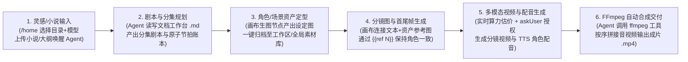

# 新版 Toonflow 产品需求文档（PRD）与工程交付标准

> **文档版本**：`v1.0.0-baseline`（正式工程基准封板版）
> **最后更新**：`2026-10-28`
> **状态**：已封板（Baseline Frozen）
> **配套基准文档**：[`apiContract.md`](file:///C:/Users/c1338/.gemini/antigravity/brain/c2ec26a6-8aaa-4a4e-b09d-c3dbec88d75c/apiContract.md)（`v1.0.0-baseline`）

| 版本号 | 日期 | 变更摘要 |
| :--- | :--- | :--- |
| `v0.1.0` | `2026-10-28` | 初始工程基准草案（完成架构转型与 6W 产品定义） |
| `v0.2.0` | `2026-10-28` | 拆分独立 API 契约文档 `apiContract.md`，建立双文档工程基准 |
| `v0.3.0` | `2026-10-28` | 落实 `DEC-01 ~ DEC-06`（清理 `/api/singleAgent/*`、保留第三方供应商余额接口、剥离废弃设置字段、收敛 `export` 仅支持 `skill`、锁定双后端配置同步与 `TOONFLOW_INTERNAL_TOKEN` 鉴权、移除 `reveal` 接口，接口总数锁定为 65 个） |
| `v1.0.0-baseline` | `2026-10-28` | 完成最后一轮封板：落实 `DEC-07 ~ DEC-09`（`sys_personalization` 独立权威表、配置同步重试/启动对账/持续恢复/可观测性要求、`balanceEvents` 临时 `accountId` 404 有限次重刷重连机制），并基于现有源码完成全部 65 个接口 Schema 与流式协议核对 |

> [!IMPORTANT]
> **工程基准与文档权威性声明（v1.0.0-baseline 封板基准）**
> 1. 本 PRD（[`newToonflowPrd.md`](file:///C:/Users/c1338/.gemini/antigravity/brain/c2ec26a6-8aaa-4a4e-b09d-c3dbec88d75c/newToonflowPrd.md)）负责定义**产品范围（6W 约束）、业务规则、领域模型与架构决策**；独立接口规范（[`apiContract.md`](file:///C:/Users/c1338/.gemini/antigravity/brain/c2ec26a6-8aaa-4a4e-b09d-c3dbec88d75c/apiContract.md)）负责定义**全量 65 个 API 的接口细节、Schema、流式协议与错误码**。两者共同构成项目正式工程基准，发生冲突时须登记并通过正式变更流程同步修订。
> 2. 项目中任何模块的新增、保留、修改或裁剪，均必须严格对应本文档中的「为什么做（Why）→ 给谁做（Who）→ 要做什么（What）→ 什么不做（Out of scope）→ 为什么这样做（Why this solution）→ 怎么判断做成了（Success criteria）」六大约束链条，严禁无理由的功能蔓延与过度设计。

---

## 第一部分：产品战略与边界约束（6W 核心决策）

### 1. 为什么做（Why）

#### 1.1 当前用户在短剧、漫剧与分镜创作中遇到的核心痛点
1. **多模态工具链碎片化与资产割裂**：传统 AIGC 短剧创作需要在 LLM 聊天框（改剧本）、生图平台（抽角色/场景）、生视频平台（跑分镜）、TTS 平台（做配音）和剪辑软件（拼成片）之间高频切换与手动搬运文件，角色形象、场景空间与剧情节拍极易在流转中丢失一致性（“穿帮”）。
2. **盲目抽卡导致算力成本失控与高返工率**：分镜师缺乏结构化的镜头提示词约束（如站位衔接、首尾帧绑定）和生成前的实时成本预估与授权门控，往往在提示词或参考图未对齐时就批量调用昂贵的视频模型，导致废片率极高。
3. **成片交付“最后一公里”未闭环**：单镜头视频和配音生成后，仍需人工逐个下载并导入外部软件对齐拼接，无法在创作工作台内直接预览和交付完整单集样片。

#### 1.2 现有 Toonflow 2.0 无法很好解决上述问题的原因
1. **交互与认知负担过重（主干被支线淹没）**：原版在画布节点上堆砌了过多低频重度工具（如 Three.js 3D 导演台、全景图 WebGL Shader 校正、3D 球体打光、3D 多角度环绕、音频非线性波形剪辑弹窗等），不仅大幅增加了编导人员的学习成本和操作路径，反而干扰了 **「小说/剧本 → 角色场景资产 → 分镜生图生视频 → 成片合成」** 这一最高频主干流。
2. **工程与二开维护成本极高（过度插件化与多端包袱）**：
   - 原版为了服务公开插件市场，将所有内部画布节点（`.umd.js`）、文档扩展（`ext-*.umd.js`）、Agent 工具（`.tool.js`）和智能体团队（`.agent.zip`）全部拆分为独立外部编译产物并通过全局变量注入，导致调试链路极长、类型断层；
   - 原版包含桌面壳（Electrobun/NSIS/`bspatch`）、Android 内置 Bun APK、鸿蒙 OHOS、ThorVG 原生 C++ 启动动画、21 国语言包及 `TF-Router` 官方充值强耦合；
   - 原版后端仅使用单机 `settings.json` 文件存储配置，缺乏关系型数据库支撑，难以融入团队现有的 **Java（Spring Boot 3 + PostgreSQL）** 企业级工程规范与数据治理体系。

#### 1.3 本次重构预期改善的核心结果
- **对创作团队（业务结果）**：砍掉一切冗余干扰弹窗，将单集短剧/漫剧（1~2 分钟）从剧本输入到合成 MP4 成片的操作路径收敛为一条清晰的端到端流水线，实现工作台内 100% 闭环出片，大幅降低废片返工率与算力浪费。
- **对研发团队（工程结果）**：构建 **「Vue 3 内聚前端 + Java 21 (Spring Boot 3 + PostgreSQL 16) 核心后端 + Bun (TypeScript) Agent & 媒体运行时」** 架构，移除约 40% 的跨端壳与动态脚本编译包袱，使系统具备企业级数据持久化、清晰的二次开发边界与高可维护性。

---

### 2. 给谁做（Who）

#### 2.1 首要目标用户画像
- **核心用户群**：**中小型 AIGC 短剧 / 漫剧制作团队与工作室（3~20 人规模）**。
- **典型角色分工**：
  1. **AIGC 编导 / 分镜师（高频日常使用者）**：负责将网文小说或创意大纲改编为分集剧本，设定角色/场景/道具视觉资产，在无限画布上连线生成分镜图、视频与配音，并输出单集视频样片。
  2. **工作室技术负责人 / 全栈研发工程师（部署、配置与二开维护者）**：负责在内网或私有云通过 Docker Compose 部署系统，在 PostgreSQL 与后台配置企业采购的 LLM / 视频生成 API Key，通过 `.ts` 沙箱接入新发布的视频大模型或内部 ComfyUI 算力节点，并基于 Java Spring Boot + Vue 3 进行定制开发。

#### 2.2 用户最常见、最重要的核心创作任务（Core JTBD）
1. **剧本结构化拆解**：导入小说章节或故事创意，借助 AI Agent 与文档工作台产出标准的分集剧本与分镜台本（`.md`）。
2. **核心视觉资产定型**：生成并锁定本剧的核心角色（三视图/设定图）、固定场景与关键道具图片，存入素材库供全剧跨集复用。
3. **画布多模态分镜生成**：在无限画布中通过 `textNode`、`imageNode`、`imageGenerationNode`、`videoGenerationNode`、`audioGenerationNode` 组合连线，利用 `{{ref N}}` 精确绑定角色参考图与首尾帧，按镜头生成视频片段与角色配音。
4. **单集样片一键合成交付**：指挥 AI Agent 调用 `ffmpeg` 工具，将画布上审阅通过的分镜视频与配音音频按序自动拼接、混音，直接在工作区内输出完整单集 `.mp4` 成片。

#### 2.3 暂时明确不服务的用户与场景（Non-Target Users）
- **不服务**：使用手机/平板在移动端离线制作短剧的个人用户（不提供 Android APK / 鸿蒙 APP 及手机扫码互联）。
- **不服务**：零配置开箱即用、需要内置官方账号登录与微信/支付宝买算力的 C 端散户（本系统面向自有 API Key 或团队统一配置网关的工作室）。
- **不服务**：需要专业三维建模动画预演（3D 骨骼K帧）或专业影视级非线性多轨精细后期调色/特效包装的传统影视后期人员。
- **不服务**：海外非中文母语使用者（首发版本仅服务简体中文团队）。

---

### 3. 要做什么（What）

#### 3.1 首发版本（MVP / V1.0）必须完成的四大核心任务
1. **搭建三端协同工程底座**：完成 `apps/web`（Vue 3）、`apps/server`（Java 21 + Spring Boot 3 + PostgreSQL 16 + MyBatis-Plus + Flyway）与 `apps/agentRuntime`（Bun + TypeScript + Pi Agent SDK）的搭建与网关打通。
2. **交付“无限画布 + 多标签文档”双模工作台**：实现源码内聚的 **7 大核心画布节点** 与 **5 大文档编辑器扩展**，打通混合文件树（画布 `.json` 展开为节点树）与乐观锁自动保存。
3. **交付短剧导演级 AI Agent 闭环**：集成主 Agent + 同工作区子智能体（`subAgent`）、源码内聚 **11 大工具包**、三级记忆、历史大图超限自动卸载、算力授权硬门控，以及热加载 `canvas` 手册与 `workflow` 短剧导演技能。
4. **交付热插拔模型供应体系与沙箱调试器**：支持三大主流协议文本模型配置，支持 `.ts` 媒体供应商动态热加载、实时算力估价与双栏沙箱调试器。

#### 3.2 核心端到端业务工作流（End-to-End Workflow）



#### 3.3 用户最终应获得的交付物（User Deliverables）
在一个标准项目工作区目录（`<workspace>/`）内，用户最终获得一套结构化、可迁移、可复用的完整数字资产包：
1. **剧本与设定文档**：位于工作区目录下的 Markdown 剧本、人物小传与分镜台本（`*.md`）。
2. **定型视觉与音频资产**：位于 `assets/` 及全局素材库中的角色设定图、场景图、分镜关键帧（`.png/.webp`）、单镜头视频片段（`.mp4`）与角色台词配音（`.mp3/.wav`）。
3. **可视化生产工程画布**：记录了完整节点拓扑、提示词参数、参考连线关系与历史生成记录的画布文件（`*.json` 及 `assets/<nodeId>/` 历史产物）。
4. **最终成片视频**：由 Agent 调用 FFmpeg 自动合成并保存在工作区内的完整单集短剧视频文件（`.mp4`）。

#### 3.4 核心功能模块与刚性验收标准（Acceptance Criteria）

| 核心模块 | 功能点 | 刚性验收标准（Pass / Fail 判定依据） |
| :--- | :--- | :--- |
| **F1. 引导与项目台**<br/>(`/hello`, `/home`) | 首次配置引导、灵感直达建项、服务端目录选择器、项目列表管理 | 1. 未配置模型时访问 `/` 自动进入 `/hello`，配置任意有效 LLM 模型后自动跳转 `/home`。<br/>2. 在 `/home` 输入指令并上传小说 `.txt/.docx` 附件、选择空目录发送后，必须在目标目录自动生成 `画布1.json`、保存附件至 `assets/chat/` 并跳转 `/workspace` 自动触发 Agent 对话。<br/>3. 支持应用内的服务端目录浏览（`GET /api/workspaces/list`）与宿主原生目录选择框（`POST /api/workspaces/selectDirectory`），支持新建/重命名/删除文件夹及校验空目录；首发版本不提供调用宿主 OS 资源管理器定位文件（`reveal`）功能。 |
| **F2. 文档工作台**<br/>(`Document Panel`) | 混合文件树、Dockview 分屏、乐观锁自动保存、5 大内聚编辑器、全文搜索替换 | 1. 文件树必须能嗅探画布 `.json` 并点击展开显示内部节点树；点击节点可在文档标签页中通过 `canvasNode` 扩展直接投影编辑该节点。<br/>2. 复制粘贴画布 `.json` 时，必须重写所有节点 UUID 并深度拷贝对应的 `assets/<nodeId>` 目录。<br/>3. 编辑器修改后 400ms 防抖保存并校验 SHA-256 `expectedRevision`；当文件被后台 Agent 修改引发 `409 ESTALE` 时，必须暂停自动保存并弹出冲突解决横幅（载入磁盘版本/另存副本/重试）。<br/>4. `md`、`image`、`media`（含 `.pcm` 解码）、`txt`、`canvasNode` 五大视图无需加载外部 `.umd.js` 即可直接打开对应资源。 |
| **F3. 无限画布与 7 大节点**<br/>(`Canvas Panel`) | 多画布保活、7 大内聚节点、`{{ref N}}` 引用排序、历史回滚、实时估价、视频抽帧 | 1. 切换画布或切到文档面板时，后台画布正在进行的生成任务与 Agent 调用不得中断。<br/>2. 从任意节点端口拖拽连线到空白处松手，必须弹出仅包含类型兼容节点的菜单，点击后自动建节点并完成连线。<br/>3. `textNode`、`imageNode`、`imageGenerationNode`、`videoNode`、`videoGenerationNode`、`audioNode`、`audioGenerationNode` 全部源码内聚运行。<br/>4. 生成节点支持拖拽调整上游参考卡片顺序（`ref 1, ref 2`）、输入 `@` 插入 `{{ref N}}`、实时显示预估价格、以及从 `mediaHistory` 弹窗回滚任意历史生成结果。<br/>5. `videoNode` 与 `videoGenerationNode` 支持一键截取「首帧 / 尾帧 / 当前帧」并在右侧自动创建对应的 `imageNode`。 |
| **F4. AI Agent 引擎与工具**<br/>(`Agent Runtime`) | 多会话流式对话、`subAgent`、11 大内聚工具、大图自动卸载、算力门控、`workflow` 技能 | 1. 支持 `@` 引用跨画布/节点输出/全局素材，支持 `/` 唤起技能，支持消息分支重发与软删除。<br/>2. 当会话历史图片累计超 20MB 或收到 `HTTP 413` 时，必须自动将最旧轮次图片卸载为文本占位符，对话不报错中断。<br/>3. Agent 在调用任何生图/生视频/生音频工具前，必须先通过 `askUser` 卡片展示模型、参数、提示词与预估价格，未获用户点击确认严禁发起生成。<br/>4. Agent 能够通过 `canvas` 18 项工具在画布上自动创建节点、连接 `{{ref N}}`、调用 `node:*` 生成，并最终调用 `ffmpeg` 工具将多段视频与音频合成为单个 `.mp4` 文件。 |
| **F5. 模型供应商与沙箱**<br/>(`Providers`) | LLM 三协议接入、`.ts` 媒体供应商热加载、第三方余额查询、双栏沙箱调试器 | 1. 支持配置 `openai-completions`、`openai-responses`、`anthropic-messages` 协议模型并在线拉取 `/v1/models`。<br/>2. 导入或修改 `.ts` 媒体供应商时，必须通过 Babel AST 静态校验并在 `node:vm` 沙箱中隔离运行；允许 `.ts` 供应商通过可选的 `getBalance` 钩子查询第三方平台自身余额并通过 SSE 推送更新（不涉及自有平台充值、扣费或账本）。<br/>3. 在「供应商沙箱调试器」中执行测试时，右侧必须实时流式展示媒体预览与脱敏后的上游 HTTP 请求/响应日志。 |
| **F6. Spring Boot 3 核心后端**<br/>(`Java Server`) | PostgreSQL 唯一权威源、`data/` 原子快照同步、内部 Token 鉴权、文件沙箱、流式代理网关 | 1. PostgreSQL 16 是配置、供应商及元数据的唯一权威数据源，Spring Boot 3 是唯一写入口；数据库事务提交后，通过临时文件+原子替换将配置快照、供应商源码等同步至共享 `data/` 目录（同步失败必须支持重试与恢复，严禁静默忽略；Bun Runtime 必须基于版本检测刷新内存缓存，不得长期使用过期配置）。<br/>2. Java 与 Bun 的内部 HTTP 调用必须通过环境变量 `TOONFLOW_INTERNAL_TOKEN` 进行服务间鉴权，严禁暴露给前端。<br/>3. 工作区文件操作必须校验 `toRealPath()` 严格处于工作区边界内，拒绝任何越界路径或符号链接逃逸。<br/>4. Spring Boot 转发 `/api/agent/*` 与 `/api/ai/*` 的 NDJSON / SSE 流时，首包延迟增加不超过 15ms，无缓冲积压、支持客户端断开时同步取消上游任务。 |

---

### 4. 什么不做（Out of scope）

为确保团队资源 100% 聚焦于上述核心目标，明确划定以下三类不做边界及重开条件：

#### 4.1 明确永久排除的能力（Never in Scope）
1. **移动端与多操作系统原生壳**：不开发 Android 内置 Bun APK（`apps/mobile`）、不开发 HarmonyOS NEXT 鸿蒙端（`compat/ohos`）、不开发 `MobileLink` 局域网/公网手机扫码互联（`/api/mobileLink/*`）。
2. **重度桌面打包、私有更新与宿主资源管理器定位**：不开发 Electrobun 桌面壳（`apps/desktop`）、NSIS 安装器、`bspatch` 增量补丁自更新器、ThorVG C++/ObjC 原生启动动画（`packages/startup`）、`toonflow://` 协议唤醒以及独立更新服务器（`apps/updateServer`）；首发版本不保留 `POST /api/workspaces/files/reveal`，不支持通过宿主操作系统的文件管理器（Explorer / Finder）定位文件（仅保留应用内服务端目录浏览与 `POST /api/workspaces/selectDirectory`）。
3. **官方商业平台强耦合模块**：不集成官方 `TF-Router` 登录授权 iframe，不开发 Toonflow 自有平台的微信/支付宝在线充值弹窗、套餐购买、扣费与余额账本模块（仅保留面向第三方媒体供应商 `.ts` 脚本可选 `getBalance` 钩子的通用余额查询能力），不开发远程赞助商展示墙与匿名遥测上报。
4. **多国语言包与 RTL 工程**：不支持 21 国语言翻译词典与 AST 编译抽取插件（`packages/i18n`），不做阿拉伯语/波斯语 RTL 镜像布局适配。
5. **公开插件市场与外部动态脚本打包体系**：不建设在线插件商店（Discover Market），不将内部节点、文档编辑器、Agent 工具编译为外部 `.umd.js` 或 `.tool.js` 动态脚本；`GET /api/plugins/export` 仅允许导出 `type=skill`，不再支持导出 `node`、`tool`、`agent`、`ext`。
6. **重度三维与跨网智能体协议**：不开发 `director3dNode`（Three.js 3D 导演台、可动人偶与骨骼动画）、不开发独立单轮子智能体接口（`/api/singleAgent/*`）、不开发 `.agent.zip` 团队包（`Teams`）、不开发 `A2A（Agent-to-Agent）` 跨网协议与 `MCP` 服务端、不集成 `puppeteer-core` 受控无头浏览器（`browser` 工具及 CDP 画面流）、不开发「AI 自动读网页写供应商助手」。

#### 4.2 因资源限制与聚焦主链路而延期的能力（Deferred to Phase 2+）
以下能力不在首发版本（V1.0）中实现，暂时排除在当前开发计划之外：
1. **图片节点内嵌的 6 大视觉精修工作台**：全景图生成与 WebGL Shader 校正预览、局部重绘（涂抹蒙版+像素羽化合成）、3D 球体双光源打光台、3D 环绕多角度机位台、智能宫格切分器、画板涂鸦标记工具。
2. **音视频节点内嵌的剪辑子弹窗**：视频节点的胶片缩略图时间轴裁剪器、音视频分离按钮；音频节点的 128 柱非线性波形分割/删除/粘合剪辑弹窗与变速滑块。
3. **画布可视化多轨时间轴合成节点（`videoComposeNode`）**：首发版本统一由 Agent 调用 `ffmpeg` 工具完成音视频合成，暂不提供前端可视化多轨拖拽时间轴。
4. **多用户账号登录与 RBAC 权限隔离**：首发版本面向工作室可信内网/私有云环境，暂不开发复杂的用户登录鉴权与细粒度项目权限控制。

#### 4.3 重新纳入范围需要满足的刚性条件（Re-entry Conditions）
任何「4.2 延期能力」想要重新进入开发排期，**必须同时满足以下三个先决条件**：
1. **主链路基线已达标**：首发版本的「剧本 → 资产 → 7 大节点分镜生成 → Agent 调用 FFmpeg 自动合成成片」端到端主链路已 100% 跑通并稳定上线运行满 2 周以上。
2. **高频痛点数据佐证**：编导团队在实际周常出片过程中，某一环节因缺少该工具导致必须频繁跳出系统借助外部软件处理，且该场景在单集制作中的出现频次 **> 30%**（例如：超过 30% 的角色三视图或九宫格分镜需要手动切图，此时才准入“智能宫格切分器”；或超过 30% 的成片因台词停顿需手动微调音轨切点，此时才准入“可视化视频合成节点”）。
3. **架构零侵入承诺**：重新纳入的组件必须作为源码内聚的子组件挂载在现有节点或面板下，严禁恢复 `.umd.js` 外部动态脚本编译体系。

---

### 5. 为什么这样做（Why this solution）

本节阐述核心架构与产品设计方案背后的推导逻辑，确保每个关键技术与交互决策都直接服务于明确的用户价值或工程目标：

| 核心设计决策 | 备选方案（放弃原因） | 为什么选择当前方案（Why This Solution） | 服务的用户价值 / 工程目标 |
| :--- | :--- | :--- | :--- |
| **1. 为什么选择「AI Agent + 无限画布 + 文档工作台」组合？** | • **纯聊天框模式**：无法直观管理几十个镜头的参考图连线与空间拓扑。<br/>• **纯固定表单向导模式**：灵活性差，无法应对跳镜、多角色同框、首尾帧接力等复杂非线性分镜编排。 | • **文档工作台**适合长文本线性阅读与结构化剧本编辑；<br/>• **无限画布**天然契合分镜的 DAG（有向无环图）依赖关系，让“哪张角色图+哪段提示词生成了哪个镜头”一目了然，且支持单镜头局部重抽；<br/>• **AI Agent** 担任“执行副导演”，省去人工在画布上繁琐建节点、连线、填参数的工作，人工只需审阅关键节点。 | **用户价值**：兼顾全局剧本把控、非线性分镜自由度与自动化批处理效率。 |
| **2. 为什么采用「Agent 调用 FFmpeg 自动合成」，而非自研前端时间轴剪辑器？** | • **自研前端 WebGL/Canvas 多轨时间轴**：开发周期极长（需处理多轨音画同步解码、帧缓存、转场渲染），且重造了剪映/Premiere 的轮子。<br/>• **完全不提供合成**：用户需手动下载十几个碎片视频才能看全集连贯效果。 | • 短剧在分镜生成阶段最核心的需求是**“快速按镜头顺序拼接音视频，检验全集叙事节奏与视听连贯性”**；<br/>• 后端已具备完整的 `ffmpeg` / `ffprobe` 能力，Agent 结合画布拓扑顺序自动执行 `concat` 与音轨合并，零前端 UI 开发成本即可交付完整 `.mp4` 样片。 | **用户价值**：工作台内一键看全集样片；<br/>**工程目标**：省去数人月的复杂视频时间轴研发成本，聚焦 AI 生成主链路。 |
| **3. 为什么保留「动态 `.ts` 媒体供应商与 `SKILL.md` 技能」，而将节点/扩展/工具改为「源码内聚」？** | • **全动态插件（原版）**：节点/工具全编译为 `.umd.js`/`.tool.js`，构建慢、无类型联动、排错极难。<br/>• **全静态硬编码**：每次接入新视频 API 或调整导演提示词都要改核心代码重新发版。 | • **变化频率决定架构边界**：画布的 7 类基础节点（文/图/视/音）和 11 类基础工具形态高度稳定，改为**源码内聚**可获得极致的 TypeScript 类型安全与 Vite HMR 秒级热更新；<br/>• 而外部多模态大模型（Seedance、Hailuo、Kling、Wan、私有 ComfyUI）与导演提示词流派（Skills）迭代极快，保留 `.ts` 沙箱与 `SKILL.md` 热加载，让工作室随时在线接入新模型、沉淀新工作流。 | **工程目标**：消除 80% 的动态构建维护痛点，同时保留 100% 的模型与业务工作流敏捷扩展力。 |
| **4. 为什么采用「Spring Boot 3 (PostgreSQL 16) + Bun AgentRuntime」双引擎架构，并通过 `settings.json` 快照同步？** | • **纯 Java 重写全部后端**：需用 Java 重写复杂的 `Pi Agent SDK`、JSONL 会话树、18 个画布工具协同及 `.ts` 供应商 VM 沙箱，工作量巨大且生态不匹配。<br/>• **纯 Bun + 单文件 JSON**：缺乏企业级关系型数据库支撑，难以与团队现有 Java 体系集成。 | • **让最擅长的语言做最擅长的事**：Java 21（开启虚拟线程）+ Spring Boot 3 + PostgreSQL 16 负责网关、配置/元数据入库治理、文件乐观锁与跨系统集成；<br/>• Bun + TypeScript 原生运行 `Pi Agent SDK` 与 `.ts` 媒体供应商沙箱；<br/>• Spring Boot 入库后原子导出 `data/settings.json` 快照，让 Bun 侧零代码改造即可实时读取最新配置，彻底解耦双端状态。 | **工程目标**：最大化复用原项目最核心的 TS Agent 与沙箱资产，同时完美落地 Java + PostgreSQL 企业级后端标准。 |

---

### 6. 怎么判断做成了（Success criteria）

#### 6.1 核心业务与工程量化指标（KPIs）
1. **端到端主链路完成率 = 100%**：编导人员从输入小说/大纲开始，到最终获得带配音的合成 `.mp4` 短剧样片，全流程在工作台内闭环完成，期间无需跳出系统使用第三方软件中转。
2. **单集成片产出耗时 ≤ 60 ~ 90 分钟**：制作一集标准 AI 短剧/漫剧（时长 1~2 分钟，包含 2~4 个核心角色/场景资产、10~15 个分镜视频镜头与配音）的端到端总耗时控制在 60~90 分钟以内。
3. **生成调度与合成技术成功率 ≥ 98%**：在外部模型 API 正常响应的前提下，系统内部的文件读写、画布节点通信、流式网关透传、媒体落盘与 FFmpeg 音视频拼接合成的工程成功率 ≥ 98%（不因系统 Bug 丢失生成产物或卡死会话）。
4. **废片返工率降低 ≥ 40%，单集算力成本可控在 ¥80 ~ ¥150 以内**：通过 `workflow` 导演技能的“源剧情节拍保真锁 + 角色参考图强绑定 + 算力消耗 `askUser` 估价授权门控”，杜绝未确认提示词的盲目批量生成，使单集模型 API 调用成本稳定可控。

#### 6.2 上线前必须通过的“端到端黄金验收场景（Golden E2E Benchmark）”
系统上线交付前，必须在实际环境中完整跑通以下标准验收剧本（不得使用 Mock 数据代替真实链路）：

> **【黄金验收用例：单集短剧全链路生产】**
> 1. **初始化与配置**：通过 Docker Compose 启动 PostgreSQL 16、`apps/server`（Spring Boot 3）与 `apps/agentRuntime`（Bun）；在浏览器访问系统，完成 `/hello` 文本模型配置，并在设置中配置至少 1 个可用的图片、视频、音频生成供应商（通过「供应商沙箱调试器」验证连通性）及就绪的 FFmpeg 环境。
> 2. **灵感建项**：在 `/home` 选择新建空工作区目录，上传一段 1,500~2,000 字的小说章节 `.txt/.md`，输入指令：“请按短剧工作流将这篇小说改编为 1 集短剧剧本（包含 8 个分镜），提取主角与场景设定图，并在画布上完成分镜视频、配音生成与最终成片合成”，点击发送。
> 3. **剧本与资产确认**：自动进入 `/workspace`，AI Agent 加载 `workflow` 技能，在文档工作台生成剧本 `.md`（可在 `ext-md` 富文本中审阅编辑），随后在画布创建角色与场景 `imageGenerationNode`，弹出 `askUser` 卡片展示预估费用；用户点击确认后成功生图并展示在画布上。
> 4. **分镜视频与配音生成**：Agent 自动在画布搭建 8 个镜头的 `textNode`、`videoGenerationNode` 与 `audioGenerationNode`，自动将角色/场景图连入视频节点并通过 `{{ref N}}` 引用；用户支持从已生成的视频节点一键「截取尾帧」作为下一镜头的首帧参考；经 `askUser` 确认后完成 8 段分镜视频与配音生成（验证 `mediaHistory` 可查看并切换历史生成版本）。
> 5. **FFmpeg 自动成片与交付预览**：Agent 调用内置 `ffmpeg` 工具，将 8 段分镜视频与配音音频按序合成输出为工作区下的 `成片_第1集.mp4`；用户在文档工作台点击该文件，通过内聚的 `ext-media` 播放器完整流畅播放音画同步的成片视频。

---

## 第二部分：系统架构与功能技术规格

### 7. 三端工程架构与数据库设计

#### 7.1 三端拓扑与通信机制

```mermaid
flowchart TB
    subgraph Web["前端应用层: apps/web (Vue 3 + TypeScript + Vite + Pinia)"]
        Pages["路由页面: /hello (引导) | /home (灵感与项目) | /workspace (双模工作台)"]
        CanvasUI["无限画布 (Vue Flow)<br/>源码内聚 7 大核心节点 + 素材库 + DAG 排版"]
        DocUI["文档工作台 (Dockview)<br/>混合文件树 + 源码内聚 5 大编辑器视图"]
        ChatUI["AI Agent 助手面板<br/>多会话保活 + 子Agent钻取 + @跨画布引用 + /技能"]
        SettingUI["精简设置中心 (6大面板)<br/>界面 / 常规快捷键 / 文本模型 / 媒体模型(含调试器) / 技能与FFmpeg / 个性化"]
    end

    subgraph JavaServer["核心业务网关层: apps/server (Java 21 + Spring Boot 3)"]
        Gateway["统一 REST & 流式网关 (/api/*, 端口 3000)<br/>保持原响应格式 {code, data, message} 与 SSE/NDJSON 契约"]
        ConfigSvc["配置与供应商管理服务<br/>MyBatis-Plus 持久化 + 同步导出 settings.json 快照"]
        WorkspaceSvc["工作区与全局素材文件系统服务<br/>SHA-256 Revision 乐观锁 + 原子写入 + 路径沙箱"]
        SkillSvc["技能包 CRUD 与 ZIP 安全解压导出服务"]
        FfmpegSvc["FFmpeg 6.1.1 镜像下载管理与本地进程执行服务"]
        ProxySvc["高性能流式反向代理 (Java 21 Virtual Threads HttpClient)<br/>转发 /api/agent/*, /api/ai/*, /api/providers/debug/*"]
    end

    subgraph DB["关系型数据库 (PostgreSQL 16)"]
        PG[("PostgreSQL 16 (Flyway 管理)<br/>sys_setting / sys_personalization / ai_language_provider / ai_media_provider / skill_meta / workspace_project")]
    end

    subgraph BunRuntime["智能体与媒体引擎层: apps/agentRuntime (Bun + TypeScript, 端口 3001)"]
        AgentEngine["Pi Agent 运行时内核<br/>树形 JSONL 会话 / 三级记忆 / 历史大图卸载 / 算力硬门控 / subAgent"]
        BuiltinTools["源码内聚 11 大工具集<br/>canvas(18项) / workspace / mediaGeneration / askUser / ffmpeg / webSearch 等"]
        SkillLoader["渐进式技能加载器 (SKILL.md)<br/>内置 canvas 手册 + workflow 导演内核"]
        MediaSandbox["媒体供应商沙箱引擎 (data/providers/*.ts)<br/>Babel AST 静态校验 + Bun Transpiler + node:vm 沙箱 + 实时估价"]
    end

    subgraph Disk["共享本地磁盘存储 (TOONFLOW_DATA_DIR & Workspaces)"]
        DataDir[("data/ 目录<br/>settings.json (快照) / providers/*.ts / skills/* / memories/memory.md / AGENTS.md / assets/*")]
        WorkDir[("workspaces/ 项目目录<br/>*.json (画布) / assets/<nodeId>/* / .agent/sessions/*.jsonl")]
    end

    Web -->|统一请求 HTTP / SSE / NDJSON| Gateway
    Gateway --> ConfigSvc & WorkspaceSvc & SkillSvc & FfmpegSvc & ProxySvc
    ConfigSvc <--> PG
    ConfigSvc -->|原子同步配置快照| DataDir
    WorkspaceSvc & FfmpegSvc <--> WorkDir & DataDir
    SkillSvc <--> DataDir
    ProxySvc -->|本地内部 HTTP/Stream 调用 (TOONFLOW_INTERNAL_TOKEN 鉴权)| AgentEngine & MediaSandbox
    AgentEngine --> BuiltinTools & SkillLoader & MediaSandbox
    AgentEngine & MediaSandbox <--> DataDir & WorkDir
```

#### 7.2 仓库目录结构规范（全小驼峰命名）

```text
toonflowApp/
├── apps/
│   ├── web/                          # 前端应用 (Vue 3 + Vite + Pinia + Vue Flow + Dockview)
│   │   └── src/
│   │       ├── components/           # 通用组件 (agent/, settings/ 等)
│   │       ├── extensions/           # 源码内聚的 5 大文档编辑器扩展 (canvasNode, md, image, media, txt)
│   │       ├── nodes/                # 源码内聚的 7 大画布节点 + nodeCore/ (原 nodeScaffold + nodeShared 合并)
│   │       ├── pages/                # 路由页面 (hello/, home/, workspace/)
│   │       ├── stores/               # Pinia 状态管理 (hello, settings, workspace, developer)
│   │       └── lib/                  # 前端工具库 (workspaceFiles, canvasShortcuts, shiki 等)
│   ├── server/                       # 核心业务后端 (Java 21 + Spring Boot 3 + MyBatis-Plus + Flyway)
│   │   ├── pom.xml
│   │   └── src/main/
│   │       ├── java/com/toonflow/server/
│   │       │   ├── config/           # WebCors, Jackson, MyBatisPlus, VirtualThreads, AgentProxyConfig
│   │       │   ├── common/           # ApiResponse ({code, data, message}), GlobalExceptionHandler, PathSandbox
│   │       │   ├── controller/       # 对应 /api/settings, /api/workspaces, /api/assets, /api/skills, /api/ffmpeg 等
│   │       │   ├── proxy/            # 流式透传网关 (转发 /api/agent/*, /api/ai/*, /api/providers/* 至 agentRuntime)
│   │       │   ├── service/          # 业务逻辑与 data/ 目录原子快照同步器
│   │       │   ├── mapper/           # MyBatis-Plus Mapper 接口
│   │       │   └── entity/           # PostgreSQL 实体类 (含 JSONB 映射)
│   │       └── resources/
│   │           ├── application.yml
│   │           └── db/migration/     # Flyway SQL 迁移脚本 (V1__initSchema.sql)
│   └── agentRuntime/                 # 智能体与媒体运行时 (Bun + TypeScript + Pi Agent SDK)
│       ├── package.json
│       └── src/
│           ├── index.ts              # 内部 HTTP 服务入口 (默认监听 127.0.0.1:3001)
│           ├── agent/                # Agent 运行时 (会话管理, Prompt 构建, 历史图片卸载, subAgent 委派)
│           ├── tools/                # 源码内聚的 11 大 Agent 工具包 (canvas, workspace, mediaGeneration 等)
│           ├── media/                # .ts 媒体供应商 AST 校验、VM 沙箱加载、生成、估价、第三方余额与沙箱调试器
│           ├── ai/                   # LLM 模型调用与 DeepSeek 视觉文件缓存层
│           └── routes/               # 内部路由 (/api/agent/*, /api/ai/*, /api/providers/*)
├── packages/
│   ├── file/                         # Bun 原子文件操作与路径锁基础包 (@toonflow/file, 供 agentRuntime 使用)
│   ├── ffmpeg/                       # FFmpeg 链式调用封装 (@toonflow/ffmpeg)
│   ├── providers/                    # 内置语言与媒体供应商模板 (@toonflow/providers)
│   └── skills/                       # 内置核心技能包 (canvas 画布手册, workflow 短剧导演工作流)
├── data/                             # 运行时共享数据目录 (Git 忽略)
└── compose.yaml                      # 一键编排 PostgreSQL 16 + Spring Boot Server + Bun AgentRuntime
```

#### 7.3 PostgreSQL 16 数据库表结构定义（`V1__initSchema.sql`）

| 表名 | 主键 | 核心字段与类型 | 职责说明 |
| :--- | :--- | :--- | :--- |
| `sys_setting` | `setting_key VARCHAR(64)` | `setting_value JSONB NOT NULL`, `updated_at TIMESTAMPTZ` | 存储全局设置项：`helloCompleted`、`ui`、`general`（含 `nodeMenu`、`canvasShortcuts`）、`personalization`（如 `memoryEnabled`）、`toolConfigs`、`agentSystemPrompt` 等（不再保存已排除的 `desktopUpdate*` 与 `mcp` 字段，且不重复存储 `memory` 和 `agents` 正文）。 |
| `sys_personalization` | `doc_type VARCHAR(32)` | `content TEXT NOT NULL`, `revision VARCHAR(64) NOT NULL`, `updated_at TIMESTAMPTZ NOT NULL` | 作为 `memory` 与 `agents` 个性化文档文本（上限 20000 字符）及其 SHA-256 `revision` 的**唯一权威数据源**；`data/memories/memory.md` 与 `data/AGENTS.md` 作为派生文件快照。 |
| `ai_language_provider` | `provider_id VARCHAR(64)` | `label VARCHAR(128)`, `api_url TEXT`, `protocol VARCHAR(32)`, `api_key TEXT`, `models JSONB`, `enabled BOOLEAN`, `updated_at TIMESTAMPTZ` | 管理所有 LLM 文本供应商（`openai-completions`、`openai-responses`、`anthropic-messages`）及模型列表。 |
| `ai_media_provider` | `provider_id VARCHAR(64)` | `file_name VARCHAR(128)`, `label VARCHAR(128)`, `source_code TEXT`, `revision VARCHAR(64)`, `config JSONB`, `models JSONB`, `enabled BOOLEAN`, `updated_at TIMESTAMPTZ` | 管理 `.ts` 媒体供应商源码、SHA-256 `revision`、API Key 等配置 `config` 及 `image`/`video`/`audio` 模型定义；保存时同步写入 `data/providers/<fileName>`。 |
| `skill_meta` | `skill_name VARCHAR(128)` | `description TEXT`, `enabled BOOLEAN`, `file_order JSONB`, `updated_at TIMESTAMPTZ` | 管理全局技能（`data/skills/<skillName>`）的启用状态与附属文件排序。 |
| `workspace_project` | `id BIGSERIAL` | `name VARCHAR(64)`, `directory TEXT UNIQUE`, `last_opened_at TIMESTAMPTZ`, `created_at TIMESTAMPTZ` | 记录服务端工作区项目元数据。 |

#### 7.4 双后端配置同步与服务间鉴权规范

1. **唯一权威数据源与唯一写入口**：
   - **PostgreSQL 16** 是系统配置（`sys_setting`）、个性化文档（`sys_personalization`）、语言模型供应商（`ai_language_provider`）、媒体供应商（`ai_media_provider`）及技能元数据（`skill_meta`）的**唯一权威数据源（Single Source of Truth）**；
   - **Spring Boot 3 (`apps/server`)** 是上述数据的**唯一写入口**，Bun `agentRuntime` 严禁直接修改权威配置。
2. **共享 `data/` 目录原子快照同步与失败恢复**：
   - 当 Spring Boot 3 的数据库事务提交后，必须将 Bun `agentRuntime` 运行所需读取的派生快照——配置快照（`data/settings.json`）、媒体供应商源码（`data/providers/<fileName>`）、长期记忆与行为准则（`data/memories/memory.md`、`data/AGENTS.md`）同步到共享 `data/` 目录；
   - 所有共享文件更新必须采用**临时文件写入 + 原子替换（Atomic Rename）**方式，防止 Bun 读取到半截文件；
   - **同步失败重试、启动对账、持续恢复与状态可观测**：当磁盘快照同步发生异常时，必须支持失败自动重试、服务启动时全量对账、后台持续恢复以及同步异常状态可观测（日志/指标告警），严禁静默忽略错误（具体重试次数与退避间隔属于实现参数，不在 PRD 中锁死）。
3. **Bun Runtime 缓存版本检测与刷新**：
   - Bun `agentRuntime` 不得长期使用过期配置；对于内存中缓存的配置或已加载的媒体供应商实例，必须通过文件 `mtime` 或 SHA-256 `revision` 摘要比对实现明确的版本检测与自动刷新机制；
   - MVP 阶段不引入额外的跨进程 RPC 配置推送机制。
4. **服务间内部 HTTP 鉴权**：
   - Spring Boot 3 (`apps/server`) 与 Bun (`apps/agentRuntime`) 之间的内部 HTTP 调用统一通过环境变量 `TOONFLOW_INTERNAL_TOKEN`（携带于内部请求头 `X-Toonflow-Internal-Token`）进行服务间鉴权，严禁将该 Token 暴露给前端客户端。

---

### 8. 核心模块功能规格明细

#### 8.1 无限画布源码内聚 7 大节点规格表（`apps/web/src/nodes/*`）

| 节点名称与标识 | 输入端口 (`in`) | 输出端口 (`out`) | 核心功能与交互（精简聚焦版） | 暴露给 Agent 的 `node:*` 工具 |
| :--- | :--- | :--- | :--- | :--- |
| **1. 文本 (`textNode`)** | `VIDEO, IMAGE, STRING, FILE` | `text` (`STRING`) | • 正文持久化于 `assets/<nodeId>/content.md`，与文档工作台实时双向同步。<br/>• 节点内 Markdown 预览 + 全屏富文本/原文双模编辑弹窗。<br/>• 底部 AI 文本生成卡：支持 `@` 引用上游素材、选择 LLM 流式生成剧本或分镜描述。 | `setText` |
| **2. 图片 (`imageNode`)** | `IMAGE` | `image` (`IMAGE`) | • 点击或拖拽上传/替换本地图片（≤100MB，存至 `assets/<nodeId>/`）。<br/>• 顶部工具栏：**添加到素材库**、**替换图片**、**下载**、**全屏大图预览**。 | `setImage` |
| **3. 图片生成 (`imageGenerationNode`)** | `IMAGE, STRING` | `image` (`IMAGE`) | • 底部生成卡：上游参考图拖拽排序 + `@` 引用提示词框 + 图片模型选择 + 参数弹窗（尺寸 `1K/2K/4K`、比例 `1:1, 16:9, 9:16, 4:3, 3:4, 21:9`）+ 实时价格预估 + 生成/取消。<br/>• 顶部工具栏：**添加到素材库**、**历史记录回滚 (`mediaHistory`)**、**替换图片**、**下载**、**全屏预览**。 | `getConfig`, `setConfig`, `setPrompt`, `generateImage`, `getGenerationStatus`, `cancelGeneration` |
| **4. 视频 (`videoNode`)** | 无 | `video` (`VIDEO`) | • 上传/替换本地视频（≤100MB），内置视频播放器。<br/>• 顶部/播放器工具栏：**一键截取视频帧（首帧 / 尾帧 / 当前帧自动在右侧创建 `imageNode`）**、添加到素材库、下载、全屏。 | `setVideo` |
| **5. 视频生成 (`videoGenerationNode`)** | `IMAGE, VIDEO, AUDIO, STRING` | `video` (`VIDEO`) | • **智能参考模式引擎**：自动匹配 `text`、`singleImage`、`startEndRequired`（首尾帧必填）、`endFrameOptional`、`multiReference`。<br/>• 参数设置弹窗：生成模式切换、**时长×分辨率联动选择 (`durationResolutionMap`)**、画幅比例、原生音频开关。<br/>• 顶部工具栏：添加到素材库、**历史记录回滚**、**一键截取首/尾/当前帧上画布**、下载、全屏。 | `getConfig`, `setConfig`, `setPrompt`, `generateVideo`, `getGenerationStatus`, `cancelGeneration` |
| **6. 音频 (`audioNode`)** | 无 | `audio` (`AUDIO`) | • 上传/替换本地音频（≤100MB）。<br/>• 内置 **128 柱 SVG 动态声波播放器**（点击波形跳转、音量调节、添加到素材库、下载）。 | `setAudio` |
| **7. 音频生成 (`audioGenerationNode`)** | `IMAGE, AUDIO, STRING`<br/>*(限1图或1音频)* | `audio` (`AUDIO`) | • 对接音频 Provider，支持 TTS 语音合成与参考音频音色克隆。<br/>• 参数设置弹窗：语种（中/英）、音色选择与试听、采样率（`8k~48k`）、格式（`WAV/MP3/PCM/Opus`）、实时估价。<br/>• 顶部工具栏：添加到素材库、**历史记录回滚**、下载。 | `getConfig`, `setConfig`, `setPrompt`, `generateAudio`, `getGenerationStatus`, `cancelGeneration` |

#### 8.2 文档工作台源码内聚 5 大扩展规格表（`apps/web/src/extensions/*`）

| 扩展标识 | 名称 | 支持对象 / 后缀 | 核心功能规格 |
| :--- | :--- | :--- | :--- |
| `canvasNode` | 画布节点视图 | 画布内任意 `canvasNode` | 静默激活对应画布与节点，通过 `<teleport>` 将画布节点的 `.documentNode` 视图投射到文档标签页中直接编辑。 |
| `md` | Markdown 编辑器 | `.md, .markdown` | Tiptap 富文本 / 原文双模式切换（超 5 万字或 1000 行自动切原文）；支持标题、列表、代码块、表格增删合并、页内查找（`Ctrl+F`）、图片粘贴存入 `assets/documentAttachments/`、`Ctrl+点击` 相对链接打开工作区文件。 |
| `image` | 图片查看器 | `.jpg, .png, .webp, .gif, .svg, .avif, .bmp, .ico` | 显示真实像素尺寸（`W × H`），支持适应窗口、`100%` 原始尺寸及 `10% ~ 800%` 滚轮缩放。 |
| `media` | 音视频播放器 | `.mp4, .mp3, .wav, .pcm, .opus` | 标准音视频播放；打开 `.pcm` 裸音频时顶部展示采样率（`1~384,000 Hz`）、声道数与 9 种采样格式转换栏，内存实时封装 WAV 播放。 |
| `txt` | 文本编辑器 | `.txt, .log, .json, .csv, .yaml, .xml, .toml, .ini` | 等宽字体编辑，支持配置字号与自动换行，内置查找与替换栏（`Ctrl+F` / `Ctrl+H`）。 |

#### 8.3 Agent 源码内聚 11 大工具包规格表（`apps/agentRuntime/src/tools/*`）

| 序号 | 工具模块名 | 包含的具体工具与职责说明 |
| :--- | :--- | :--- |
| 1 | `memory` | 读写全局长期记忆 `data/memories/memory.md`（带 SHA-256 `revision` 乐观锁）。 |
| 2 | `subAgent` & `report` | 同工作区并行子智能体任务委派（最多 8 任务/4 并发）与子智能体阶段成果实时汇报。 |
| 3 | `askUser` | 发起交互式提问（单选列表或最多 12 个字段的复合动态表单），配套前端内聚 `questionCard.vue`。 |
| 4 | `canvas` | **18 个画布与节点操控工具**（5 个分页读取工具 `getCanvas`, `findCanvasNodes`, `getCanvasNodes`, `getCanvasEdges`, `getNodeTools` + 13 个操作工具 `addCanvas`, `switchCanvas`, `renameCanvas`, `addNode`, `deleteNodes`, `moveNodes`, `renameNodes`, `connectNodes`, `deleteEdges`, `selectNodes`, `arrangeCanvas`, `fitCanvas`, `nodeTools`），配套前端内聚 `nodeFocusCard.vue`。 |
| 5 | `mediaGeneration` | 查询可用媒体模型规格 (`listMediaModels`) 及直接生成图片 (`generateImage`)、视频 (`generateVideo`)、音频 (`generateAudio`)。 |
| 6 | `workspace` | 工作区文件读写：`ls`, `write`, `edit`, `downloadImage`，以及支持文本、图片视觉注入与 `.docx/.xlsx/.pptx/.pdf/.epub` 自动转 Markdown 的 `read` 工具。 |
| 7 | `assetOperator` | 全局素材库 (`data/assets`) 增删改查与工作区双向复制导入 (`import`)。 |
| 8 | `skillOperator` | 读取、创建与更新工作区级（`.agents/skills`）或全局级（`data/skills`）技能文件。 |
| 9 | `ffmpeg` | **短剧成片合成核心工具**：提供 `ffprobe`（探测音视频时长/分辨率/音轨）与 `ffmpeg`（链式执行分镜视频按序拼接 `concat`、配音混音、转码、裁剪与抽帧）。 |
| 10 | `webSearch` | 联网搜索（`web_search`），支持 DuckDuckGo、DeepSeek 联网搜索与 Tavily API。 |
| 11 | `webFetch` | 抓取公开网页并清洗为结构化正文文本。 |

#### 8.4 核心后端（Spring Boot 3）与 Bun Runtime API 路由切分表（全量 65 个接口）

> **接口契约权威说明**：各接口的详细入参、请求体、响应结构、错误码及流式协议以 [`apiContract.md`](file:///C:/Users/c1338/.gemini/antigravity/brain/c2ec26a6-8aaa-4a4e-b09d-c3dbec88d75c/apiContract.md) 为准。关键边界规则如下：
> 1. `PUT /api/settings/save` 不再校验或保存 `desktopUpdateSource`、`desktopUpdateCustomUrl`、`mcp` 字段；旧客户端若传入则直接忽略且不持久化。`GET / PUT /api/settings/personalization/*` 以 `sys_personalization` 表为唯一权威源，派生同步 `data/memories/memory.md` 与 `data/AGENTS.md`。
> 2. 工作区模块共 11 个接口，保留 `GET /api/workspaces/list` 与 `POST /api/workspaces/selectDirectory`，首发版本不提供 `POST /api/workspaces/files/reveal`。
> 3. `GET /api/plugins/export` 路径保持不变，`type` 参数仅允许 `"skill"`。
> 4. `POST /api/ai/media/balance` 与 `GET /api/ai/media/balanceEvents` 仅用于调用第三方 `.ts` 媒体供应商可选的 `getBalance` 钩子查询第三方平台余额及推送刷新事件（不涉及任何自有平台充值、扣费或账本）；保留基于 Bun 进程内存状态的临时 `accountId`，当 `balanceEvents` 返回账户失效的 `404` 时，前端重新调用 `POST /api/ai/media/balance` 换取新 `accountId` 后重连事件流，并限制自动重试次数避免无限重连。
> 5. `POST /api/ffmpeg/execute` 按 `operation.method` 区分 JSON 模式（`"cancel" | "prepare"`）与 SSE 模式（其余 20 个执行/查询方法，1s 保活）；`POST /api/ai/media/generate` 采用 `application/json; charset=utf-8` 前导 `\n`（20s 保活）Chunked JSON 协议，响应头发出后的异常在 `200 OK` 流内通过 `ApiResponse.code` 返回并自动回滚已落盘文件。

| 归属服务 | 模块（接口数） | 路由路径清单 |
| :--- | :--- | :--- |
| **Spring Boot 3 直接实现**<br/>(`apps/server`) | 系统配置与个性化（5） | `GET /api/settings/get`, `PUT /api/settings/save`, `GET /api/settings/systemPrompt`, `GET /api/settings/personalization/get`, `PUT /api/settings/personalization/save` |
| **Spring Boot 3 直接实现**<br/>(`apps/server`) | 工作区与文件管理（11） | `GET /api/workspaces/check`, `GET /api/workspaces/list`, `POST /api/workspaces/selectDirectory`, `GET /api/workspaces/files/list`, `GET /api/workspaces/files/read` (快照 JSON / Range 二进制流), `PUT /api/workspaces/files/write`, `POST /api/workspaces/files/mkdir`, `POST /api/workspaces/files/rename`, `POST /api/workspaces/files/copy`, `DELETE /api/workspaces/files/remove`, `POST /api/workspaces/files/importImage` |
| **Spring Boot 3 直接实现**<br/>(`apps/server`) | 全局素材库与技能管理（17） | `GET /api/assets/list`, `GET /api/assets/read` (二进制流), `PUT /api/assets/save`, `POST /api/assets/mkdir`, `POST /api/assets/rename`, `DELETE /api/assets/remove`<br/>`GET /api/skills/get`, `POST /api/skills/install`, `DELETE /api/skills/uninstall`, `PUT /api/skills/setEnabled`, `GET /api/skills/list`, `GET /api/skills/read`, `PUT /api/skills/save`, `POST /api/skills/create`, `PUT /api/skills/move`, `PUT /api/skills/order`, `GET /api/plugins/export` (ZIP 流, 仅 `type=skill`) |
| **Spring Boot 3 直接实现**<br/>(`apps/server`) | 语言模型探测与 FFmpeg（8） | `POST /api/providers/models`, `GET /api/ai/models`<br/>`GET /api/ffmpeg/status`, `GET /api/ffmpeg/progress`, `POST /api/ffmpeg/download`, `POST /api/ffmpeg/cancel`, `GET /api/ffmpeg/events` (SSE 流), `POST /api/ffmpeg/execute` (JSON / SSE 双模式) |
| **Spring Boot 3 流式透传/协同 Bun**<br/>(`apps/agentRuntime`) | 主 Agent 会话与推理（10） | `POST /api/agent` (NDJSON 流), `POST /api/agent/create`, `GET /api/agent/list`, `GET /api/agent/get`, `PATCH /api/agent/rename`, `DELETE /api/agent/message`, `POST /api/agent/answer`, `POST /api/agent/canvasResult`, `GET /api/agent/mentionSource`, `GET /api/agent/skills` |
| **Spring Boot 3 流式透传/协同 Bun**<br/>(`apps/agentRuntime`) | 多模态生成与供应商沙箱（14） | `POST /api/ai/generate` (SSE 流), `GET /api/ai/media/models`, `POST /api/ai/media/generate` (前导 `\n` 保活 Chunked JSON), `POST /api/ai/media/price`, `POST /api/ai/media/balance`, `GET /api/ai/media/balanceEvents` (SSE 流)<br/>`GET /api/providers/media/list`, `POST /api/providers/media/validate`, `POST /api/providers/media/add`, `PUT /api/providers/media/save`, `POST /api/providers/media/models`, `DELETE /api/providers/media/delete`, `POST /api/providers/debug/inspect`, `POST /api/providers/debug/run` (NDJSON 流) |

---

## 第三部分：分阶段开发实施路线图（Phased Roadmap）

### 阶段一（M1）：仓库瘦身与前端 `apps/web` 源码内聚化改造
- **目标**：剥离所有「4.1 永久排除」与「4.2 延期」模块，完成前端节点、文档扩展、工具卡片的源码内聚化与单语化。
- **执行步骤**：
  1. 移除 `apps/desktop`、`apps/mobile`、`apps/updateServer`、`compat/*`、`packages/startup`、`packages/mcp`、`packages/teams`、`packages/teamScaffold`、`packages/extScaffold`、`packages/toolScaffold`、`packages/i18n` 及 `packages/nodes/director3dNode`。
  2. 将 7 大核心节点（`textNode`, `imageNode`, `imageGenerationNode`, `videoNode`, `videoGenerationNode`, `audioNode`, `audioGenerationNode`）与 `nodeScaffold`/`nodeShared` 合并迁入 `apps/web/src/nodes/` 直接注册，移除图片 6 大视觉工作台弹窗与音视频波形剪辑弹窗（保留视频抽首/尾/当前帧与音频声波播放）。
  3. 将 5 大文档扩展迁入 `apps/web/src/extensions/` 直接注册；将 `askUser` 与 `canvas` 的聊天卡片迁入 `apps/web/src/components/agent/toolCards/`。
  4. 重构去品牌化 `/hello` 引导页、精简 `/home` 顶栏与 6 大设置面板，移除 Vite i18n 编译插件并完成 `apps/web` 类型检查与构建验证。

### 阶段二（M2）：`apps/agentRuntime`（Bun + TypeScript）提纯与内部引擎化
- **目标**：将原 `apps/server` 重构为专注 Agent 运行时、内聚工具集与 `.ts` 媒体供应商沙箱的内部引擎 `apps/agentRuntime`（默认监听 `127.0.0.1:3001`）。
- **执行步骤**：
  1. 重命名/重构为 `apps/agentRuntime`，移除所有已划归淘汰或由 Spring Boot 直接接管的路由（包括移除 `desktop`, `mobileLink`, `mcp`, `agents/a2a`, `singleAgent`, `browser`, `workspaces/files/reveal` 及 `nodes`, `ext`, `tools` 动态安装路由），增加 `TOONFLOW_INTERNAL_TOKEN` 内部请求鉴权与配置文件/供应商缓存版本检测刷新机制。
  2. 将保留的 11 大 Agent 工具直接内聚到 `apps/agentRuntime/src/tools/`，移除 `.tool.js` 动态加载器。
  3. 更新 `packages/skills/workflow/SKILL.md`，补充成片阶段调用 `ffmpeg` 工具自动按序合成画布分镜视频与配音的标准操作规程（SOP）。
  4. 完成 `apps/agentRuntime` 的类型检查与独立运行验证。

### 阶段三（M3）：`apps/server`（Java 21 + Spring Boot 3 + PostgreSQL 16）核心后端开发
- **目标**：构建企业级 Java 核心后端，接管前端唯一网关入口（端口 `3000`），实现 PostgreSQL 唯一权威数据治理、共享 `data/` 目录原子快照同步（含失败重试与恢复）以及对 `agentRuntime` 的高性能流式透传。
- **执行步骤**：
  1. 初始化 `apps/server`（Spring Boot 3 + Java 21 Virtual Threads + MyBatis-Plus + PostgreSQL 16 + Flyway），编写 `V1__initSchema.sql`。
  2. 实现配置管理（忽略遗留字段 `desktopUpdate*` / `mcp`）、语言模型探测、技能管理（`/api/plugins/export` 仅允许 `type=skill`）、全局素材库、FFmpeg 下载与执行接口，以及 `DataSnapshotSyncService`（数据库事务提交后通过临时文件+原子替换同步至 `data/` 目录，支持失败重试与恢复）。
  3. 实现工作区文件系统 11 个接口（`/api/workspaces/*`），包含严格的路径沙箱校验、HTTP Range 二进制流、字符编码保持与 SHA-256 `expectedRevision` 乐观锁原子写入。
  4. 实现 `AgentRuntimeProxyController`，携带 `X-Toonflow-Internal-Token` 透传 `/api/agent/*`、`/api/ai/*`、`/api/providers/*` 的 REST、SSE 与 NDJSON 流。

### 阶段四（M4）：全栈容器化编排与「黄金验收场景」端到端验收
- **目标**：完成三端联调、Docker Compose 编排，并对照「6.2 端到端黄金验收场景」完成验收。
- **执行步骤**：
  1. 编写多服务 `compose.yaml`（`postgres:16` + `server` + `agentRuntime`）与构建脚本。
  2. 逐项验证「3.4 刚性验收标准」与「6.2 黄金验收场景」，确保从小说输入、剧本改编、资产定型、分镜视频/配音生成到 FFmpeg 自动合成 `.mp4` 成片 100% 闭环通过。
