# Toonflow Next-Gen 分波次并行研发任务规划（Wave-Based Task Plan）

> **关联基准文档**：
> - 产品需求基准：[`newToonflowPrd.md`](file:///C:/Users/c1338/.gemini/antigravity/brain/c2ec26a6-8aaa-4a4e-b09d-c3dbec88d75c/newToonflowPrd.md)（`v1.0.0-baseline`）
> - 接口契约基准：[`apiContract.md`](file:///C:/Users/c1338/.gemini/antigravity/brain/c2ec26a6-8aaa-4a4e-b09d-c3dbec88d75c/apiContract.md)（`v1.0.0-baseline`）
> - 仓库开发铁律：[`AGENTS.md`](file:///c:/Users/c1338/Desktop/workplace/toonflow/Toonflow-app/AGENTS.md)

---

## 0. 任务拆分总则与全局红线（所有任务共同遵守）

1. **同波次零耦合原则（Strict File Ownership）**：
   - 同一波次（Wave）内的所有任务在**文件与目录读写范围上 100% 物理互斥**，不存在任何两个并行任务同时修改同一文件的情况，支持多开发者或多 Subagent 同时并行执行。
   - 下游波次仅依赖上游波次已封板的产物或契约，严禁跨任务私自修改其他任务独占目录中的文件。
2. **代码规范与命名铁律（源自 `AGENTS.md`）**：
   - 所有新建文件、文件夹、自有组件名、模板标签、变量、函数、DOM 类名及组件属性绑定**必须统一使用小驼峰（lowerCamelCase）**，严禁短横线、蛇形、帕斯卡（PascalCase）或全大写常量命名。
   - 所有 `.vue` 文件顶层结构必须严格按 `<template>` → `<script>` → `<style>` 顺序排列。
   - **禁止新增任何测试模块**：严禁编写或新增 `.test.ts`、`.spec.ts`、`check*.ts` 等测试文件、测试脚本或测试框架依赖（运行时业务入参校验、路径沙箱校验、乐观锁校验必须保留）。
3. **范围覆盖声明**：
   - 本规划共 **5 个波次（Wave 1 ~ Wave 5）、16 个独立任务（`W1-T1` ~ `W5-T2`）**，执行完毕后 **100% 交付** `newToonflowPrd.md` 的四大核心任务（三端协同底座、双模工作台 7 节点 + 5 扩展、短剧导演 Agent + 11 工具 + `workflow` 技能、热插拔供应商 + 沙箱调试器）与 `apiContract.md` 的 **全部 65 个 API 接口**。

```mermaid
flowchart LR
    subgraph Wave1["第一波 (Wave 1): 底座瘦身与双后端骨架 (4任务并行)"]
        W1T1["W1-T1: 废弃跨端/插件包物理清理"]
        W1T2["W1-T2: apps/agentRuntime 独立建包与24路由提纯"]
        W1T3["W1-T3: apps/server Spring Boot 3 + PG16 底座与快照同步器"]
        W1T4["W1-T4: workflow 导演技能与 FFmpeg 自动成片 SOP 升级"]
    end

    subgraph Wave2["第二波 (Wave 2): 节点/扩展/工具源码内聚化 (3任务并行)"]
        W2T1["W2-T1: 前端 7 大核心画布节点源码内聚"]
        W2T2["W2-T2: 前端 5 大文档扩展与 2 张工具卡片内聚"]
        W2T3["W2-T3: AgentRuntime 11 大工具内聚与算力硬门控"]
    end

    subgraph Wave3["第三波 (Wave 3): Spring Boot 3 全量 65 接口分域实现 (5任务并行)"]
        W3T1["W3-T1: 系统设置与个性化 (5接口)"]
        W3T2["W3-T2: 工作区与文件操作 (11接口)"]
        W3T3["W3-T3: 全局资产与技能管理 (17接口)"]
        W3T4["W3-T4: 语言模型探测与 FFmpeg (8接口)"]
        W3T5["W3-T5: Agent 与多模态流式透传网关 (24接口)"]
    end

    subgraph Wave4["第四波 (Wave 4): 前端工作台接入与单语化收口 (2任务并行)"]
        W4T1["W4-T1: /hello、/home、6大设置面板与 balanceEvents 404 重连"]
        W4T2["W4-T2: /workspace 双模工作台内聚挂载与移除 i18n/umd"]
    end

    subgraph Wave5["第五波 (Wave 5): 容器化编排与黄金场景端到端验收 (2任务顺序/协同)"]
        W5T1["W5-T1: Docker Compose 全栈编排与启动对账联调"]
        W5T2["W5-T2: 65 接口契约核验与单集短剧黄金 E2E 验收"]
    end

    Wave1 --> Wave2 --> Wave3 --> Wave4 --> Wave5
```

---

## 第一波（Wave 1）：仓库瘦身、双后端骨架初始化与导演技能升级（4 个任务完全并行）

> **并行前提**：4 个任务分别操作「根目录废弃子包」、「`apps/agentRuntime` 新目录」、「`apps/server` Java 新工程结构」、「`packages/skills/workflow` 技能包」，文件集合零交集。

---

### 任务 `W1-T1`：跨端与永久排除模块物理清理及根工作区收敛

- **独占文件/目录范围**：
  - 根配置文件：[`package.json`](file:///c:/Users/c1338/Desktop/workplace/toonflow/Toonflow-app/package.json)
  - 待物理删除目录：`apps/desktop/`、`apps/mobile/`、`apps/updateServer/`、`compat/`、`packages/startup/`、`packages/mcp/`、`packages/teams/`、`packages/teamScaffold/`、`packages/nodes/director3dNode/`、`packages/tools/browser/`、`packages/tools/a2a/`
- **要做什么（Do）**：
  1. 物理删除上述 PRD 第 4.1 节明确永久排除的所有跨端壳（桌面端 Electrobun、Android 端、鸿蒙 `compat/ohos`）、私有更新服务（`apps/updateServer`）、原生启动动画（`packages/startup`）、MCP 包（`packages/mcp`）、团队包（`packages/teams`、`packages/teamScaffold`）、3D 导演节点（`packages/nodes/director3dNode`）、无头浏览器与跨网协议工具（`packages/tools/browser`、`packages/tools/a2a`）。
  2. 修改根目录 `package.json`：
     - 从 `workspaces` 中移除 `"packages/teams/*"`；
     - 从 `scripts` 中删除 `dev:desktop`、`dev:updateServer`、`start:updateServer`、`publish:update`、`build:desktop`、`build:mcp`、`build:teams`、`package:desktop`、`release:desktop`；
     - 新增 `"dev:agentRuntime": "bun run --filter '@toonflow/agent-runtime' dev"` 与 `"build:agentRuntime": "bun run --filter '@toonflow/agent-runtime' build"`。
- **什么不能做（Do Not）**：
  1. **严禁触碰** `apps/web/`、`apps/server/`、`apps/agentRuntime/` 的内部源码文件（由其他任务负责）。
  2. **严禁在第一波删除**仍需在 Wave 2 迁移源码的 7 大核心节点目录（`packages/nodes/*` 其余 7 个节点）、5 大文档扩展目录（`packages/ext/*`）和保留的 11 大工具目录（`packages/tools/*` 其余工具）以及 `packages/i18n`（待 Wave 4 前端解除引用后再清理）。
  3. **严禁删除**保留的核心基础包：`packages/file/`、`packages/ffmpeg/`、`packages/providers/`、`packages/skills/`、`packages/assets/`、`packages/modelIcons/`。
- **怎样才算做完（Definition of Done）**：
  1. 上述 11 个永久排除目录已从文件系统中彻底移除。
  2. 根目录 `package.json` JSON 语法合法，不再包含任何指向 `desktop`、`updateServer`、`mcp`、`teams` 的脚本。

---

### 任务 `W1-T2`：`apps/agentRuntime`（Bun + TypeScript）独立建包、路由提纯与内部鉴权

- **独占文件/目录范围**：
  - 新建目录：`apps/agentRuntime/**`（从现有 `apps/server/` 复制迁移核心 Agent、媒体沙箱与 AI 推理源码）
- **要做什么（Do）**：
  1. 创建 `apps/agentRuntime/`（包名 `@toonflow/agent-runtime`，默认监听 `127.0.0.1:${TOONFLOW_AGENT_RUNTIME_PORT || 3001}`）。
  2. 迁移原 `apps/server/src/` 中的 `agent/`、`utils/media/`、`utils/ai/`、`utils/conf/`、`utils/workspace/`、`utils/personalization.ts`、`lib/`，并在 `apps/agentRuntime/src/routes/` 下**仅保留归属 Bun `agentRuntime` 的 24 个接口路由文件**：
     - 第 5 组（10 个）：`/api/agent`（`index.ts`、`create.ts`、`list.ts`、`get.ts`、`rename.ts`、`message.ts`、`answer.ts`、`canvasResult.ts`、`mentionSource.ts`、`skills.ts`）；
     - 第 6 组（14 个）：`/api/ai/generate.ts`、`/api/ai/media/models.ts`、`/api/ai/media/generate.ts`、`/api/ai/media/price.ts`、`/api/ai/media/balance.ts`、`/api/ai/media/balanceEvents.ts`、`/api/providers/media/list.ts`、`/api/providers/media/validate.ts`、`/api/providers/media/add.ts`、`/api/providers/media/save.ts`、`/api/providers/media/models.ts`、`/api/providers/media/delete.ts`、`/api/providers/debug/inspect.ts`、`/api/providers/debug/run.ts`。
  3. **彻底剔除**不属于 `agentRuntime` 的所有路由与工具模块（严禁保留 `singleAgent`、`mobileLink`、`mcp`、`browser`、`a2a`、`desktop`、`workspaces/files/reveal`、以及由 Spring Boot 3 直接实现的 41 个路由）。
  4. **实现服务间内部鉴权中间件**（对应 `DEC-05`）：校验请求头 `X-Toonflow-Internal-Token` 与环境变量 `process.env.TOONFLOW_INTERNAL_TOKEN` 完全一致（未携带或不匹配时返回 `403 Forbidden`）。
  5. **实现配置与供应商快照版本检测刷新**（对应 `DEC-05`、`DEC-08`）：读取 `data/settings.json`、`data/providers/*.ts`、`data/memories/memory.md`、`data/AGENTS.md` 时，基于文件 `mtimeMs` 或 SHA-256 `revision` 校验内存缓存有效性，发现变更立即热刷新内存缓存，确保绝不长期使用过期配置。
  6. 执行 `bun run routes` 生成 `apps/agentRuntime/src/router.ts`。
- **什么不能做（Do Not）**：
  1. **严禁修改** `apps/server/`（该目录留给 `W1-T3` 重建为 Spring Boot 3 工程）或 `apps/web/`。
  2. **严禁绑定** `0.0.0.0` 公网地址，仅允许监听 `127.0.0.1`。
  3. **严禁向前端暴露** `TOONFLOW_INTERNAL_TOKEN` 或新增任何非契约定义的 RPC 框架。
- **怎样才算做完（Definition of Done）**：
  1. `apps/agentRuntime/src/router.ts` 自动注册的路由数量精确为 **24 个**，且路径、HTTP 方法与 `apiContract.md` 第 3.5、3.6 节完全一致。
  2. 在 `apps/agentRuntime` 下执行 `bun run typecheck` 与 `bun run build` 零报错通过。

---

### 任务 `W1-T3`：`apps/server`（Java 21 + Spring Boot 3 + PostgreSQL 16）工程底座与原子快照同步器

- **独占文件/目录范围**：
  - `apps/server/**`（在 `W1-T2` 完成 Bun 代码迁移后，将 `apps/server/` 替换为标准 Spring Boot 3 工程）
- **要做什么（Do）**：
  1. 初始化 `apps/server/pom.xml`（Java 21、Spring Boot 3.3+、Spring Web、MyBatis-Plus、PostgreSQL Driver、Flyway、Jackson、Apache Commons Compress / ZIP），开启 `spring.threads.virtual.enabled=true`，默认监听端口 `3000`。
  2. 编写 Flyway 迁移脚本 `src/main/resources/db/migration/V1__initSchema.sql`，严格创建 PRD 第 7.3 节与 `DEC-07` 定义的 **6 张核心表**：
     - `sys_setting`（`setting_key VARCHAR(64) PRIMARY KEY`, `setting_value JSONB NOT NULL`, `updated_at TIMESTAMPTZ NOT NULL`）
     - `sys_personalization`（`doc_type VARCHAR(32) PRIMARY KEY`, `content TEXT NOT NULL`, `revision VARCHAR(64) NOT NULL`, `updated_at TIMESTAMPTZ NOT NULL`）
     - `ai_language_provider`、`ai_media_provider`、`skill_meta`、`workspace_project`。
  3. 实现 `common/` 公共基础设施：
     - `ApiResponse<T>`（`{ code, data, message }`，对应 `apiContract.md` 1.1 节）；
     - `GlobalExceptionHandler`（统一映射 `400/403/404/409/413/415/424/500/502`）；
     - `PathSandbox`（基于 `Path.toRealPath()` 的工作区边界校验、禁止访问 `.toonflow`、禁止符号链接逃逸、同路径进程内互斥锁队列 `PerPathMutexQueue` 及 SHA-256 `revision` 计算工具）。
  4. 实现 `service/dataSnapshotSyncService.java`（对应 `DEC-05`、`DEC-07`、`DEC-08`）：
     - 提供将 PostgreSQL 中的权威数据通过**临时文件 + `Files.move(..., ATOMIC_MOVE, REPLACE_EXISTING)`** 原子同步到 `data/settings.json`、`data/providers/<fileName>`、`data/memories/memory.md`、`data/AGENTS.md` 的标准方法；
     - 实现**失败自动重试**、**Spring Boot 启动时 `ApplicationRunner` 全量对账修复（Startup Reconciliation）**、**后台 `Scheduled` 持续恢复队列（Continuous Recovery）**以及**同步状态结构化日志与内存可观测指标（Observability）**。
  5. 定义 6 张表对应的 `entity/` 与 `mapper/` 接口。
- **什么不能做（Do Not）**：
  1. **不在本任务中编写**具体的业务 Controller（65 个接口的具体 Controller 分派在 Wave 3 的 5 个并行任务中实现）。
  2. **严禁在 `sys_setting` 表中重复存储** `memory` 和 `agents` 正文或 `desktopUpdate*`、`mcp` 字段。
  3. **严禁静默吞掉**文件快照同步异常。
- **怎样才算做完（Definition of Done）**：
  1. `mvn test-compile` / `mvn package -DskipTests` 编译零错误通过。
  2. `V1__initSchema.sql` 包含全部 6 张表，字段类型与 PRD 第 7.3 节完全一致。
  3. `DataSnapshotSyncService` 具备原子文件替换、失败重试、启动对账、持续恢复队列及可观测日志实现。

---

### 任务 `W1-T4`：`packages/skills/workflow` 短剧导演技能与 FFmpeg 自动成片 SOP 升级

- **独占文件/目录范围**：
  - `packages/skills/workflow/**`
- **要做什么（Do）**：
  1. 修改 `packages/skills/workflow/SKILL.md` 及附属参考文档，落实 PRD 第 3.2、5.2、6.2、9.2 节要求：
     - **算力消耗硬门控规程**：明确规定 Agent 在调用任何生图（`generateImage` / `node:generateImage`）、生视频（`generateVideo` / `node:generateVideo`）、生音频（`generateAudio` / `node:generateAudio`）工具前，必须先获取或估算价格并通过 `askUser` 卡片向用户展示模型名称、参数、提示词摘要与预计消耗，获得用户确认后方可执行；
     - **FFmpeg 自动合成单集成片 SOP**：将原工作流末尾依赖可视化合成节点的逻辑，升级为调用内置 `ffmpeg` / `ffprobe` 工具，按分镜画布拓扑顺序探测各镜头视频时长与音轨，自动执行分镜视频按序拼接（`concat`）、角色配音轨对齐混音与转码，在工作区根目录或指定目录直接输出完整 `.mp4` 成片文件。
- **什么不能做（Do Not）**：
  1. **严禁修改** `packages/skills/workflow/SKILL.md` YAML Frontmatter 中的 `name: workflow` 标识。
  2. **严禁触碰** `packages/skills/canvas/` 或其他代码目录。
- **怎样才算做完（Definition of Done）**：
  1. `SKILL.md` 包含合法的 YAML Frontmatter（`name: workflow` 且 `description` 非空且 ≤ 1024 字）。
  2. 技能正文完整包含「6 步端到端短剧工作流」、「`askUser` 算力授权硬门控指令」与「`ffmpeg` 工具链式合成单集 `.mp4` 成片标准操作规程」。

---

## 第二波（Wave 2）：画布节点、文档扩展与 Agent 工具源码内聚化（3 个任务完全并行）

> **前置依赖**：Wave 1 已完成。
> **并行前提**：`W2-T1` 独占 `apps/web/src/nodes/**`；`W2-T2` 独占 `apps/web/src/extensions/**` 与 `apps/web/src/components/agent/toolCards/**`；`W2-T3` 独占 `apps/agentRuntime/src/tools/**` 与 `apps/agentRuntime/src/agent/**`。三者目录完全隔离。

---

### 任务 `W2-T1`：前端 7 大核心画布节点源码内聚与延期子弹窗剥离

- **独占文件/目录范围**：
  - 新建/内聚目标目录：`apps/web/src/nodes/**`
  - 迁出并清理目录：`packages/nodes/*`、`packages/nodeScaffold/`、`packages/nodeShared/`
- **要做什么（Do）**：
  1. 将 `packages/nodeScaffold` 与 `packages/nodeShared` 中的通用节点底座、句柄、运行状态、参考图排序、模型规则表单与历史记录组件（`mediaHistory`）合并内聚至 `apps/web/src/nodes/nodeCore/`。
  2. 将 7 大核心画布节点源码迁入 `apps/web/src/nodes/` 并严格按小驼峰命名：
     - `textNode/`、`imageNode/`、`imageGenerationNode/`、`videoNode/`、`videoGenerationNode/`、`audioNode/`、`audioGenerationNode/`；
     - 提供统一静态注册入口 `apps/web/src/nodes/index.ts`，导出 7 个节点的定义、组件与默认菜单配置。
  3. **严格执行 PRD 第 4.2 节与第 8.1 节的节点精简要求**：
     - **移除 `imageNode` 与 `imageGenerationNode` 中的 6 大低频重度视觉工作台弹窗**：移除全景图生成与 WebGL Shader 校正预览、局部重绘（涂抹蒙版）、3D 球体双光源打光台、3D 环绕多角度机位台、智能宫格切分器、画板涂鸦标记工具（同时解除对 `three` 的依赖）；**保留**添加到素材库、`mediaHistory` 历史记录回滚、替换图片、下载、全屏预览、参考图拖拽排序（`{{ref N}}`）与实时价格预估（调用 `POST /api/ai/media/price`）。
     - **移除 `videoNode` / `videoGenerationNode` 的胶片缩略图裁剪器与音视频分离按钮**：**保留**内置播放、**一键截取视频帧（首帧 / 尾帧 / 当前帧自动在右侧创建 `imageNode`）**、`mediaHistory` 历史回滚、时长×分辨率联动选择、添加到素材库、下载、全屏。
     - **移除 `audioNode` / `audioGenerationNode` 的非线性波形分割/删除/粘合剪辑弹窗与变速滑块**：**保留** **128 柱 SVG 动态声波播放器**（点击跳转、音量调节）、TTS 与参考音色克隆参数配置、实时估价、`mediaHistory` 历史回滚、添加到素材库与下载。
  4. 迁移完成后删除外部插件目录 `packages/nodes/`、`packages/nodeScaffold/`、`packages/nodeShared/`。
- **什么不能做（Do Not）**：
  1. **严禁修改** `apps/web/src/pages/` 或 `apps/web/src/extensions/`（由 `W4-T2` 和 `W2-T2` 负责）。
  2. **严禁保留** `.umd.js` 外部构建脚本或 `window.__toonflow` 全局变量注入方式。
  3. **严禁违反** `AGENTS.md`：所有 `.vue` 文件必须按 `<template>` → `<script>` → `<style>` 排列，组件标签与属性绑定统一使用小驼峰。
- **怎样才算做完（Definition of Done）**：
  1. `apps/web/src/nodes/index.ts` 完整导出 7 大核心节点及各节点暴露给 Agent 的 `node:*` 工具定义（与 PRD 第 8.1 节表格 100% 一致）。
  2. 6 大图片重度弹窗与音视频剪辑弹窗代码已彻底剥离，视频抽首/尾/当前帧与 128 柱音频声波播放器完整保留。

---

### 任务 `W2-T2`：前端 5 大文档工作台扩展与 Agent 聊天工具卡片源码内聚

- **独占文件/目录范围**：
  - 新建/内聚目标目录：`apps/web/src/extensions/**`、`apps/web/src/components/agent/toolCards/**`
  - 迁出并清理目录：`packages/ext/*`、`packages/extScaffold/`
- **要做什么（Do）**：
  1. 将 `packages/ext/` 下的 5 大文档工作台扩展源码内聚至 `apps/web/src/extensions/`（小驼峰命名）：
     - `canvasNode/`（画布节点 `<teleport>` 投影视图）
     - `md/`（Tiptap 富文本/原文双模编辑器，超 5 万字或 1000 行自动切原文，支持表格、`Ctrl+F`、粘贴图片存入 `assets/documentAttachments/`、`Ctrl+点击` 相对链接）
     - `image/`（像素尺寸展示、`10%~800%` 缩放）
     - `media/`（标准音视频播放 + `.pcm` 裸音频采样率/声道/格式实时封装 WAV 播放）
     - `txt/`（等宽代码/文本编辑 + `Ctrl+F` / `Ctrl+H` 查找替换）
     - 提供统一静态注册入口 `apps/web/src/extensions/index.ts`。
  2. 将原 `packages/tools/askUser` 与 `packages/tools/canvas` 中的前端聊天卡片组件内聚至 `apps/web/src/components/agent/toolCards/`：
     - `questionCard.vue`（渲染 `askUser` 单选/多选/复合表单及算力消耗确认卡片）
     - `nodeFocusCard.vue`（渲染 `canvas` 工具节点定位与状态卡片）
     - 提供统一导出入口 `apps/web/src/components/agent/toolCards/index.ts`。
  3. 迁移完成后物理删除 `packages/ext/` 与 `packages/extScaffold/`。
- **什么不能做（Do Not）**：
  1. **严禁修改** `apps/web/src/nodes/` 或 `apps/web/src/pages/`。
  2. **严禁保留** `ext-*.umd.js` 动态脚本加载逻辑。
- **怎样才算做完（Definition of Done）**：
  1. `apps/web/src/extensions/index.ts` 与 `apps/web/src/components/agent/toolCards/index.ts` 导出齐全，符合小驼峰规范与 `.vue` 区块顺序要求。
  2. `packages/ext/` 与 `packages/extScaffold/` 已物理移除。

---

### 任务 `W2-T3`：`apps/agentRuntime` 11 大工具包源码内聚与算力授权门控闭环

- **独占文件/目录范围**：
  - `apps/agentRuntime/src/tools/**`、`apps/agentRuntime/src/agent/**`
  - 迁出并清理目录：`packages/tools/*`、`packages/toolScaffold/`
- **要做什么（Do）**：
  1. 将 PRD 第 8.3 节定义的 **11 大 Agent 工具包**全部源码内聚至 `apps/agentRuntime/src/tools/`（小驼峰命名）：
     - `memory`、`subAgent`（含 `report`）、`askUser`、`canvas`（全部 18 个画布读写与操控工具）、`mediaGeneration`（`listMediaModels`, `generateImage`, `generateVideo`, `generateAudio`）、`workspace`（`ls`, `read`, `write`, `edit`, `downloadImage`，含 `.docx/.xlsx/.pptx/.pdf/.epub` 转 Markdown）、`assetOperator`、`skillOperator`、`ffmpeg`（`ffprobe` + `ffmpeg` 链式执行）、`webSearch`、`webFetch`。
  2. 移除原 `.tool.js` 外部动态脚本扫描与加载器，改为在 `apps/agentRuntime/src/tools/index.ts` 中直接静态组装并带有完整 TypeScript 类型。
  3. **强化算力授权门控与大图自动卸载（PRD 3.4 F4）**：
     - 确保会话历史图片累计超 `20MB` 或上游返回 `HTTP 413` 时，自动卸载最旧轮次图片为文本占位符；
     - 确保 `mediaGeneration` 工具与画布生成节点工具调用链支持实时估价与 `askUser` 挂起确认回路（`apiContract.md` 1.6 节）。
  4. 迁移完成后物理删除 `packages/tools/` 与 `packages/toolScaffold/`，并同步清理 `apps/agentRuntime/package.json` 对 `@toonflow/tool-*` 的外部依赖。
- **什么不能做（Do Not）**：
  1. **严禁包含**已淘汰的 `browser`（Puppeteer）或 `a2a` 工具。
  2. **严禁修改** `apps/web/` 或 `apps/server/`。
- **怎样才算做完（Definition of Done）**：
  1. 11 大工具包在 `apps/agentRuntime/src/tools/` 内聚完毕，`packages/tools/` 与 `packages/toolScaffold/` 已物理删除。
  2. 在 `apps/agentRuntime` 下运行 `bun run typecheck` 与 `bun run build` 零错误通过。

---

## 第三波（Wave 3）：`apps/server`（Spring Boot 3）全量 65 个 API 分域并行实现（5 个任务完全并行）

> **前置依赖**：Wave 1 的 `W1-T3`（Spring Boot 3 底座、6 张数据库表、公共异常/沙箱/同步器）已完成。
> **并行前提**：5 个任务在 `apps/server/src/main/java/com/toonflow/server/` 下按业务子包（`settings`、`workspace`、`asset` & `skill`、`ffmpeg` & `model`、`proxy`）严格物理隔离，互不修改对方的 Controller 与 Service。

---

### 任务 `W3-T1`：系统设置与个性化模块实现（第 1 组：5 个接口）

- **独占文件/目录范围**：
  - `apps/server/src/main/java/com/toonflow/server/controller/settings/**`
  - `apps/server/src/main/java/com/toonflow/server/service/settings/**`
- **要做什么（Do）**：
  严格按 [`apiContract.md`](file:///C:/Users/c1338/.gemini/antigravity/brain/c2ec26a6-8aaa-4a4e-b09d-c3dbec88d75c/apiContract.md#L243-L355) 第 3.1 节实现以下 5 个接口：
  1. `GET /api/settings/get`：从 PostgreSQL `sys_setting`、`ai_language_provider`、`ai_media_provider` 组装并返回完整 `settings` 对象（未保存时返回 `{}`）。
  2. `PUT /api/settings/save`：
     - 校验 `settings` 对象及 `agentSystemPrompt`（`<= 50000` 字）；
     - **执行 `DEC-03` 遗留字段剥离规则**：若请求传入 `desktopUpdateSource`、`desktopUpdateCustomUrl` 或 `mcp` 字段，直接忽略剥离，不落库、不写入快照；
     - 在单个数据库事务中更新 `sys_setting`、`ai_language_provider`、`ai_media_provider`，事务提交后调用 `DataSnapshotSyncService` 原子更新 `data/settings.json`；
     - 返回 `{ models?, nodeMenu }`，消息为 `"设置已保存"`。
  3. `GET /api/settings/systemPrompt`：返回 `{ defaultSystemPrompt, maxLength: 50000 }`。
  4. `GET /api/settings/personalization/get`（对应 `DEC-07`）：校验 `document`（`"memory" | "agents"`），从唯一权威表 `sys_personalization` 读取并返回 `{ content, revision }`（内容超过 `20000` 字返回 `400`）。
  5. `PUT /api/settings/personalization/save`（对应 `DEC-07`）：校验 `document`、`content`（`<= 20000` 字，自动剥离 UTF-8 BOM 并归一化 `\n`）与 64 位 SHA-256 `revision`；在互斥锁与数据库事务中执行 CAS 乐观锁校验（不匹配返回 `409 { code: "ESTALE" }`），更新 `sys_personalization` 后调用 `DataSnapshotSyncService` 原子更新派生快照 `data/memories/memory.md` 或 `data/AGENTS.md`，返回 `{ content, revision }`，消息为 `"保存成功"`。
- **什么不能做（Do Not）**：
  1. **严禁在 `sys_setting` 表中重复存储** `memory` 或 `agents` 文本。
  2. **严禁修改**其他业务域的 Controller/Service。
- **怎样才算做完（Definition of Done）**：
  1. 5 个接口的 URL、HTTP 方法、请求参数校验、响应 JSON 字段、错误码（`400` / `409 ESTALE`）与 `apiContract.md` 3.1 节 100% 一致。
  2. 保存设置与个性化文档后，`data/settings.json`、`data/memories/memory.md`、`data/AGENTS.md` 派生快照同步更新且 SHA-256 `revision` 一致。

---

### 任务 `W3-T2`：工作区与文件操作模块实现（第 2 组：11 个接口）

- **独占文件/目录范围**：
  - `apps/server/src/main/java/com/toonflow/server/controller/workspace/**`
  - `apps/server/src/main/java/com/toonflow/server/service/workspace/**`
- **要做什么（Do）**：
  严格按 [`apiContract.md`](file:///C:/Users/c1338/.gemini/antigravity/brain/c2ec26a6-8aaa-4a4e-b09d-c3dbec88d75c/apiContract.md#L359-L546) 第 3.2 节实现以下 **11 个接口**：
  1. `GET /api/workspaces/check`：校验工作区目录存在且可访问，返回规范化真实路径 `{ directory }`。
  2. `GET /api/workspaces/list`：列出 `data/workspaces` 下指定相对路径的子目录列表 `{ path, absolutePath, parent, directories }`。
  3. `POST /api/workspaces/selectDirectory`：在支持桌面 GUI 的宿主环境唤起原生目录选择器，在无头/容器环境返回 `{ native: false, directory: null }`。
  4. `GET /api/workspaces/files/list`：列出一层文件与子目录（过滤 `.toonflow`，目录在前、文件在后），返回 `{ directory, empty, entries }`。
  5. `GET /api/workspaces/files/read`：
     - `snapshot="true"`：校验文件 `<= maxBytes`（默认 20MB）且非二进制，自动识别 `"utf-8" | "utf-8-bom" | "utf-16le" | "utf-16be"`，返回 `{ text, encoding, revision }`；
     - 未传 `snapshot`：支持 HTTP `Range: bytes=0-N`（`206 Partial Content`）输出原始二进制流。
  6. `PUT /api/workspaces/files/write`：接收 `application/octet-stream`（`<= 100MB`），支持 `exclusive="true"`、`expectedRevision`（SHA-256 乐观锁，不匹配返回 `409 { code: "ESTALE" }`）及目标 `encoding` 编码还原（补回 BOM 或转 UTF-16LE/BE），通过临时文件原子落盘；传入 `expectedRevision` 时返回 `{ revision }`，否则返回 `null`。
  7. `POST /api/workspaces/files/mkdir`：单层创建目录（已存在返回 `409 EEXIST`）。
  8. `POST /api/workspaces/files/rename`：非覆盖重命名/移动（禁止移入自身子目录）。
  9. `POST /api/workspaces/files/copy`：文件或目录递归复制（拒绝符号链接，中断且回滚不完全时返回 `500 ECOPYINCOMPLETE`）。
  10. `DELETE /api/workspaces/files/remove`：删除文件或目录（禁止删除工作区根目录；非空目录未传 `recursive: true` 返回 `409 ENOTEMPTY`）。
  11. `POST /api/workspaces/files/importImage`：下载 `http(s)://` 或解码 `data:image/*`（`<= 20MB`），校验 PNG/JPEG/WEBP/GIF/BMP/ICO/AVIF 文件头魔数（非法返回 `415`），原子保存至工作区 `assets/chatImages/image-<timestamp>-<random>.<ext>` 并返回 `{ path, mimeType }`。
- **什么不能做（Do Not）**：
  1. **严禁实现** `POST /api/workspaces/files/reveal`（已由 `DEC-06` 明确移除）。
  2. **严禁允许**任何包含 `..` 逃逸工作区、指向受保护系统目录或 `.toonflow` 内部目录的读写。
- **怎样才算做完（Definition of Done）**：
  1. 11 个接口全部编译通过，完全兼容前端 `apps/web/src/lib/workspaceFiles.ts` 的所有调用方式（含 `Range` 头读取、快照 `revision` 读写与 `409 ESTALE` 冲突响应）。

---

### 任务 `W3-T3`：全局资产与技能管理模块实现（第 3 组：17 个接口）

- **独占文件/目录范围**：
  - `apps/server/src/main/java/com/toonflow/server/controller/asset/**`
  - `apps/server/src/main/java/com/toonflow/server/controller/skill/**`
  - `apps/server/src/main/java/com/toonflow/server/service/asset/**`
  - `apps/server/src/main/java/com/toonflow/server/service/skill/**`
- **要做什么（Do）**：
  严格按 [`apiContract.md`](file:///C:/Users/c1338/.gemini/antigravity/brain/c2ec26a6-8aaa-4a4e-b09d-c3dbec88d75c/apiContract.md#L549-L762) 第 3.3 节实现以下 **17 个接口**：
  1. **全局资产库（6 个接口，操作 `data/assets`）**：
     - `GET /api/assets/list`（递归树 `{ entries }`）、`GET /api/assets/read`（支持 `download="true"` 与 HTTP `Range`）、`PUT /api/assets/save`（`exclusive: true`，`<= 100MB`）、`POST /api/assets/mkdir`、`POST /api/assets/rename`、`DELETE /api/assets/remove`。
  2. **全局技能管理（10 个接口，操作 `data/skills` 与 PostgreSQL `skill_meta` 表）**：
     - `GET /api/skills/get`：扫描 `data/skills` 并结合 `skill_meta` 返回 `SkillSummary[]`（含 `name`, `version`, `displayName`, `description`, `author`, `github`, `enabled`）；
     - `POST /api/skills/install`：支持本地 Base64（`.zip` / `.md`，`<= 20MB`）或远程 `url` 安装，内置 ZIP 路径穿越防护、符号链接拒绝、总大小 `<= 20MB`、`SKILL.md` Frontmatter 校验与失败自动回滚，同步写入 `skill_meta`；
     - `DELETE /api/skills/uninstall`、`PUT /api/skills/setEnabled`、`GET /api/skills/list`（返回 `{ mainPath, files }`）、`GET /api/skills/read`（`<= 20MB` UTF-8 校验）、`PUT /api/skills/save`（保存 `SKILL.md` 时强制校验 Frontmatter `name` 与目录名一致且 `description <= 1024` 字）、`POST /api/skills/create`、`PUT /api/skills/move`（禁止移动 `SKILL.md`）、`PUT /api/skills/order`（更新 `skill_meta.file_order` 及 `.toonflowOrder.json`）。
  3. **技能导出（1 个接口，对应 `DEC-04`）**：
     - `GET /api/plugins/export`：校验 Query 参数 `type` **仅允许为 `"skill"`**（传入 `"node"` / `"tool"` / `"agent"` / `"ext"` 等任何其他值直接返回 `400 Bad Request`），将指定技能目录打包为 `.zip` 二进制流下载（剔除 `.toonflowOrder.json`，总大小 `<= 20MB`、条目 `<= 2000`）。
- **什么不能做（Do Not）**：
  1. **严禁支持**导出 `skill` 以外的任何插件类型。
  2. **严禁允许** ZIP 解压时发生 Zip-Slip 路径穿越或解压炸弹。
- **怎样才算做完（Definition of Done）**：
  1. 17 个接口全部实现并编译通过，`GET /api/plugins/export?type=node` 明确返回 `400`，`GET /api/plugins/export?type=skill&name=workflow` 正常返回 `.zip` 流。

---

### 任务 `W3-T4`：语言模型探测与 FFmpeg 引擎模块实现（第 4 组：8 个接口）

- **独占文件/目录范围**：
  - `apps/server/src/main/java/com/toonflow/server/controller/model/**`
  - `apps/server/src/main/java/com/toonflow/server/controller/ffmpeg/**`
  - `apps/server/src/main/java/com/toonflow/server/service/ffmpeg/**`
- **要做什么（Do）**：
  严格按 [`apiContract.md`](file:///C:/Users/c1338/.gemini/antigravity/brain/c2ec26a6-8aaa-4a4e-b09d-c3dbec88d75c/apiContract.md#L765-L926) 第 3.4 节与第 1.3.2 节实现以下 **8 个接口**：
  1. `POST /api/providers/models`：校验 `apiUrl`、`protocol`、`apiKey`，请求上游 `{apiUrl}/v1/models` 并返回模型列表（上游失败返回 `502 Bad Gateway`）。
  2. `GET /api/ai/models`：从 PostgreSQL `ai_language_provider` 查询所有已启用且配置了有效 `apiKey`/`apiUrl` 的语言模型列表。
  3. `GET /api/ffmpeg/status`：返回 `FfmpegStatusData`（含 `platform`, `arch`, `target`, `supported`, `directory`, `version`, `sources`, `config`, `tools`, `download`）。
  4. `GET /api/ffmpeg/progress`：返回当前 `DownloadState`（`{ phase, file?, received, total?, error? }`）。
  5. `POST /api/ffmpeg/download`：从指定镜像源（`github | npmmirror | unpkg`）异步下载校验并安装 FFmpeg 6.1.1 二进制，返回 `DownloadState`。
  6. `POST /api/ffmpeg/cancel`：取消正在进行的下载任务，返回 `DownloadState`。
  7. `GET /api/ffmpeg/events`：建立全局 SSE 流（`text/event-stream; charset=utf-8`），首帧发送 `": connected\n\n"`，每 20s 发送 `": keepalive\n\n"`，当本地 FFmpeg 未就绪被调用时向所有连接广播 `data: {"type":"required"}\n\n`。
  8. `POST /api/ffmpeg/execute`（**严格落实双模式分流协议**）：
     - 当 `operation.method === "cancel"` 或 `"prepare"` 时：走 **JSON 模式**（`application/json`），返回 `200 OK` `ApiResponse<null>`；若 `prepare` 时本地 FFmpeg/FFprobe 未就绪，触发 `/api/ffmpeg/events` 广播 `{"type":"required"}` 并返回 **HTTP `424 Failed Dependency`**（`data: { code: "FFMPEG_REQUIRED" }`）；
     - 当 `operation.method` 为 11 个 `runMethods` 或 9 个 `queryMethods` 之一时：前置校验通过后走 **SSE 模式**（`text/event-stream`），每 `1,000ms` 发送 `": keepalive\n\n"`，实时推送 `"start"` / `"codecData"` / `"progress"` / `"stderr"` / `"filenames"` 事件帧，结束前必发唯一一条终结帧（`"end"` / `"result"` / `"error"`）并关闭流；客户端断开连接时立即终止对应 FFmpeg 子进程。
- **什么不能做（Do Not）**：
  1. **严禁混淆** `POST /api/ffmpeg/execute` 的 JSON 模式与 SSE 模式响应头。
  2. **严禁允许** FFmpeg 命令链访问工作区目录以外的未授权文件路径。
- **怎样才算做完（Definition of Done）**：
  1. 8 个接口全部实现并编译通过，前端 `@toonflow/ffmpeg` 浏览器客户端（`packages/ffmpeg/src/browser.ts`）可无缝对接 `POST /api/ffmpeg/execute` 的 `prepare`、`cancel`、`ffprobe` 与 `run` 全链路。

---

### 任务 `W3-T5`：Agent 与多模态流式透传网关模块实现（第 5、6 组：24 个接口）

- **独占文件/目录范围**：
  - `apps/server/src/main/java/com/toonflow/server/proxy/**`
  - `apps/server/src/main/java/com/toonflow/server/controller/proxy/**`
- **要做什么（Do）**：
  基于 Java 21 Virtual Threads 与 `java.net.http.HttpClient`，严格按 [`apiContract.md`](file:///C:/Users/c1338/.gemini/antigravity/brain/c2ec26a6-8aaa-4a4e-b09d-c3dbec88d75c/apiContract.md#L211-L237) 第 2.2、3.5、3.6 节实现面向 Bun `agentRuntime`（`127.0.0.1:3001`）的 **24 个接口代理与协同持久化**：
  1. **服务间鉴权与请求头注入**：所有发往 Bun `agentRuntime` 的请求自动注入 `X-Toonflow-Internal-Token: ${TOONFLOW_INTERNAL_TOKEN}` 与 `X-Request-Id`（UUID v4）；严禁将 `X-Toonflow-Internal-Token` 回传给前端。
  2. **第 5 组：主 Agent 会话与推理（10 个接口）**：
     - 代理转发 `POST /api/agent`（NDJSON 流，`application/x-ndjson; charset=utf-8`，每帧立即 `OutputStream.flush()`，零缓冲）、`POST /api/agent/create`、`GET /api/agent/list`、`GET /api/agent/get`、`PATCH /api/agent/rename`、`DELETE /api/agent/message`、`POST /api/agent/answer`、`POST /api/agent/canvasResult`、`GET /api/agent/mentionSource`、`GET /api/agent/skills`。
  3. **第 6 组：多模态生成与媒体供应商沙箱（14 个接口）**：
     - 流式直通转发：`POST /api/ai/generate`（SSE 流）、`POST /api/ai/media/generate`（**前导 `\n` 保活 Chunked JSON**，保持 `Content-Type: application/json; charset=utf-8` 并在收到每个保活 `\n` 或最终 JSON 块时立即 `flush()`）、`GET /api/ai/media/balanceEvents`（SSE 流，上游返回 `404` 时原样透传 `404` JSON 供前端触发 `DEC-09` 重刷 `accountId`）、`POST /api/providers/debug/run`（NDJSON 流）；
     - 普通 JSON 转发与数据库协同：`GET /api/ai/media/models`、`POST /api/ai/media/price`、`POST /api/ai/media/balance`、`GET /api/providers/media/list`、`POST /api/providers/media/validate`、`POST /api/providers/debug/inspect`；
     - **媒体供应商写操作协同持久化（`DEC-05`）**：在 `POST /api/providers/media/add`、`PUT /api/providers/media/save`、`POST /api/providers/media/models`、`DELETE /api/providers/media/delete` 中，由 Bun 完成 AST 校验/模型拉取后，以 PostgreSQL `ai_media_provider` 表作为唯一权威源提交事务，并通过 `DataSnapshotSyncService` 原子写入/删除 `data/providers/<fileName>` 与更新 `data/settings.json`。
  4. **连接断开级联取消（Abort Propagation，1.5 节）**：监听前端 `HttpServletRequest` / `OutputStream` 断开异常，一旦前端中断连接，立即 abort 发往 Bun `agentRuntime` 的上游 HTTP 请求。
- **什么不能做（Do Not）**：
  1. **严禁使用**会全量缓冲响应体的 RestTemplate 默认 byte[] 转换器处理 NDJSON、SSE 或 `POST /api/ai/media/generate` 流式接口。
  2. **严禁转发**已淘汰的 `/api/singleAgent/*`。
- **怎样才算做完（Definition of Done）**：
  1. 24 个接口全部映射完毕，流式接口首包与心跳（1s / 20s）透传无积压，客户端断开时上游 Bun 任务同步终止。
  2. 媒体供应商增删改后 PostgreSQL `ai_media_provider` 表与 `data/providers/*.ts` 保持严格一致。

---

## 第四波（Wave 4）：前端页面、Store 接入与单语化收口（2 个任务完全并行）

> **前置依赖**：Wave 2（7 节点、5 扩展、2 卡片源码内聚）已完成。
> **并行前提**：`W4-T1` 独占 `/hello`、`/home`、设置面板与 `settings/hello` Store；`W4-T2` 独占 `/workspace` 双模工作台页面、`workspace` Store 与 Vite/包配置。文件集合完全互斥。

---

### 任务 `W4-T1`：`/hello` 引导页、`/home` 顶栏、6 大设置面板精简与 `balanceEvents` 404 有限次重连实现

- **独占文件/目录范围**：
  - `apps/web/src/pages/hello/**`
  - `apps/web/src/pages/home/**`
  - `apps/web/src/components/settings/**`
  - `apps/web/src/stores/settings.ts`、`apps/web/src/stores/hello.ts`
- **要做什么（Do）**：
  1. **重构 `/hello` 引导页（PRD 3.4 F1）**：移除原版 `TF-Router` 官方商业授权登录 iframe 与营销海报，精简为纯粹的「首次文本模型配置引导页」，配置任意有效 LLM 模型后自动跳转 `/home`。
  2. **精简 `/home` 首页顶栏与项目列表（PRD 3.4 F1 & `DEC-06`）**：
     - 移除顶栏中的「桌面客户端下载」、「手机扫码互联（MobileLink）」、「在线插件市场」、「语言切换器」、「自有平台充值/账单入口」；
     - 保留灵感直达输入框（上传小说附件 + 选择空目录自动建 `画布1.json` 并跳转 `/workspace`）、应用内服务端目录树浏览（`GET /api/workspaces/list`）与原生文件夹选择（`POST /api/workspaces/selectDirectory`）；
     - 移除项目卡片或文件菜单中调用宿主 OS 资源管理器定位文件（`/api/workspaces/files/reveal`）的按钮与请求。
  3. **收敛设置中心为 6 大面板（PRD 7.1）**：
     - 仅保留：**界面设置**、**常规与快捷键**、**文本模型供应商**、**媒体模型供应商（含双栏沙箱调试器与第三方供应商余额展示）**、**技能与 FFmpeg 管理（导出仅传 `type=skill`）**、**个性化（`MEMORY.md` 与 `AGENTS.md` 乐观锁编辑）**；
     - 移除桌面自动更新源设置（不再向 `PUT /api/settings/save` 发送 `desktopUpdateSource`、`desktopUpdateCustomUrl`）与 `MCP` 设置面板。
  4. **实现 `GET /api/ai/media/balanceEvents` 的 `404` 有限次自动重刷 `accountId` 与重连逻辑（落实 `DEC-09` 与 `TBD-IMP-02`）**：
     - 在 `apps/web/src/stores/settings.ts` 中，当订阅 `/api/ai/media/balanceEvents` 遇到账户失效（HTTP `404` / 连接异常且探测为 `404`）时，自动重新调用 `POST /api/ai/media/balance` 获取新的临时 `accountId` 并重新建立 SSE 连接；
     - 设置明确的最大连续自动重试次数上限（如最多连续重试 `3` 次，每次间隔退避 `1500ms`），达到上限后停止自动重连并标记状态，严禁产生无限重连死循环。
- **什么不能做（Do Not）**：
  1. **严禁修改** `apps/web/src/pages/workspace/**` 或 `apps/web/src/stores/workspace.ts`（由 `W4-T2` 负责）。
  2. **严禁保留**任何 `TF-Router`、自有平台微信/支付宝充值弹窗或 `/api/workspaces/files/reveal` 调用。
- **怎样才算做完（Definition of Done）**：
  1. `/hello`、`/home` 与 6 大设置面板无任何已排除功能的残留 UI 或失效接口调用。
  2. `settings.ts` 中 `balanceEvents` 404 重新获取 `accountId` 及最大重试次数限制逻辑完整闭环。

---

### 任务 `W4-T2`：`/workspace` 双模工作台内聚挂载、移除 `.umd.js` 加载器与全站单语化收口

- **独占文件/目录范围**：
  - `apps/web/src/pages/workspace/**`
  - `apps/web/src/components/agent/**`（不含 `toolCards/` 内部实现）
  - `apps/web/src/stores/workspace.ts`、`apps/web/src/stores/developer.ts`
  - `apps/web/vite.config.ts`、`apps/web/package.json`、`apps/web/src/main.ts`
  - 待物理删除目录：`packages/i18n/`
- **要做什么（Do）**：
  1. **挂载源码内聚的 7 大画布节点**：在画布面板（`apps/web/src/pages/workspace/`）中直接从 `@/nodes` 静态导入并注册 7 大核心节点，移除从服务端 `/nodes/*.umd.js` 动态拉取脚本与挂载 `window.__toonflow` 的加载器代码。
  2. **挂载源码内聚的 5 大文档扩展**：在 Dockview 文档工作台中直接从 `@/extensions` 静态导入并注册 `canvasNode`、`md`、`image`、`media`、`txt` 五大视图，移除 `/ext/*.umd.js` 动态脚本加载器。
  3. **挂载源码内聚的聊天工具卡片**：在 Agent 聊天面板中直接从 `@/components/agent/toolCards` 导入 `questionCard` 与 `nodeFocusCard`；移除独立单轮子智能体（`singleAgent`）、无头浏览器画面流（`browser`）与团队包（`Teams`）的残留调用。
  4. **移除多语言工程包袱（PRD 4.1.4）**：
     - 从 `apps/web/vite.config.ts` 与 `apps/web/package.json` 中移除 `@toonflow/i18n`、Three.js（`three`、`@types/three`）、`@toonflow/ext-scaffold`、`@toonflow/nodes-scaffold`、`@toonflow/tools-scaffold`、`@toonflow/tool-browser` 依赖；
     - 物理删除 `packages/i18n/` 目录。
- **什么不能做（Do Not）**：
  1. **严禁破坏**多画布 `<keep-alive>` 保活、空白处拖拽连线自动兼容建节点、混合文件树展开画布内部节点树、复制画布重写节点 UUID 并深拷贝 `assets/<nodeId>`、以及 `409 ESTALE` 乐观锁冲突解决横幅（载入磁盘版本/另存副本/重试）等核心能力（PRD 3.4 F2、F3）。
  2. **严禁修改** `W4-T1` 负责的 `/hello`、`/home` 与 `components/settings/`。
- **怎样才算做完（Definition of Done）**：
  1. `packages/i18n/` 已物理删除，`apps/web` 不再发起任何 `*.umd.js` 请求。
  2. 在 `apps/web` 下执行 `bun run typecheck`（`vue-tsc`）与 `bun run build`（`vite build`）零报错通过。

---

## 第五波（Wave 5）：全栈容器化编排与「黄金验收场景」端到端实测（2 个任务）

> **前置依赖**：Wave 1 ~ Wave 4 全部完成，`apps/web`、`apps/server`（Spring Boot 3）、`apps/agentRuntime`（Bun）各自独立构建与类型检查均已通过。

---

### 任务 `W5-T1`：Docker Compose 全栈容器化编排与双后端启动对账联调

- **独占文件/目录范围**：
  - `compose.yaml`、`.env.example`
  - `apps/server/Dockerfile`、`apps/agentRuntime/Dockerfile`、`apps/web/Dockerfile`（或由 Spring Boot 托管 `apps/web/dist` 静态资源）
- **要做什么（Do）**：
  1. 编写生产与开发通用的 `compose.yaml`，编排 `postgres:16-alpine`、`server`（Spring Boot 3，对外暴露端口 `3000`）与 `agentRuntime`（Bun，仅内部网络/回环端口 `3001`）。
  2. 配置统一共享卷挂载：`./data:/app/data` 与 `./workspaces:/app/workspaces`，配置环境变量 `TOONFLOW_DATA_DIR=/app/data`、`TOONFLOW_INTERNAL_TOKEN`、PostgreSQL 连接串与 `TOONFLOW_AGENT_RUNTIME_URL=http://agentRuntime:3001`。
  3. 启动三端服务，联调验证：
     - Flyway 自动初始化 6 张核心表；
     - Spring Boot 3 启动时 `DataSnapshotSyncService` 完成全量对账并在 `data/` 生成初始快照；
     - Spring Boot 3 与 Bun `agentRuntime` 之间携带 `X-Toonflow-Internal-Token` 通信正常，直接不带 Token 访问 `agentRuntime` 返回 `403`。
- **什么不能做（Do Not）**：
  1. **严禁在 `compose.yaml` 中将 `agentRuntime` 的 3001 端口暴露到宿主机公网**，所有外部流量必须 100% 经过 `server`（Spring Boot 3）网关。
  2. **严禁硬编码**数据库密码或 `TOONFLOW_INTERNAL_TOKEN` 到源码中，必须通过环境变量注入。
- **怎样才算做完（Definition of Done）**：
  1. `docker compose up --build` 可一键拉起 `postgres`、`server`、`agentRuntime`，健康检查全部为 `healthy`。
  2. 启动日志中清晰输出 PostgreSQL → `data/` 快照启动对账成功记录。

---

### 任务 `W5-T2`：全量 65 个 API 契约核验与「单集短剧全链路生产」黄金场景验收

- **检验范围**：
  - 对照 [`apiContract.md`](file:///C:/Users/c1338/.gemini/antigravity/brain/c2ec26a6-8aaa-4a4e-b09d-c3dbec88d75c/apiContract.md) 全量 65 个接口与 [`newToonflowPrd.md`](file:///C:/Users/c1338/.gemini/antigravity/brain/c2ec26a6-8aaa-4a4e-b09d-c3dbec88d75c/newToonflowPrd.md) 第 3.4 节刚性验收表、第 6.2 节黄金验收用例进行实机端到端验证。
- **要做什么（Do）**：
  1. **全量 65 个接口与关键协议实测**：
     - 验证临时配置目录下 `PUT /api/settings/save`（含传入 `desktopUpdateSource` / `mcp` 被自动忽略）与 `PUT /api/settings/personalization/save`（`sys_personalization` 入库 + 派生文件原子同步 + `409 ESTALE` 冲突拦截）；
     - 验证工作区文件 11 个接口（路径越界拦截返回 `403`、快照读取与 `expectedRevision` 乐观锁写入、HTTP `Range` 读取）；
     - 验证 `GET /api/plugins/export?type=skill` 成功导出 ZIP，且 `type=node|tool|agent|ext` 返回 `400`；
     - 验证 `POST /api/ffmpeg/execute` 的 `prepare`/`cancel` JSON 模式与 `run`/`ffprobe` SSE 模式；
     - 验证 `POST /api/ai/media/generate` 的前导 `\n` 保活 Chunked JSON 响应与流内异常自动回滚文件；
     - 验证 `GET /api/ai/media/balanceEvents` 在 `accountId` 失效返回 `404` 时，前端自动调用 `POST /api/ai/media/balance` 换取新 `accountId` 重连且受最大重试次数约束。
  2. **执行 PRD 6.2「黄金验收用例：单集短剧全链路生产」**：
     - 步骤 1：首次访问自动进入 `/hello` 配置文本模型 → 自动跳转 `/home`，在设置中配置图片/视频/音频供应商（通过双栏沙箱调试器验证流式日志与预览）并确认 FFmpeg 就绪；
     - 步骤 2：在 `/home` 新建空工作区，上传小说章节 `.txt/.md` 发送指令，自动生成 `画布1.json` 并进入 `/workspace` 唤醒 Agent；
     - 步骤 3：Agent 加载 `workflow` 技能生成剧本 `.md`（在文档工作台 `md` 视图中可富文本审阅），在画布创建角色/场景 `imageGenerationNode`，弹出 `askUser` 卡片展示预估费用，点击确认后完成生图；
     - 步骤 4：Agent 在画布搭建分镜 `textNode`、`videoGenerationNode`、`audioGenerationNode` 并连接 `{{ref N}}` 参考图，验证从视频节点一键「截取尾帧」在右侧自动创建 `imageNode`，验证 `mediaHistory` 版本回滚；
     - 步骤 5：Agent 调用 `ffmpeg` 工具将多段分镜视频与配音合成为工作区下的 `成片_第1集.mp4`，在文档工作台通过内聚 `media` 播放器完整播放音画同步成片。
- **什么不能做（Do Not）**：
  1. **严禁在仓库中新增或残留任何 `.test.ts`、`.spec.ts`、`check*.ts` 等测试代码文件**（严格遵守 `AGENTS.md`「测试与检查边界」铁律，验证使用临时目录与实机 HTTP/UI 操作完成，验证后清理临时数据）。
  2. **严禁使用 Mock 假数据跳过真实文件落盘、双后端同步或 FFmpeg 实际合成链路**。
- **怎样才算做完（Definition of Done）**：
  1. PRD 第 3.4 节 F1 ~ F6 全部刚性验收项及第 6.2 节黄金验收用例 100% 实测通过。
  2. `git status` 干净，无任何未清理的废弃包、无任何违规测试文件、无任何大驼峰文件名，`apps/web`、`apps/agentRuntime`、`apps/server` 全部构建通过。

---

## 附：PRD 与 API 契约 100% 覆盖度映射矩阵

| PRD / API 契约核心要求 | 对应落地任务编号 |
| :--- | :--- |
| **4.1 永久排除模块物理清理**（`desktop`, `mobile`, `updateServer`, `ohos`, `startup`, `mcp`, `teams`, `director3dNode`, `browser`, `a2a`, `i18n`） | `W1-T1`、`W4-T2` |
| **F1. 引导与项目台**（去品牌化 `/hello`、`/home` 灵感建项、服务端目录浏览、移除 `reveal`） | `W3-T2`、`W4-T1` |
| **F2. 文档工作台**（混合文件树、乐观锁自动保存、5 大内聚扩展 `canvasNode`/`md`/`image`/`media`/`txt`） | `W2-T2`、`W3-T2`、`W4-T2` |
| **F3. 无限画布与 7 大核心节点**（7 节点源码内聚、剥离 6 大图片重度弹窗与音视频剪辑弹窗、保留抽首/尾/当前帧与 128 柱声波播放、`{{ref N}}`、`mediaHistory`） | `W2-T1`、`W4-T2` |
| **F4. AI Agent 引擎与 11 大工具**（`apps/agentRuntime` 提纯、11 工具内聚、大图 >20MB/413 自动卸载、`askUser` 算力硬门控、`workflow` 技能 FFmpeg 自动成片 SOP） | `W1-T2`、`W1-T4`、`W2-T3` |
| **F5. 模型供应商与沙箱**（三协议 LLM、`.ts` 媒体供应商 AST 校验 + VM 沙箱、第三方余额查询 + `balanceEvents` 404 有限次重刷重连、双栏沙箱调试器） | `W1-T2`、`W3-T5`、`W4-T1` |
| **F6. Spring Boot 3 核心后端与 PostgreSQL 16**（6 张核心表含 `sys_personalization`、`data/` 原子快照同步 + 失败重试/启动对账/持续恢复/可观测性、`TOONFLOW_INTERNAL_TOKEN` 鉴权） | `W1-T3`、`W3-T1` ~ `W3-T5` |
| **`apiContract.md` 全量 65 个 API 接口**（`5 + 11 + 17 + 8 + 10 + 14 = 65`） | `W1-T2`、`W3-T1`（5）、`W3-T2`（11）、`W3-T3`（17）、`W3-T4`（8）、`W3-T5`（24） |
| **全栈容器化编排与 6.2 黄金 E2E 场景验收** | `W5-T1`、`W5-T2` |
